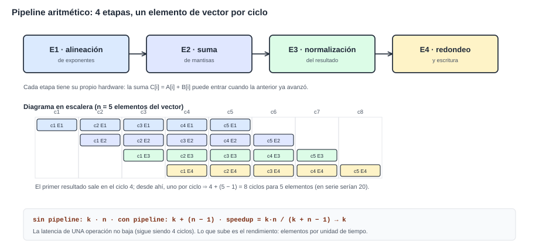

# 8.1.1 Etapas segmentadas y suma de vectores

> [!abstract] En una frase
> Un **pipeline aritmético** parte una operación larga (una suma en punto flotante, una multiplicación) en **k
> etapas** con hardware propio, y acepta **un elemento nuevo por ciclo**: así `n` operaciones se hacen en
> **`k + (n − 1)`** ciclos en lugar de `k·n`.

> [!note] Si la primera vez que ves esto
> Es la **línea de montaje** de una fábrica: el primer auto tarda 4 estaciones en salir, pero después **sale uno
> por estación**. La primera operación no se hace más rápido; lo que cambia es el **ritmo**.

## Las 4 etapas de una suma en punto flotante

| Etapa | Qué hace | Por qué es lenta sola |
|---|---|---|
| **E1 · alineación** | iguala los exponentes (desplaza la mantisa menor) | comparar y desplazar |
| **E2 · suma** | suma las mantisas (sumador completo de `n` bits) | propagación del acarreo |
| **E3 · normalización** | corre la coma para que quede en 1,xxx | contar ceros, desplazar |
| **E4 · redondeo** | ajusta el último bit y escribe el resultado | lógica de redondeo |

Cada etapa tiene **su propio hardware**. Eso es lo que permite que trabajen a la vez: si dos etapas compartieran
un bloque, no se podría solapar (**conflicto estructural**).



## El diagrama en escalera (n = 5 elementos)

| ciclo | 1 | 2 | 3 | 4 | 5 | 6 | 7 | 8 |
|---|---|---|---|---|---|---|---|---|
| **C[0]** | E1 | E2 | E3 | E4 | | | | |
| **C[1]** | | E1 | E2 | E3 | E4 | | | |
| **C[2]** | | | E1 | E2 | E3 | E4 | | |
| **C[3]** | | | | E1 | E2 | E3 | E4 | |
| **C[4]** | | | | | E1 | E2 | E3 | E4 |

- **C[0] sale en el ciclo 4** (igual que sin pipeline).
- **C[4] sale en el ciclo 8**; en serie habría sido el ciclo **20**.
- Desde el ciclo 4, **sale un resultado por ciclo**.

## La cuenta general
```
sin pipeline:   k · n          ciclos
con pipeline:   k + (n − 1)    ciclos
speedup:        S = k·n / (k + n − 1)     →  k  cuando n ≫ k
```

| k (etapas) | n (elementos) | Serie | Pipeline | Speedup |
|---|---|---|---|---|
| 4 | 5 | 20 | 8 | **2,5** |
| 4 | 100 | 400 | 103 | **3,88** |
| 4 | 1000 | 4000 | 1003 | **3,99** |
| 8 | 100 | 800 | 107 | **7,48** |

> [!important] El límite es `k`, no más
> El speedup **tiende** a `k` (la cantidad de etapas) y nunca lo supera: en el límite, cada ciclo entrega **un**
> elemento. Para ir más allá hay que **duplicar el pipeline** (superescalar) o **ensanchar** el vector (SIMD).

## Diferencia con el pipeline de instrucciones

| | **Pipeline aritmético** (8.1) | **Pipeline de instrucciones** (Unidad 7) |
|---|---|---|
| Qué se solapa | operaciones **de datos** (elementos del vector) | **instrucciones** del programa |
| Etapas | fases de una operación (alinear, sumar, normalizar) | búsqueda, decodificación, operandos, ejecución |
| Quién lo usa | procesadores **vectoriales**, GPU | toda CPU moderna |
| Conflictos | dependencia entre elementos, etapa no uniforme | estructural, de datos (RAW), de control (saltos) |
| Clasificación de Flynn | **SIMD** | sigue siendo **SISD** (paralelismo temporal) |

## Ejemplo resuelto (el que se toma)
> "Se suman dos vectores de 60 elementos en un pipeline aritmÉtico de 4 etapas que funciona a 200 MHz. ¿Cuánto
> tarda y qué speedup se obtiene?"

1. Ciclos con pipeline: `4 + (60 − 1) = 63`.
2. Tiempo: `63 / 200 MHz = 63 × 5 ns = 315 ns`.
3. Ciclos en serie: `4 × 60 = 240` ⇒ `240 × 5 ns = 1 200 ns`.
4. `Speedup = 240 / 63 = 3,81` (cerca del máximo teórico, 4).

**Verificación:** `3,81 < 4` ✔ y el tiempo baja al 26 % del original ✔.

> [!warning] Errores típicos
> - Decir que **una** operación tarda menos: tarda lo mismo (4 ciclos) o un poco más por los registros de etapa.
> - Usar `k·n` para el caso con pipeline (es `k + n − 1`).
> - Prometer speedup mayor que `k` con un solo pipeline.
> - Olvidar que la etapa **más lenta** fija el período del reloj: si E2 tarda el doble, todas esperan.
> - Confundir este pipeline con el de instrucciones: acá se solapan **datos**.

## Relacionado
[[8.1.2 Encadenamiento y speedup]] · [[Pipeline]] · [[Paralelismo y procesamiento vectorial]] ·
[[TP5 Sumadores]] · [[4.3.1 Ciclo de reloj, de máquina y de instrucción]]
