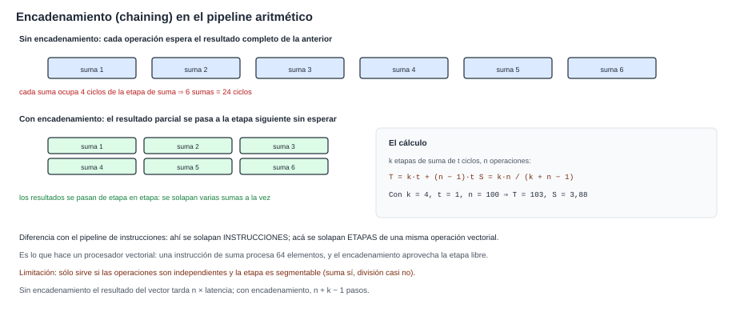
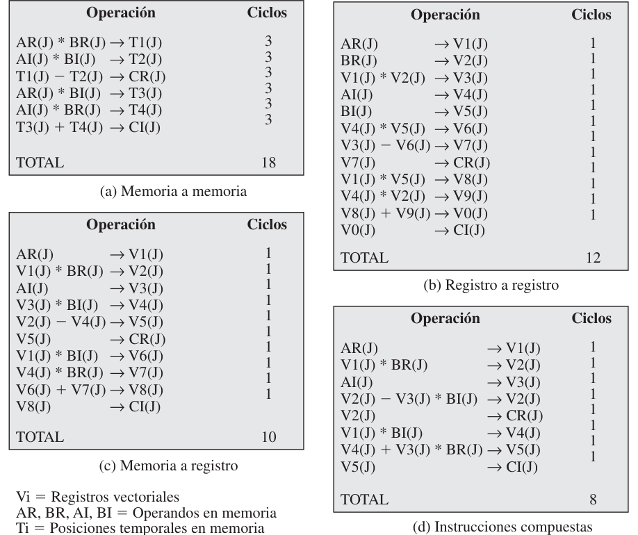

# 8.1.2 Encadenamiento y speedup

> [!abstract] En una frase
> El **encadenamiento** (*chaining*) conecta la **salida** de una etapa con la **entrada** de la siguiente operación
> **sin pasar por los registros**: así una cadena de operaciones sobre vectores (`C = (A+B)·D`) avanza al ritmo de
> la etapa más lenta, no al de la operación completa.

> [!note] Si la primera vez que ves esto
> Sin encadenamiento, cada resultado espera a "guardarse en la caja" antes de que lo use la etapa siguiente. Con
> encadenamiento, el resultado **sale por la ventana** y la etapa siguiente lo toma al vuelo, como en una cadena de
> montaje donde el auto pasa directo al siguiente puesto.

## Encadenar etapas



## Qué es exactamente
```
sin encadenamiento:   E1→E2→E3→E4 → [registro] → E1→E2→E3→E4
con encadenamiento:   E1→E2→E3→E4 ─────────────► E1→E2→E3→E4
                                    (el dato sale de E4 y entra a E1 sin esperar)
```
En un procesador vectorial, **cada etapa de una operación puede alimentar la etapa equivalente de la otra**:
`A+B` en E4 pasa a la multiplicación en su E1 mientras los elementos siguientes siguen entrando.

## El speedup, con sus tres límites

| Límite | Qué hace | Cómo se nota |
|---|---|---|
| **Etapas desparejas** | el período es el de la etapa más lenta | si E2 tarda 2 ciclos, todo tarda 2 ciclos |
| **Dependencias** | el elemento `i` necesita el `i−1` | aparece un **stall** (burbuja) |
| **Tiempo de llenado** | el primer resultado tarda `k` ciclos | con `n` chico el speedup se derrumba |

```
S(n) = k·n / (k + n − 1)
```
| n con k = 4 | S | Comentario |
|---|---|---|
| 4 | 2,29 | el llenado pesa tanto como el trabajo |
| 10 | 3,08 | |
| 100 | 3,88 | |
| ∞ | **4** | techo |

> [!important] La consecuencia práctica
> Un pipeline aritmético **sólo vale la pena con vectores largos**. Por eso el procesamiento vectorial (8.2) usa
> vectores de cientos o miles de elementos y "**strip mining**": cortar un vector enorme en bloques del ancho del
> registro.

## Ejemplo resuelto: `C[i] = (A[i] + B[i]) · D[i]`
> Pipeline de 4 etapas para la suma y 4 para el producto, a 250 MHz (4 ns por ciclo), vector de 100 elementos.
> ¿Cuánto tarda sin encadenamiento y con encadenamiento?

| Caso | Qué pasa | Ciclos | Tiempo |
|---|---|---|---|
| **Sin encadenamiento** | el producto **no arranca** hasta que la suma terminó **todo** el vector | `(4+99) + (4+99) = 206` | `206 × 4 ns =` **824 ns** |
| **Con encadenamiento** | el producto toma el primer resultado de la suma y avanza de a uno | `4 + 4 + (100−1) = 107` | `107 × 4 ns =` **428 ns** |

`Speedup = 206 / 107 = 1,93` — casi el doble, **sin agregar hardware**: sólo dejando que el dato pase de una
unidad a la otra sin esperar a que se escriba el registro.

> [!tip] La regla
> Sin encadenamiento se paga **dos veces el llenado y dos veces el vaciado** del vector. Con encadenamiento se paga
> **un llenado** (`k1 + k2 − 2` ciclos de arranque) y después un elemento por ciclo.

## Producto punto: el caso donde se ve
```
escalar:     AC ← 0 ;  para i: AC ← AC + A[i]·B[i]
vectorial:   multiplicar el vector A por el B (pipeline de producto)
             y encadenar con el sumador de acumulación (árbol de suma)
```
- Sin encadenamiento: cada `A[i]·B[i]` debe **terminar** para sumarse ⇒ 1 elemento cada 8 ciclos.
- Con encadenamiento y **suma en árbol**: se suman 4 productos a la vez ⇒ 1 elemento cada ciclo o mejor.

## Cómo se relaciona con lo demás
| Técnica | Qué agrega sobre el pipeline simple |
|---|---|
| **Encadenamiento** | solapa operaciones **distintas** sobre datos distintos |
| **Múltiples pipelines funcionales** | permite lanzar suma y producto a la vez (uno por tipo) |
| **Suma en árbol** (reducción) | reduce `n` valores en `log₂ n` etapas en vez de `n` |
| **SIMD** | procesa 4-8 elementos por **instrucción** |

> [!warning] Errores típicos
> - Creer que el encadenamiento duplica la velocidad: elimina **esperas**, no etapas.
> - Olvidar que la **etapa más lenta** define el período (diseñar etapas parejas).
> - Aplicar la fórmula `k + n − 1` **sin** sumar el llenado de cada operación encadenada.
> - Confundir encadenamiento con *forwarding*: el primero es entre **operaciones vectoriales**; el segundo, entre
>   **instrucciones** de un pipeline de instrucciones.

## Figura del libro



*Fig. 18.19 — Programas alternativos de computación vectorial.* · Stallings, *Organización y arquitectura de computadores*, 7ª ed., p. 734.

## Relacionado
[[8.1.1 Etapas segmentadas y suma de vectores]] · [[8.2.1 SIMD, registros vectoriales y GPU]] ·
[[8.2.3 Multiplicación de matrices]] · [[Pipeline]] · [[Técnicas para aumentar la velocidad]]
