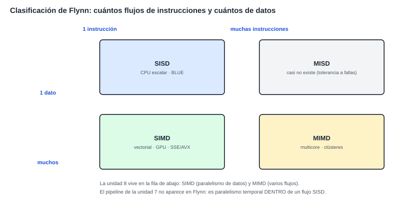

# 8.2.2 Flynn, arreglos SIMD y conectados

> [!abstract] En una frase
> Flynn clasifica las arquitecturas por **cuántos flujos de instrucciones** y **cuántos flujos de datos** tienen
> (SISD, SIMD, MISD, MIMD); dentro del SIMD, un **arreglo de procesadores** pone **un PE por dato** y, si además los
> PE están **interconectados**, se convierte en un **arreglo conectado**.

> [!note] Si la primera vez que ves esto
> Un **arreglo SIMD** es un aula donde todos los alumnos (PE) hacen **la misma consigna** con **su propia** hoja.
> Un **arreglo conectado** es la misma aula, pero además los alumnos **se pasan papelitos** entre bancos vecinos.

## La clasificación de Flynn



| Clase | Instrucciones | Datos | Ejemplo | ¿Dónde está en la cursada? |
|---|---|---|---|---|
| **SISD** | 1 | 1 | CPU escalar clásica, **BLUE** | Unidades 4-5 |
| **SIMD** | 1 | muchos | vectorial, GPU, MMX/SSE/AVX | **esta unidad** |
| **MISD** | muchas | 1 | casi no existe (tolerancia a fallas, *systolic arrays*) | mención |
| **MIMD** | muchas | muchos | multicore, multiprocesadores, clústeres | 8.4 |

> [!important] El pipeline no está en Flynn
> El pipeline de instrucciones es paralelismo **temporal dentro de un flujo**: sigue siendo **SISD**. Metros de
> gente lo responde como "MIMD" porque "hace varias cosas a la vez"; **no**: hay una sola instrucción por ciclo
> saliendo por el cauce, no muchas.

## Arreglo SIMD (sin conexión)
```
        ┌──────────────── UC común (una instrucción) ────────────────┐
        ▼             ▼             ▼             ▼             ▼
      ┌─────┐      ┌─────┐      ┌─────┐      ┌─────┐      ┌─────┐
      │ PE0 │      │ PE1 │      │ PE2 │      │ PE3 │  ... │ PEn │
      │ALU+M│      │ALU+M│      │ALU+M│      │ALU+M│      │ALU+M│
      └─────┘      └─────┘      └─────┘      └─────┘      └─────┘
       dato 0       dato 1       dato 2       dato 3       dato n
```
- **Un PE** (*processing element*) = una ALU chica + su memoria local.
- Todos reciben **la misma instrucción** y trabajan sobre **su** dato.
- **Ejemplo típico:** procesar los píxeles de una imagen (un PE por píxel), aplicar un filtro, umbralizar.

## Arreglo conectado (con red de interconexión)
```
      PE0 ──── PE1 ──── PE2
       │  ╲     │     ╱  │
       │    ╲   │   ╱    │        malla 2D: cada PE habla con sus 4 vecinos
      PE3 ──── PE4 ──── PE5       (o hipercubo, toroide, árbol…)
       │    ╱   │   ╲    │
      PE6 ──── PE7 ──── PE8
```
**Agrega el intercambio de datos entre PE**. Sirve cuando cada elemento **necesita a sus vecinos**:

| Aplicación | Por qué necesita vecinos |
|---|---|
| **Autómata celular** (Juego de la vida) | cada celda mira sus 8 vecinas |
| **Simulación física** (difusión, calor) | el valor nuevo depende de la celda y sus contiguas |
| **Procesamiento de imágenes** (convolución) | cada píxel se calcula con su entorno 3×3 |

> [!important] La diferencia que se pregunta
> **Arreglo SIMD** = mismos datos distintos, **sin** comunicación. **Arreglo conectado** = lo mismo **+ red** entre
> PE. La red es lo que permite resolver problemas con **dependencia espacial**.

## El problema del arreglo: el tamaño
| Situación | Qué se hace |
|---|---|
| El problema es **más chico** que el arreglo | se apagan PE (desperdicio) |
| El problema es **más grande** | se parte en tandas (*strip mining*) |
| Los datos necesitan viajar lejos | cuesta más la comunicación que el cálculo |

## Monousuario vs multiusuario (cierre del tema)

| | **Monousuario** (PC, notebook) | **Multiusuario** (servidor, mainframe) |
|---|---|---|
| Paralelismo típico | ILP + SIMD + pocos núcleos | **MIMD** con muchos núcleos/nodos |
| Objetivo | **latencia**: que *mi* programa termine ya | **productividad** (*throughput*): muchas tareas por hora |
| Memoria | jerarquía local + caché grande | compartida o distribuida + red de interconexión |
| E/S | estándar | canales de E/S de alta capacidad |
| Se mide con | tiempo de respuesta | trabajos por unidad de tiempo |
| Ejemplo | Ryzen de 8 núcleos | clúster, mainframe, granja de servidores |

**La misma idea de SIMD aplica distinto:** en un PC sirve para acelerar **un** programa (juegos, video); en un
servidor, para atender **muchos** usuarios a la vez.

> [!warning] Errores típicos
> - Confundir SIMD con MIMD (una instrucción vs muchas).
> - Decir que el pipeline es MIMD (es SISD, paralelismo temporal).
> - Confundir arreglo SIMD con arreglo conectado (falta la red).
> - Invertir los objetivos: el servidor busca **throughput**, el PC busca **latencia**.
> - Olvidar que MISD casi no existe.

> [!example] Flynn con ejemplos
> **SISD**: la BLUE (una instrucción, un dato). **SIMD**: una GPU sumando un vector (una instrucción, 32 datos).
> **MISD**: casi no existe (aviónica redundante). **MIMD**: un multicore o un cluster (cada núcleo con su
> instrucción y su dato). Para clasificar cualquier máquina alcanza con contar **cuántas instrucciones** y
> **cuántos datos** procesa por vez.

## Relacionado
[[8.2.1 SIMD, registros vectoriales y GPU]] · [[8.2.3 Multiplicación de matrices]] · [[8.4.2 Monousuario vs multiusuario]] ·
[[Paralelismo y procesamiento vectorial]] · [[CISC y RISC]] · [[Glosario — Unidad 8]]
