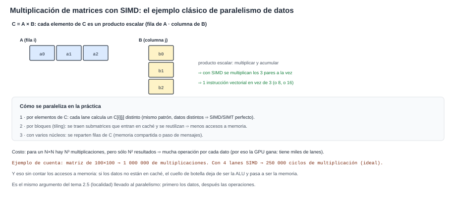

# 8.2.3 Multiplicación de matrices

> [!abstract] En una frase
> `C = A · B` con matrices de `n × n` necesita **`n³`** multiplicaciones y **`n³`** sumas; el procesamiento
> vectorial ataca el **lazo interno** (producto punto) y por eso es **el** benchmark clásico del paralelismo.

> [!note] Si la primera vez que ves esto
> Cada elemento de `C` es el **producto punto** de una fila de `A` con una columna de `B`: multiplicar de a pares y
> sumar todo. Ese "multiplicar de a pares y sumar" es justo lo que el hardware vectorial hace en un ciclo.

## Matrices con SIMD



## La fórmula
```
C[i][j] = Σ (k = 0..n-1)  A[i][k] · B[k][j]
```
```
escalar (3 lazos anidados):
    for i: for j: { s = 0 ; for k: s += A[i][k] * B[k][j] ; C[i][j] = s }
```

## Las tres versiones

| Versión | Qué se vectoriza | Ganancia |
|---|---|---|
| **Escalar** | nada: `n³` multiplicaciones una por una | 1× |
| **Vectorial** (producto punto vectorial) | el lazo **interno** `k` se hace de a `w` elementos | ≈ `w` (ancho del registro) |
| **Vectorial + encadenamiento + bloqueo** | además se encadena `mult` con `suma` y se corta la matriz en bloques que entran en los registros | hasta `w` con mejor uso del pipeline |

**Bloqueo (*blocking*):** en lugar de recorrer `k` de 1 en 1, se toman bloques de `w` (el ancho vectorial) para que
cada dato traído de memoria se use `w` veces.

> [!important] El cuello de botella real: la memoria
> La cuenta dice `n³` operaciones, pero la **memoria** es lo que manda: para `n = 1000` haría falta mover del orden
> de **cientos de MB** por cada pasada si se recorre mal. Por eso se combina con **memoria entrelazada** (8.3) y con
> **caché** (reutilizar bloques). Sin eso, el pipeline se queda esperando datos.

## Ejemplo resuelto 2 × 2 (a mano, para el pizarrón)
```
A = ┌ 1 2 ┐      B = ┌ 5 6 ┐
    └ 3 4 ┘          └ 7 8 ┘

C[0][0] = 1·5 + 2·7 = 5 + 14 = 19
C[0][1] = 1·6 + 2·8 = 6 + 16 = 22
C[1][0] = 3·5 + 4·7 = 15 + 28 = 43
C[1][1] = 3·6 + 4·8 = 18 + 32 = 50

C = ┌ 19 22 ┐
    └ 43 50 ┘
```
**Verificación con la traza:** `tr(C) = 69` y `tr(A)·tr(B) = 5 × 13 = 65`; no tienen por qué coincidir (el
producto de trazas no es la traza del producto) ⇒ **no** sirve como control. El control correcto es **recalcular
un elemento** por la definición: `C[1][1] = 43` ✔.

## Cuánto cuesta

| n | Operaciones (`n³`) | Con vector de ancho 8 | Instrucciones |
|---|---|---|---|
| 10 | 1 000 | 1 000 / 8 | 125 (+ sumas) |
| 100 | 1 000 000 | 125 000 | ~250 000 |
| 1 000 | 1 000 000 000 | 125 000 000 | — |

**Comparación de tiempo (n = 100, 1 ciclo por operación vectorial a 3 GHz):** `125 000 / 3·10⁹ ≈ 42 µs` contra
`1 000 000 / 3·10⁹ ≈ 333 µs` del escalar ⇒ **8×** (el ancho del registro).

## Por qué es *el* benchmark
- Es **regular**: mismo trabajo para todos los elementos (SIMD lo ama).
- Es **paralelizable** por filas: cada fila de `C` es independiente ⇒ se reparte entre núcleos (MIMD).
- Mide **cómputo + memoria + red** a la vez ⇒ **LINPACK** y el ranking **TOP500** se basan en esto.

> [!warning] Errores típicos
> - Decir `n²` operaciones (son `n³`: por cada uno de los `n²` elementos hay una suma de `n` productos).
> - Vectorizar el lazo **externo** en vez del **interno** (el interno es el que tiene datos contiguos).
> - Olvidar el costo de memoria: la ganancia vectorial se pierde si no hay ancho de banda.
> - Confundir transponer `B` (para acceder por filas) con "cambiar el algoritmo": es lo mismo, pero con memoria
>   amigable (**por eso las bibliotecas reales transponen**).

## Relacionado
[[8.2.1 SIMD, registros vectoriales y GPU]] · [[8.3.1 Bancos de memoria y ancho de banda]] ·
[[8.1.2 Encadenamiento y speedup]] · [[8.4.1 Multicore, coherencia de caché y ley de Amdahl]]
