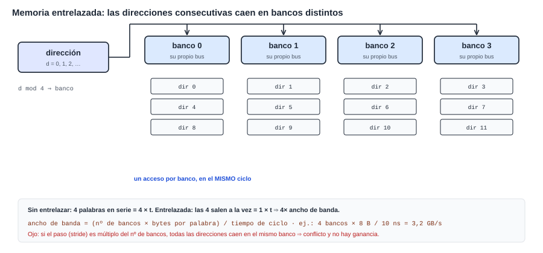

# 8.3.1 Bancos de memoria y ancho de banda

> [!abstract] En una frase
> La **memoria entrelazada** divide la memoria en **bancos independientes** que atienden accesos **al mismo
> tiempo**; si las direcciones consecutivas caen en bancos distintos, el **ancho de banda se multiplica por la
> cantidad de bancos** sin que baje el tiempo de acceso de cada palabra.

> [!note] Si la primera vez que ves esto
> Un supermercado con **una** caja: cada cliente espera lo mismo. Con **cuatro** cajas y la gente repartida, en el
> tiempo de una atención salen cuatro clientes. El tiempo **de cada** cliente no cambió; la **cantidad por hora**,
> sí. Eso es ancho de banda.

## El esquema



```
banco = dirección mod (nº de bancos)

dir 0 → banco 0        dir 4 → banco 0
dir 1 → banco 1        dir 5 → banco 1
dir 2 → banco 2        dir 6 → banco 2
dir 3 → banco 3        dir 7 → banco 3
```

Cada banco tiene **su propio** decodificador y su propio registro de datos: se accede a los cuatro **en el mismo
ciclo**.

## Tiempo de acceso vs ancho de banda

| Concepto | Qué mide | Efecto del entrelazado |
|---|---|---|
| **Latencia** (tiempo de acceso) | cuánto tarda **una** palabra | **no cambia** |
| **Ancho de banda** | cuántos bytes por segundo | **se multiplica por el nº de bancos** |

```
ancho de banda = (nº de bancos × bytes por palabra) / tiempo de ciclo
```

> [!example] Ejemplo resuelto
> "Memoria de 4 bancos, palabras de **8 bytes**, tiempo de ciclo **10 ns**. ¿Ancho de banda? ¿Y con 8 bancos?"

| Bancos | Cálculo | Ancho de banda |
|---|---|---|
| 1 | `8 B / 10 ns` | **0,8 GB/s** |
| 4 | `4 × 8 B / 10 ns` | **3,2 GB/s** |
| 8 | `8 × 8 B / 10 ns` | **6,4 GB/s** |

**Verificación:** `4 × 8 = 32 B` por ciclo de 10 ns ⇒ `32 / 10·10⁻⁹ = 3,2·10⁹ B/s` ✔

## Para qué sirve en la práctica
| Consumidor | Por qué lo necesita |
|---|---|
| **Procesador vectorial** | pide **un elemento por ciclo**: sin bancos, se queda esperando |
| **Pipeline de instrucciones** | busca instrucción **y** dato en el mismo ciclo (bancos distintos o caché I/D) |
| **DMA / GPU** | transfiere bloques enteros |
| **Multicore** | varios núcleos pidiendo a la vez |
| **DRAM moderna** | los *channels* y los *banks* internos del chip son exactamente esto |

## Las dos formas de repartir
| Forma | Cómo | Cuándo conviene |
|---|---|---|
| **Entrelazado por bits bajos** (*low-order*) | `banco = dirección mod n` (los bits bajos eligen el banco) | accesos **consecutivos** (vectores, código) |
| **Entrelazado por bits altos** (*high-order*) | los bits altos eligen el banco (cada banco es un rango contiguo) | varios **procesos** trabajando en zonas distintas |

El caso normal en un procesador vectorial es el **low-order**: es el que hace que `A[0], A[1], A[2], A[3]` estén en
cuatro bancos distintos.

## Lo que hay que decir junto a esto
1. **El entrelazado no reduce la latencia**: sólo mejora el caudal.
2. **Necesita accesos independientes**: si el programa pide la misma dirección, no hay paralelismo que valga.
3. **Se combina con la caché**: la caché evita el acceso; el entrelazado hace que, cuando hay que ir, vaya rápido.
4. **Cuesta hardware**: más decodificadores, más buses, más pines.

> [!warning] Errores típicos
> - Decir que el entrelazado **baja el tiempo de acceso** (no: sube el ancho de banda).
> - Olvidar dividir/multiplicar por el tamaño de palabra: confundir **palabras** con **bytes**.
> - Creer que más bancos siempre es mejor (cuesta y hay conflicto; ver 8.3.2).
> - Mezclar esta técnica con **caché**: son cosas distintas y complementarias.

## Relacionado
[[8.3.2 Patrón de entrelazado y conflictos de banco]] · [[2.3.3 Matriz, expansión y RAM 8x3]] ·
[[2.5.3 AMAT y cálculo de mejora]] · [[Jerarquía de memorias]] · [[Técnicas para aumentar la velocidad]] · [[Glosario — Unidad 8]]
