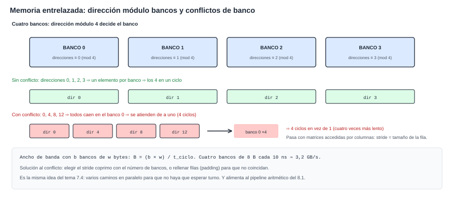
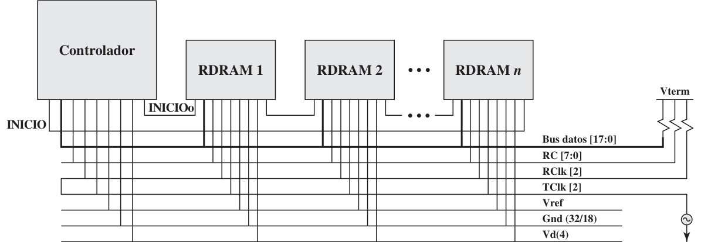

# 8.3.2 Patrón de entrelazado y conflictos de banco

> [!abstract] En una frase
> El entrelazado sólo da ganancia si los accesos **caen en bancos distintos**: cuando el **paso** (*stride*) es **múltiplo del número de bancos**, todas las direcciones van al **mismo banco** ⇒ **conflicto de banco** y la ganancia desaparece.

> [!note] Si la primera vez que ves esto
> Cuatro cajas y todos los clientes con el número de ticket par: van **todos a la misma caja**. La culpa no es del supermercado, es del **patrón** de llegada. Acá pasa igual: la culpa es del paso del lazo.

## Módulo bancos



## El conflicto, con números
4 bancos, `banco = dirección mod 4`:

| Paso (*stride*) | Direcciones | Bancos | Resultado |
|---|---|---|---|
| **1** | 0, 1, 2, 3 | 0, 1, 2, 3 | **4 en paralelo** ✔ |
| **2** | 0, 2, 4, 6 | 0, 2, 0, 2 | 2 por ciclo (mitad) |
| **4** | 0, 4, 8, 12 | **0, 0, 0, 0** | **conflicto total**: 1 por ciclo ✘ |
| **3** | 0, 3, 6, 9 | 0, 3, 2, 1 | 4 en paralelo ✔ (3 y 4 son coprimos) |

> [!important] La regla
> Con `B` bancos, hay conflicto si `stride` y `B` **comparten divisores**. Lo ideal: `stride` **coprimo** con `B` (por ejemplo `B` primo o impar).

## Dónde aparece en la práctica (el caso de la matriz)
Recorrer una matriz `n × n` guardada **por filas**:
```
A[i][j]  está en la dirección  i·n + j
```

- Recorrer **por filas** (lazo `j` interno): `stride = 1` ⇒ **sin conflicto**.

- Recorrer **por columnas** (lazo `i` interno): `stride = n`. Si `n = 4` y hay 4 bancos ⇒ `stride = 4` ⇒ **conflicto total**.

| Recorrido | `stride` | Con 4 bancos |
|---|---|---|
| por filas | 1 | 4 accesos/ciclo |
| por columnas, `n = 4` | 4 | **1 acceso/ciclo** (4× más lento) |
| por columnas, `n = 5` | 5 | 4 accesos/ciclo (5 y 4 coprimos) |

**La solución clásica:** **transponer** `B` (o recorrer por filas) para que el lazo interno tenga `stride = 1`, o **rellenar** la matriz (`padding`) con una columna para que `n` deje de ser múltiplo de los bancos.

> [!example] Ejemplo resuelto
> "Un procesador con 4 bancos recorre una matriz de 100 × 100 por columnas. ¿Cuánto pierde respecto del recorrido por filas?"

1. Por filas: `stride = 1`, 4 palabras por ciclo ⇒ `10 000 / 4 = 2 500` ciclos.

2. Por columnas: `stride = 100`, y `100 mod 4 = 0` ⇒ **todas** al mismo banco ⇒ `10 000` ciclos.

3. Pérdida: `10 000 / 2 500 =` **4× más lento**.

4. Arreglo: transponer `B` (o `padding` a 101 columnas, `101 mod 4 = 1` ⇒ sin conflicto).

## El entrelazado en la memoria real

| Nivel | Cómo se ve |
|---|---|
| **Bancos del chip** | la DRAM tiene 4-16 *banks* por chip y los abre en paralelo |
| **Canales** | dos o cuatro canales de DRAM (como "bancos" externos) |
| **Módulos** | *dual channel* del mother: `4 GB + 4 GB` en canales distintos |
| **Caché** | los *sets* de la caché también pueden tener conflictos (mismo problema, otra escala) |

> [!warning] Errores típicos
> - Decir que el conflicto depende de la memoria y no del **programa**: el patrón de acceso lo pone el código.
> - Olvidar que el conflicto también existe en la caché (conflictos de *set*).
> - Creer que "más bancos" siempre ayuda: con `stride` múltiplo, sigue habiendo conflicto.
> - Confundir `stride` con la cantidad de bancos.

## Figura del libro



*Fig. 5.14 — Estructura RDRAM: un controlador y varios canales (RDRAM1 a RDRAMn) que trabajan en paralelo.* · Stallings, *Organización y arquitectura de computadores*, 7ª ed., p. 190.

> [!tip] Qué mirar
> Es entrelazado llevado al extremo: los canales se reparten las direcciones y transmiten a la vez. El patrón de acceso decide si el paralelismo se aprovecha o si todos los pedidos caen en el mismo canal (conflicto).

## Relacionado
[[8.3.1 Bancos de memoria y ancho de banda]] · [[8.2.3 Multiplicación de matrices]] · [[2.5.2 Caché: mapeos y políticas]] · [[Jerarquía de memorias]] · [[8.4.1 Multicore, coherencia de caché y ley de Amdahl]] · [[Glosario — Unidad 8]]
