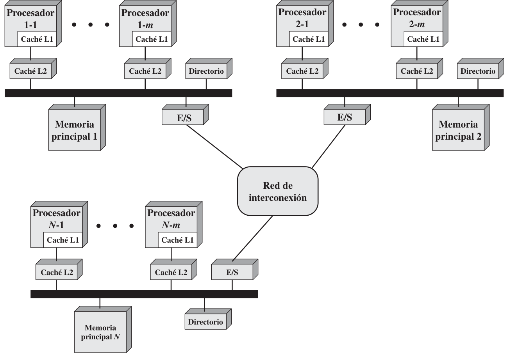
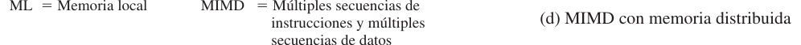

# 8.4.2 Monousuario vs multiusuario

> [!abstract] En una frase
> Un sistema **monousuario** optimiza la **latencia** (que *mi* programa termine cuanto antes); un sistema
> **multiusuario** optimiza la **productividad** (*throughput*: cuántas tareas terminan por unidad de tiempo). Son
> dos objetivos distintos y llevan a máquinas distintas.

> [!note] Si la primera vez que ves esto
> Un **taxi** y un **colectivo**. El taxi te lleva a vos rápido aunque el resto espere (latencia); el colectivo
> lleva a muchos por hora aunque cada uno tarde más (productividad). Los dos son "transporte", pero no se diseñan
> igual.

## Compartida o distribuida

## La tabla

| | **Monousuario** (PC, notebook, celular) | **Multiusuario** (servidor, mainframe) |
|---|---|---|
| Objetivo | **latencia** mínima | **throughput** máximo |
| Se mide con | tiempo de respuesta | trabajos / hora, usuarios simultáneos |
| Paralelismo típico | ILP + **SIMD** + pocos núcleos | **MIMD** con muchos núcleos / nodos |
| Memoria | jerarquía local, caché grande, poca DRAM | mucha memoria, compartida o **distribuida** + red |
| E/S | estándar (SATA, USB, red doméstica) | **canales de E/S** de alta capacidad |
| Disponibilidad | se reinicia y listo | tolerancia a fallas, redundancia, *hot swap* |
| Ejemplo | Ryzen 8 núcleos | clúster, mainframe, granja de servidores |

## Cómo cambia el diseño de cada uno
| Decisión | Monousuario | Multiusuario |
|---|---|---|
| Núcleos | pocos y **muy rápidos** (frecuencia alta) | muchos, más lentos, con **SMT** |
| Caché | grande y jerárquica (L1/L2/L3) por núcleo | compartida con **protocolo de coherencia** y directorio |
| Pipeline | profundo para latencia | ancho y **superescalar** para throughput |
| Red | no aplica | **interconexión** (InfiniBand, Ethernet rápida) |
| Balance | cómputo ≫ E/S | **E/S y memoria** tan importantes como el cómputo |

## Qué se pregunta en el final
1. **Diferencia conceptual:** latencia (tiempo de **una** tarea) vs productividad (tareas por **unidad de tiempo**).
2. **Consecuencia:** el monousuario prioriza **frecuencia y caché**; el multiusuario, **núcleos, memoria y E/S**.
3. **Métricas:** el PC se prueba con *benchmarks* de un hilo y de juegos; el servidor, con **tpmC**, **SPEC** de
   throughput y **LINPACK**.
4. **Cierre:** ambos usan las mismas técnicas (paralelismo, jerarquía de memoria, entrelazado); cambia **el
   objetivo** con que se combinan.

> [!important] El puente con Amdahl
> En un servidor, el trabajo **es** paralelo (muchos usuarios, cada uno independiente) ⇒ `f` alta ⇒ escala bien.
> En un PC, un programa de un usuario suele tener partes secuenciales grandes ⇒ `f` baja ⇒ los núcleos extra se
> quedan ociosos. **Por eso el servidor justifica 64 núcleos y la notebook, 8.**

## Confusiones frecuentes
| Se dice | Es |
|---|---|
| "Multiusuario = más rápido" | no: es **más productivo**; puede ser más lento por tarea |
| "Un servidor es una PC más grande" | no: cambia el **balance** (memoria, E/S, redundancia) |
| "Tiempo compartido (*time sharing*) = paralelismo" | no: es **multiprogramación** en un solo núcleo (se turnan) |
| "Multicore y multiusuario son lo mismo" | no: multicore es **hardware**; multiusuario, **modo de uso** |

> [!warning] Errores típicos
> - Invertir los objetivos (decir que el servidor busca latencia).
> - Confundir **multiprogramación** (turnos en una CPU) con **multiprocesamiento** (varias CPU a la vez).
> - Olvidar la E/S: en un servidor es la mitad del diseño.
> - Decir que un mainframe es "lento" sin aclarar que es lento **por tarea** y rapidísimo **por hora**.

## Figura del libro

*Fig. 18.12 — Organización CC-NUMA.* · Stallings, *Organización y arquitectura de computadores*, 7ª ed., p. 724.

*Fig. 18.2 — Organizaciones de computador alternativas.* · Stallings, *Organización y arquitectura de computadores*, 7ª ed., p. 694.

> [!example] Los límites de cada modelo
> **Monousuario** (una PC): todos los recursos para uno, el límite es el reloj. **Multiusuario** (servidor): muchos
> usuarios a la vez ⇒ el límite es el **ancho de banda de memoria**, la coherencia de caché y la planificación del
> SO. Escalar de 4 a 16 núcleos no da 4×: con `p = 0,9`, Amdahl da **3,08** y **5,93** (ver
> [[8.4.1 Multicore, coherencia de caché y ley de Amdahl]]).

## Relacionado
[[8.4.1 Multicore, coherencia de caché y ley de Amdahl]] · [[8.2.2 Flynn, arreglos SIMD y conectados]] ·
[[Técnicas para aumentar la velocidad]] · [[Paralelismo y procesamiento vectorial]] · [[Interrupciones y entrada-salida]] · [[Glosario — Unidad 8]]
