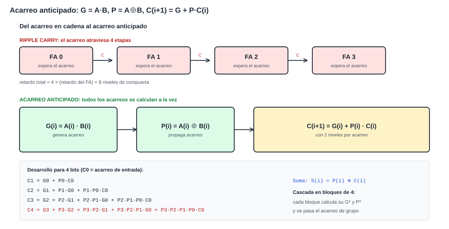
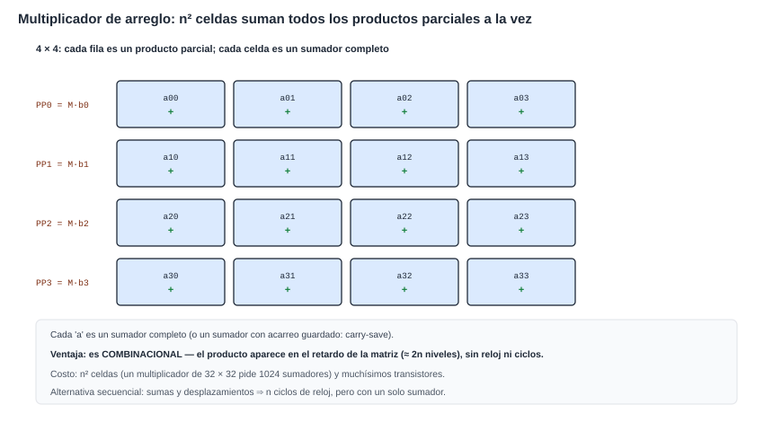

# Síntesis — Unidad 9: Hardware aritmético

> [!abstract] Qué es este archivo
> **Toda la Unidad 9 en un solo lugar**: representación y suma, multiplicación, división, punto flotante e IEEE 754,
> y BCD; con las fórmulas, los ejemplos verificados, las recetas de examen y la autoevaluación.

> [!tip] Cómo usarlo
> 1. Leer **§1 a §6** (30 minutos).
> 2. Rehacer **a mano** los cuatro ejemplos: resta con flags, Booth, 7÷3, −6,5 en IEEE 754.
> 3. Recitar las **fórmulas de §7**.
> 4. Contestar **§10** sin mirar.

## Índice
1. [[#1. Representación: complemento a 2]]
2. [[#2. Suma, resta y desbordamiento]]
3. [[#3. Acarreo anticipado]]
4. [[#4. Multiplicación]]
5. [[#5. División]]
6. [[#6. Punto flotante e IEEE 754]]
7. [[#7. Aritmética BCD]]
8. [[#8. Tablas de memoria rápida]]
9. [[#9. Recetas de examen y errores]]
10. [[#10. Autoevaluación]]

---

## 1. Representación: complemento a 2

| Representación (n bits) | Rango | Negativo | Problema |
|---|---|---|---|
| Magnitud y signo | `−(2ⁿ⁻¹−1) … +(2ⁿ⁻¹−1)` | bit de signo | dos ceros |
| Complemento a 1 | ídem | negar bits | dos ceros |
| **Complemento a 2** | **`−2ⁿ⁻¹ … +(2ⁿ⁻¹−1)`** | negar **y sumar 1** | un negativo sin positivo (`−128`) |
| Sin signo | `0 … 2ⁿ−1` | — | — |

| n | Rango | Caso borde |
|---|---|---|
| 4 | −8 … +7 | `1000` = −8 |
| 8 | −128 … +127 | `10000000` = −128 |
| 16 | −32 768 … +32 767 | |
| 32 | −2 147 483 648 … +2 147 483 647 | |

**Por qué C2:** un solo sumador (`A + B' + 1`), un solo cero, sin correcciones.
👉 [[9.1.1 Complemento a 2 y desbordamiento]]

## 2. Suma, resta y desbordamiento

```
resta:  A − B = A + B' + SUB          (SUB = acarreo de entrada C0; XOR en las entradas de B)
```

| Flag | Fórmula | Qué mide |
|---|---|---|
| **`C`** (carry) | acarreo de salida del MSB | desborde **sin signo** |
| **`V`** (overflow) | **`Cin(MSB) ⊕ Cout(MSB)`** | desborde **con signo** |
| **`Z`** | todas las salidas 0 | resultado nulo |
| **`S`** | el MSB | signo |

> [!example] Los dos casos con 4 bits
> `0111 + 0001 = 1000`: `Cin=1, Cout=0` ⇒ **V=1** (7+1 no puede dar −8)
> `1111 + 0001 = 1 0000`: `Cin=1, Cout=1` ⇒ **V=0** (como con signo es −1+1=0 ✔); `C=1`

**Regla rápida:** mismo signo en los operandos y signo distinto en el resultado ⇒ **overflow**.
👉 [[9.1.1 Complemento a 2 y desbordamiento]]

## 3. Acarreo anticipado



```
G(i) = A(i) · B(i)          genera acarreo
P(i) = A(i) ⊕ B(i)          propaga acarreo   (¡XOR!)
C(i+1) = G(i) + P(i)·C(i)
S(i) = P(i) ⊕ C(i)
```
```
C1 = G0 + P0·C0
C2 = G1 + P1·G0 + P1·P0·C0
C3 = G2 + P2·G1 + P2·P1·G0 + P2·P1·P0·C0
C4 = G3 + P3·G2 + P3·P2·G1 + P3·P2·P1·G0 + P3·P2·P1·P0·C0
```

| Sumador | Niveles (4 bits) | 32 bits |
|---|---|---|
| Ripple carry | 8 | **64** |
| CLA | ~4 | — |
| CLA en bloques de 4 | ~6 | **~20** |

**Ejemplo verificado:** `1011 + 0110` con `C0 = 0` ⇒ `G = 0,1,0,0`; `P = 1,0,1,1`; `C = 0,1,1,1` ⇒
`S = 0001`, `C4 = 1` ⇒ `1 0001 = 17` ✔
👉 [[9.1.2 Acarreo anticipado (G y P)]]

## 4. Multiplicación

### Sumas y desplazamientos
`n` iteraciones con `M` (multiplicando), `Q` (multiplicador → parte baja), `A` (acumulador → parte alta) y `C`.

```
repetir n veces:  si Q0 = 1 ⇒ A ← A + M ;  desplazar a la derecha (C,A,Q)
producto = A Q  (2n bits)
```
> [!example] 13 × 11 (verificado)
> | Iter | `Q0` | Acción | `A` | `Q` |
> |---|---|---|---|---|
> | 1 | 1 | `+M` | `0110` | `1101` |
> | 2 | 1 | `+M` (con `C=1`) | `1001` | `1110` |
> | 3 | 0 | — | `0100` | `1111` |
> | 4 | 1 | `+M` (con `C=1`) | `1000` | `1111` |
> Producto `1000 1111` = **143** ✔

### Booth
| `(Q0, Q−1)` | Acción |
|---|---|
| `00` · `11` | sólo desplazar |
| `01` | `A ← A + M` |
| `10` | `A ← A − M` |

Después: **desplazamiento aritmético** de `(A, Q, Q−1)`.
> [!example] 6 × (−3) = −18 (verificado)
> `M=0110`, `−M=1010`, `Q=1101` ⇒ producto `A Q = 1110 1110` = **−18** ✔ (2 sumas en vez de 3)

### Arreglo
`n²` celdas, **combinacional** (sin ciclos), retardo ≈ `2n` niveles; con *carry-save*, ≈ `n`.



👉 [[9.2.1 Sumas y desplazamientos]] · [[9.2.2 Algoritmo de Booth]] · [[9.2.3 Arreglo multiplicador]]

## 5. División

### Restaurativo
```
n veces:  desplazar (A,Q) ; A ← A − M
          si A ≥ 0 ⇒ Q0 = 1
          si A < 0 ⇒ Q0 = 0 ; A ← A + M      (restaura)
```
**7 ÷ 3 verificado:** `A = 0001` (resto), `Q = 0010` (cociente) ⇒ `7 = 3×2 + 1` ✔

### No restaurativo
```
n veces:  desplazar (A,Q) ; si A ≥ 0 ⇒ A←A−M ; si A < 0 ⇒ A←A+M ; Q0 = 1 si A ≥ 0
al final: si A < 0 ⇒ A ← A + M
```
**Mismo ejemplo:** 1 suma/resta por iteración (en vez de 2) + una corrección final ⇒ cociente 2, resto 1 ✔

| | Restaurativo | No restaurativo |
|---|---|---|
| Operaciones | 1 + (restauración) | **1** |
| Extra | — | corrección final |
| Velocidad | menor | **mayor** |

### Sobreflujo
| Caso | Regla |
|---|---|
| Divisor 0 | trap / excepción |
| Cociente que no entra | `dividendo ≥ divisor × 2ⁿ` (o `A ≥ M` al inicio) |
| Caso borde C2 | `−128 / −1` ⇒ overflow |
| **Signo del resto** | **sigue al dividendo** (`−7/3 = −2` resto `−1`) |
| **Signo del cociente** | `S1 ⊕ S2` |

👉 [[9.3.1 Restauración y no restauración]] · [[9.3.2 Sobreflujo y división con signo]]

## 6. Punto flotante e IEEE 754

```
valor = (−1)^S × 1.M × 2^(E − exceso)
```

| Operación | Pasos |
|---|---|
| **Suma** | comparar exponentes → **alinear** → sumar mantisas → **normalizar** → **redondear** |
| **Multiplicación** | `e = e1 + e2 − exceso` → multiplicar mantisas → normalizar/redondear → `S = S1⊕S2` |
| **División** | `e = e1 − e2` → dividir mantisas → normalizar/redondear |

> [!example] 6,5 + 1,5 (verificado)
> `1,101×2²` + `1,1×2¹` → alinear: `0,11×2²` → sumar: `10,000×2²` → normalizar: `1,000×2³` = **8** ✔

### IEEE 754
| | Simple | Doble |
|---|---|---|
| Bits | **1 + 8 + 23 = 32** | **1 + 11 + 52 = 64** |
| Exceso | **127** | **1023** |
| Precisión | ~7 dígitos | ~16 dígitos |
| Menor normal | `2⁻¹²⁶ ≈ 1,18×10⁻³⁸` | `2⁻¹⁰²²` |

| Exponente | Mantisa | Es |
|---|---|---|
| 0 | 0 | ±0 |
| 0 | ≠0 | **subnormal** |
| 1…254 | cualquiera | normal |
| todo 1 | 0 | **±∞** |
| todo 1 | ≠0 | **NaN** |

> [!example] −6,5 = `C0D0 0000h`
> `6,5 = 1,101×2²` ⇒ `S=1` · `E = 2+127 = 129 = 10000001` · `M = 1010…` ⇒ `1 10000001 1010…` ✔
> Y al revés: `4120 0000h` ⇒ `e = 3`, `1,010×2³` = **10,0** ✔

**Redondeo por defecto:** al más cercano, **empates al par** (no acumula sesgo).
👉 [[9.4.1 Formato, normalización y operaciones]] · [[9.4.2 IEEE 754]]

## 7. Aritmética BCD

```
si (dígito > 1001)  o  (hubo acarreo)  ⇒  sumar 0110  y propagar acarreo
```

| Suma | Binario | Corrección | BCD |
|---|---|---|---|
| `4+3` | `0111` | — | 7 |
| `8+5` | `1101` | `+0110` | **3** + acarreo = 13 |
| `9+9` | `1 0010` | `+0110` | **8** + acarreo = 18 |

> [!example] 47 + 38 = 85 (verificado)
> Unidades: `0111+1000 = 1111` (>9) ⇒ `+0110` = `1 0101` ⇒ dígito **5**, acarreo 1.
> Decenas: `0100+0011+1 = 1000` (válido) ⇒ **8**. Resultado `1000 0101` = **85** ✔

**Por qué 6:** `2⁴ − 10 = 6` códigos inválidos. En el 8086: `DAA` / `DAS`.
👉 [[9.5.1 Suma decimal corregida]]

## 8. Tablas de memoria rápida

### Las fórmulas de la unidad
| Qué | Fórmula |
|---|---|
| Resta | `A − B = A + B' + 1` |
| Overflow | `V = Cin(MSB) ⊕ Cout(MSB)` |
| Genera / propaga | `G = A·B` · `P = A ⊕ B` |
| Acarreo | `C(i+1) = G + P·C(i)` |
| Suma (CLA) | `S(i) = P(i) ⊕ C(i)` |
| Producto | `2n` bits (`8 × 8 ⇒ 16`) |
| Arreglo multiplicador | `n²` celdas |
| Punto flotante | `(−1)^S × 1.M × 2^(E − exceso)` |
| IEEE simple | `1 + 8 + 23`, exceso **127** |
| BCD | corrector **`+6`** |

### Los números de la unidad
| Dato | Valor |
|---|---|
| Rango 8 bits con signo | `−128 … +127` |
| Niveles de retardo: ripple 32 bits | 64 |
| Iteraciones de una multiplicación | `n` |
| Celdas de un multiplicador 32 × 32 | **1 024** |
| Precisión de `float` | `2⁻²³ ≈ 1,2 × 10⁻⁷` (7 dígitos) |
| Códigos BCD inválidos | 6 de 16 (37,5 % desperdiciado) |

## 9. Recetas de examen y errores

> [!example] Receta 1 — "Sume/reste y dé los flags"
> 1. Complementar `B` si es resta (`B' + 1`) y anotar el `C0 = SUB`.
> 2. Sumar en binario **mostrando los acarreos de cada bit**.
> 3. `C` = acarreo de salida del MSB; `Cin` = el que entra al MSB.
> 4. `V = Cin ⊕ Cout`; `Z` = ¿todo 0?; `S` = MSB.
> 5. **Verificar en decimal**: si el resultado no cabe en el rango, `V` **tiene** que ser 1.

> [!example] Receta 2 — "Multiplique con Booth"
> 1. Escribir `M` y `−M` (complemento a 2).
> 2. Tabla de `n` filas con `(Q0, Q−1)`, la acción, y el estado después del desplazamiento aritmético.
> 3. Producto = `A Q` (`2n` bits).
> 4. Verificar en **decimal** (¡y el signo!).

> [!example] Receta 3 — "Divida con restauración"
> 1. `A = 0`, `Q = dividendo`, `M = divisor`.
> 2. `n` iteraciones: desplazar `(A,Q)`, `A − M`, decidir, restaurar si hace falta.
> 3. Cociente = `Q`, resto = `A`.
> 4. Verificar `dividendo = cociente × divisor + resto` **y** `resto < divisor`.

> [!example] Receta 4 — "Codifique en IEEE 754"
> 1. Pasar la magnitud a binario.
> 2. Normalizar: `1.M × 2^e`.
> 3. `E = e + 127` (simple) en 8 bits.
> 4. Mantisa: `M` completada con ceros a 23 bits (el 1 **no** se escribe).
> 5. Agrupar en hexadecimal y **volver a decodificar** para verificar.

> [!example] Receta 5 — "Sume en BCD"
> 1. Sumar **dígito por dígito** en binario.
> 2. Si `> 1001` **o** hay acarreo ⇒ `+ 0110`.
> 3. Propagar el acarreo al dígito siguiente.
> 4. Verificar con la suma decimal.

### Errores que cuestan puntos

| Error | Lo correcto |
|---|---|
| Detectar overflow con el acarreo de salida | `V = Cin ⊕ Cout` del **MSB** |
| `B'` sin el `+1` | `−B = B' + 1` |
| `P = A + B` | `P = A ⊕ B` (la suma usa `S = P ⊕ C`) |
| Producto de `n` bits | **`2n`** |
| Desplazamiento lógico en Booth | **aritmético** (conserva el signo) |
| Booth sólo para sin signo | es justo para **con signo** |
| Olvidar la corrección final del no restaurativo | `A ← A + M` |
| Resto `+1` en `−7/3` | **−1** (sigue al dividendo) |
| Sumar mantisas sin alinear | **alinear primero** |
| Exceso 128 en simple | **127** |
| `+0 ≠ −0` | son **iguales** |
| Sumar 6 siempre en BCD | sólo si `>9` **o** acarreo |
| Creer que `float` es exacto | `0,1 + 0,2 ≠ 0,3` |

## 10. Autoevaluación

1. ¿Por qué se usa complemento a 2 y no magnitud y signo? Dame tres razones.
2. Rango de 8 bits con signo en complemento a 2. ¿Qué vale `1000 0000`?
3. Calculá `0110 − 1001` en 4 bits e indicá `C`, `V`, `Z`, `S`.
4. ¿Cuándo hay overflow con signo? ¿Y acarreo sin signo? ¿Pueden darse los dos a la vez?
5. Definí `G` y `P` con sus fórmulas. ¿Por qué `P` es un XOR?
6. Escribí `C1…C4` expandidos y contá los niveles de retardo frente al ripple.
7. ¿Cuántas iteraciones y cuántos bits de producto tiene una multiplicación de 8 × 8?
8. Booth: ¿qué hace `01`? ¿Y `10`? ¿Por qué el desplazamiento es aritmético?
9. Multiplicá `0110 × 1101` con Booth y verificá en decimal.
10. Restaurativo vs no restaurativo: ¿cuál hace menos operaciones y qué paga a cambio?
11. Dividí `7 ÷ 3` con los dos métodos y compará las tablas.
12. ¿Qué dos casos producen sobreflujo al dividir? ¿Cómo se detecta antes de empezar?
13. ¿Cuál es el signo del resto en `−7 / 3`? ¿Y el del cociente? Justificá.
14. Pasos para sumar en punto flotante, con `6,5 + 1,5` como ejemplo.
15. ¿Por qué la suma en punto flotante **no** es asociativa? ¿Qué son los bits de guarda y sticky?
16. Codificá `−6,5` y `10,0` en IEEE 754 simple, y verificá con los valores hexadecimales.
17. ¿Qué es un número **subnormal** y para qué sirve? ¿Y `NaN`?
18. Sumá `47 + 38` en BCD y explicá cada corrección. ¿Por qué se suma exactamente 6?

---

## Relacionado
[[00 Unidad 9 completa (lectura de corrido)]] · [[00 Unidad 9 — temas y subtemas]] · [[00 Unidad 8 — temas y subtemas]] · [[00 Unidad 10 — temas y subtemas]] ·
[[00 Índice de la materia (las 10 unidades)]] · [[Hardware aritmético (resumen)]]
