# Unidad 9 — Hardware aritmético

> [!abstract] Qué es este archivo
> **La Unidad 9 completa en un solo archivo**: los **10 subtemas** pegados uno detrás de otro, con todo su contenido: definiciones, tablas, diagramas, ejemplos resueltos, figuras del libro y errores típicos. Son **9.162 palabras** y **5 temas**. Está pensado para **leer de corrido** y para **imprimir**: no hace falta abrir ninguna otra nota.
>
> - **Repaso rápido** (una página): [[00 Síntesis — Unidad 9]].
> - **Buscar un punto**: el índice de abajo o el de la unidad, [[00 Unidad 9 — temas y subtemas]].
> - Cada subtema conserva su número (`1.4.1`), así coincide con el índice y con las preguntas del final.
> - **Todo junto, las 10 unidades**: [[00 Materia completa (las 10 unidades en un archivo)]].
>
> *Archivo generado con `tools/unir_unidades.py`: no editarlo a mano, editar el subtema y regenerar.*

## Contenido

**9.1 Suma y resta**

- [[#9.1.1 Complemento a 2 y desbordamiento]]

- [[#9.1.2 Acarreo anticipado (G y P)]]

**9.2 Multiplicación**

- [[#9.2.1 Sumas y desplazamientos]]

- [[#9.2.2 Algoritmo de Booth]]

- [[#9.2.3 Arreglo multiplicador]]

**9.3 División**

- [[#9.3.1 Restauración y no restauración]]

- [[#9.3.2 Sobreflujo y división con signo]]

**9.4 Punto flotante**

- [[#9.4.1 Formato, normalización y operaciones]]

- [[#9.4.2 IEEE 754]]

**9.5 Aritmética BCD**

- [[#9.5.1 Suma decimal corregida]]

---

## 9.1 Suma y resta

### 9.1.1 Complemento a 2 y desbordamiento

> [!abstract] En una frase
> En **complemento a 2** la resta es `A + B' + 1` ⇒ **un solo sumador** hace suma y resta, sin doble cero; el **desbordamiento** (`V`) ocurre cuando el resultado **no entra** y se detecta comparando los **dos** acarreos del bit de signo: `V = Cin ⊕ Cout`.

> [!note] Si la primera vez que ves esto
> Con magnitud y signo hay que **decidir** antes de operar ("¿signos iguales? sumo; distintos, resto y me quedo con el signo del mayor"). Con complemento a 2 **no se decide nada**: se suma siempre, y el hardware de control queda en una línea (`SUB`).

#### Rango y banderas

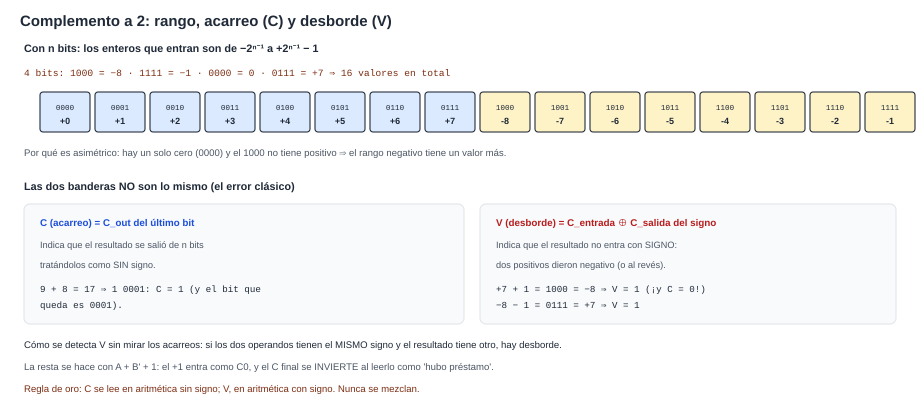

#### Las cuatro representaciones (n bits)

| Representación | Rango | Negativo de `+x` | Problema |
|---|---|---|---|
| **Magnitud y signo** | `−(2ⁿ⁻¹−1) … +(2ⁿ⁻¹−1)` | cambiar el bit de signo | **dos ceros** (`+0` y `−0`) |
| **Complemento a 1** | `−(2ⁿ⁻¹−1) … +(2ⁿ⁻¹−1)` | negar todos los bits | dos ceros; la resta pide **acarreo circular** |
| **Complemento a 2** | `−2ⁿ⁻¹ … +(2ⁿ⁻¹−1)` | negar todo y **sumar 1** | un número negativo **sin positivo** (`−128` en 8 bits) |
| **Sin signo** | `0 … 2ⁿ−1` | no aplica | — |

| n | Rango en complemento a 2 | Valor "raro" |
|---|---|---|
| 4 | **−8 … +7** | `1000` = −8 (no hay +8) |
| 8 | **−128 … +127** | `10000000` = −128 |
| 16 | −32 768 … +32 767 | — |
| 32 | −2 147 483 648 … +2 147 483 647 | — |

> [!important] Por qué complemento a 2 y no las otras
> 1. **Un solo circuito:** `A − B = A + B' + 1` (XOR en las entradas de `B` + acarreo de entrada = `SUB`).
> 2. **Un solo cero:** no hay que corregir `+0 = −0`.
> 3. **El acarreo de salida no se descarta con "vuelta"**: se ignora y listo.
> 4. Es la que usan **todas** las CPUs reales (y la BLUE, y el 8086).

#### La resta con el mismo sumador
```
        B3 B2 B1 B0
          │  │  │  │
        ┌─┴──┴──┴──┴─┐
  SUB ─►│ XOR ×4     │   SUB = 0 ⇒ pasa B (suma)
        └─┬──┬──┬──┬─┘   SUB = 1 ⇒ pasa B' (resta)
          ▼  ▼  ▼  ▼
        ┌───────────┐
   SUB ─┤  SUMADOR  │──► S (resultado)
        └───────────┘       + C (acarreo de salida) + V (desbordamiento)
```
`A − B` se hace con `A + B' + SUB`, donde `SUB` **es** el acarreo de entrada `C0`.

#### El desbordamiento (signed) vs el acarreo (unsigned)

| Concepto | Qué significa | Cómo se detecta |
|---|---|---|
| **`C`** (carry) | el resultado **sin signo** no entra en `n` bits | acarreo de **salida** del MSB |
| **`V`** (overflow) | el resultado **con signo** no entra | `V = Cin(MSB) ⊕ Cout(MSB)` |
| **`Z`** | resultado cero | todas las salidas en 0 |
| **`S`** (signo) | bit de signo del resultado | el MSB |

> [!example] Los dos casos, con 4 bits
> **Desbordamiento con signo:** `0111 + 0001`
> ```
>    0111   (+7)
>  + 0001   (+1)
>  ────────
>    1000   (−8)  ← ¡7 + 1 no puede dar −8!
> ```
> `Cin(MSB) = 1`, `Cout(MSB) = 0` ⇒ **`V = 1`**. El acarreo de salida `C = 0`.
>
> **Acarreo sin signo:** `1111 + 0001`
> ```
>    1111   (15)
>  + 0001   ( 1)
>  ────────
>  1 0000   (16 no entra en 4 bits)
> ```
> `C = 1`, pero `Cin(MSB) = 1` y `Cout = 1` ⇒ **`V = 0`**: como **con signo** el resultado es correcto (`1111` = −1, `0001` = +1, suma `0000` = 0 ✔).

**Regla mnemotécnica:** si los dos operandos tienen **el mismo signo** y el resultado tiene **signo distinto** ⇒ overflow. `+` con `+` da `−` ⇒ mal.

#### Ejemplo resuelto completo
> "Calcule `A − B` con `A = 0110 (+6)` y `B = 1001 (−7)` en 4 bits, e indique `C`, `V` y `Z`."

1. `B' = 0110`; `B' + 1 = 0111` (complemento a 2 de `B` = `+7` ✔ porque `−(−7) = +7`).

2. `SUB = 1` ⇒ se suman `A + B' + 1 = 0110 + 0110 + 1`:
   ```
      0110
   +  0110
   +     1
   ────────
      1101
   ```

3. Resultado `1101` = **−3**. Verificación decimal: `6 − (−7) = 13`, que **no entra** en 4 bits con signo (máximo +7) ⇒ **tiene que haber overflow**.

4. Flags: `Cin(MSB)` = acarreo que entra al bit 3 → sumando `0110+0110+1`: bit2 genera acarreo (1+1+carry…), el acarreo hacia el bit 3 es **1**; `Cout(MSB)` = **0** ⇒ **`V = 1`** ✔. `C = 0`, `Z = 0`.

5. **La cuenta correcta con 5 bits** habría dado `01101 = +13` ✔: el resultado existe, no entraba.

> [!warning] Errores típicos
> - Detectar el overflow mirando **sólo** el acarreo de salida (`C` no es `V`).
> - Decir que `−(−8)` en 4 bits da `+8` (no entra: da `−8`; es el caso borde del complemento a 2).
> - Olvidar el `+1` al complementar (`B'` no es `−B`; `B' + 1` sí).
> - Confundir `Z` con `V`: `Z` mira el resultado, `V` mira los acarreos del MSB.
> - Decir que la magnitud y signo "es más simple": lo es para el humano, **no** para el hardware.

#### Figura del libro

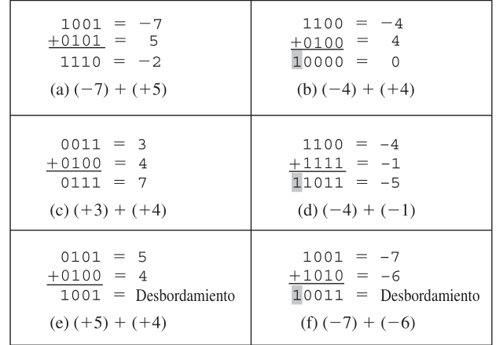

*Fig. 9.3 — Suma de números representados en complemento a dos.* · Stallings, *Organización y arquitectura de computadores*, 7ª ed., p. 333.

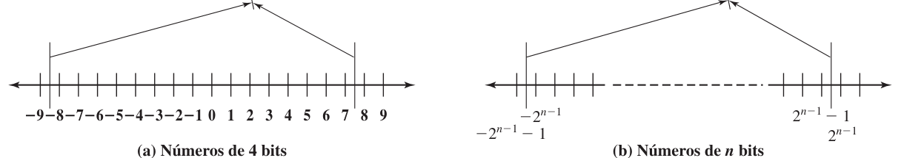

*Fig. 9.5 — Descripción geométrica de los enteros en complemento a dos.* · Stallings, *Organización y arquitectura de computadores*, 7ª ed., p. 335.

#### Relacionado
[[9.1.2 Acarreo anticipado (G y P)]] · [[3.2.2 Operaciones aritméticas, lógicas y flags]] · [[1.5.2 Sumador de n bits y resta en complemento a 2]] · [[Hardware aritmético (resumen)]] · [[1.5.1 Semisumador y sumador completo]] · [[Glosario — Unidad 9]]

### 9.1.2 Acarreo anticipado (G y P)

> [!abstract] En una frase
> En un sumador de **acarreo en cadena** (*ripple carry*) el bit `i` no puede sumar hasta que llegó el acarreo del `i−1`: el retardo crece **linealmente** con los bits. Con **acarreo anticipado** (CLA) cada posición calcula su acarreo **en paralelo** usando **`G = A·B`** (genera) y **`P = A⊕B`** (propaga).

> [!note] Si la primera vez que ves esto
> Es el **efecto dominó** de una fila de personas pasándose un balde: el último no tiene agua hasta que le llegue. El acarreo anticipado es ponerle a cada uno **su propia manguera**, calculada con dos datos que ya tiene: si él y su vecino generan agua (`G`) o si la dejan pasar (`P`).

#### El problema del ripple carry
```
FA0 ──C1──► FA1 ──C2──► FA2 ──C3──► FA3 ──► Cout
```
Cada `FA` tarda **2 niveles** de compuerta (un XOR de 3 entradas o dos XOR + el acarreo `AB + Cin(A⊕B)`). Para `n = 32`: `32 × 2 =` **64 niveles** de retardo ⇒ **limita la frecuencia del reloj**.

#### Las dos señales mágicas

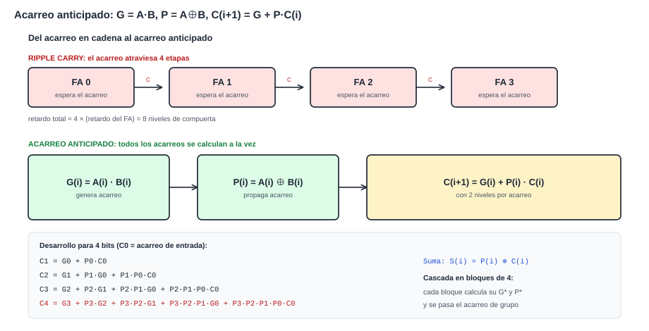

| Señal | Fórmula | Significado |
|---|---|---|
| **`G(i)`** (generate) | `A(i) · B(i)` | **genera** acarreo por sí mismo (1+1) |
| **`P(i)`** (propagate) | `A(i) ⊕ B(i)` | **propaga** el acarreo que le llega |
| **Acarreo** | `C(i+1) = G(i) + P(i)·C(i)` | la ecuación de recurrencia |
| **Suma** | `S(i) = P(i) ⊕ C(i)` | la suma ya no depende del acarreo (sólo del `P` y `C`) |

> [!important] La idea en una frase
> `C(i+1) = G(i) + P(i)·C(i)` dice: **"hay acarreo si lo genero yo, o si me llega y lo dejo pasar"**. Y esa expresión se puede **expandir** hasta `C0` ⇒ ningún acarreo depende de otro acarreo, sólo de `G`, `P` y `C0`.

#### Las ecuaciones expandidas (4 bits)
```
C1 = G0 + P0·C0
C2 = G1 + P1·G0 + P1·P0·C0
C3 = G2 + P2·G1 + P2·P1·G0 + P2·P1·P0·C0
C4 = G3 + P3·G2 + P3·P2·G1 + P3·P2·P1·G0 + P3·P2·P1·P0·C0
```
Todos los `C` se calculan **a la vez**, en **3 niveles** de compuerta (una AND de 5 entradas + una OR), en lugar de `4 × 2 = 8`.

| Sumador | Niveles de retardo (4 bits) | 32 bits |
|---|---|---|
| **Ripple carry** | 8 | **64** |
| **CLA de 4 bits** | ~4 (G, P, C, S) | — |
| **CLA en bloques de 4** | 4 + 2 × 8 bloques ≈ 20 | ~20 |

#### Ejemplo resuelto (con los `G` y `P`)
> "Sume `A = 1011` y `B = 0110` con acarreo anticipado de 4 bits y `C0 = 0`. Muestre todos los `G`, `P` y `C`."

| i | A | B | `G = A·B` | `P = A⊕B` |
|---|---|---|---|---|
| 0 | 1 | 0 | **0** | **1** |
| 1 | 1 | 1 | **1** | **0** |
| 2 | 0 | 1 | **0** | **1** |
| 3 | 1 | 0 | **0** | **1** |

```
C1 = G0 + P0·C0 = 0 + 1·0 = 0
C2 = G1 + P1·C1 = 1 + 0·0 = 1
C3 = G2 + P2·C2 = 0 + 1·1 = 1
C4 = G3 + P3·C3 = 0 + 1·1 = 1
```
```
S0 = P0 ⊕ C0 = 1 ⊕ 0 = 1
S1 = P1 ⊕ C1 = 0 ⊕ 0 = 0
S2 = P2 ⊕ C2 = 1 ⊕ 1 = 0
S3 = P3 ⊕ C3 = 1 ⊕ 1 = 0
C4 = 1  ⇒  resultado = 1 0001
```
**Verificación decimal:** `1011 = 11`, `0110 = 6` ⇒ `17 = 10001` ✔ (5 bits: `S3..S0` = `0001` y `C4` = 1).

#### Cómo se escala: CLA en bloques
Con 32 bits no se hace una AND de 33 entradas: se agrupa en **bloques de 4** y cada bloque calcula su **genera de grupo** `G*` y **propaga de grupo** `P*`:
```
G* = G3 + P3·G2 + P3·P2·G1 + P3·P2·P1·G0      (¿el bloque genera?)
P* = P3·P2·P1·P0                              (¿el bloque propaga?)
```
Con esos dos valores, la unidad de anticipación **entre** bloques funciona igual que dentro de un bloque.

| Estrategia | Retardo | Área |
|---|---|---|
| Ripple | `O(n)` | mínima |
| **CLA en bloques** | `O(n/k)` | media (lo normal en una ALU real) |
| Árbol de anticipación (*lookahead* completo) | `O(log n)` | grande |

> [!warning] Errores típicos
> - Confundir `G` y `P`: **G genera** (`A·B`), **P propaga** (`A⊕B`, ¡es un **XOR**, no un OR!).
> - Usar `P = A + B` en lugar de `A ⊕ B` (funciona para el acarreo, pero **rompe** la suma `S = P ⊕ C`).
> - Decir que el CLA **elimina** el retardo del acarreo: lo reduce de `O(n)` a `O(n/k)` o `O(log n)`.
> - Olvidar el acarreo de entrada `C0` en las expresiones (es el que permite restar).
> - Creer que el CLA es más "barato": gasta **más compuertas** por la velocidad.

#### Figura del libro

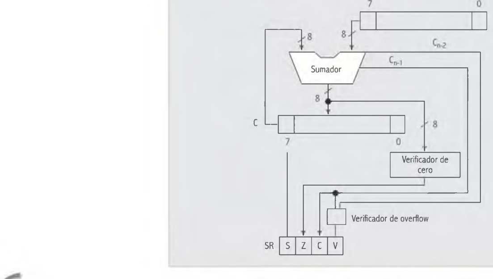

*Fig. 4.1 — Esquema de registros para la suma de 8 bits, con el acarreo serie y las banderas S, Z, C y V.* · Quiroga, *Arquitectura de computadoras*, p. 100.

> [!tip] Qué mirar
> El acarreo va pasando de bloque en bloque y las banderas se actualizan al final: `C` es el acarreo de salida y `V` el desborde con signo.

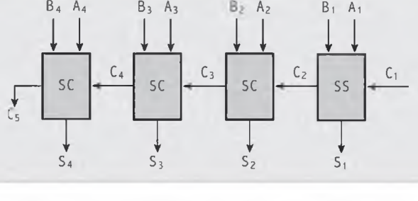

*Fig. 5.16 — Sumador binario paralelo con acarreo serie (SS y SC en cadena).* · Quiroga, *Arquitectura de computadoras*, p. 126.

> [!tip] Qué mirar
> El problema que resuelve el acarreo anticipado: `C4` no puede empezar hasta que termina `C3`, y así hasta `C1`. Con `n` bits el retardo crece con `n`; con lógica `G`/`P` todos los acarreos se calculan en dos niveles.

#### Relacionado
[[9.1.1 Complemento a 2 y desbordamiento]] · [[3.2.1 Estructura, G-P y señales de selección]] · [[1.5.1 Semisumador y sumador completo]] · [[Hardware aritmético (resumen)]] · [[TP5 Sumadores]] · [[Glosario — Unidad 9]]

## 9.2 Multiplicación

### 9.2.1 Sumas y desplazamientos

> [!abstract] En una frase
> Multiplicar a mano es sumar el multiplicando **desplazado** por cada bit del multiplicador que vale 1. El hardware lo hace con **un sumador, dos registros y un desplazamiento**: `n` pasos para `n` bits (el doble ancho en el resultado).

> [!note] Si la primera vez que ves esto
> `13 × 11` no es más que `13` + `13×2` + `13×8` = `13 + 26 + 104 = 143`. Cada "×2" es **un desplazamiento a la izquierda**; cada suma parcial es **un `ADD`**. Todo el algoritmo es eso.

#### Sumar y desplazar

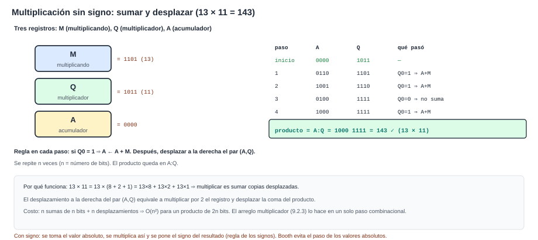

#### El algoritmo (sin signo, n bits)

```
M = multiplicando     Q = multiplicador     A = 0 (acumulador)     C = 0 (bit que se pierde)

repetir n veces:
    1. si Q0 = 1  ⇒  A ← A + M        (si no, nada)
    2. desplazar a la derecha (C, A, Q) en bloque de 1 bit
resultado = A (parte alta) · Q (parte baja)
```

| Registro | Ancho | Para qué |
|---|---|---|
| **`M`** | `n` | multiplicando (fijo) |
| **`Q`** | `n` | multiplicador; se va convirtiendo en la **parte baja** del producto |
| **`A`** | `n` | acumulador; termina siendo la **parte alta** |
| **`C`** | 1 | guarda el bit que sale de `A` al desplazar |

**Producto de doble ancho:** `2n` bits (`A` `Q`). Por eso una `MUL` de 8 bits da 16.

#### Ejemplo resuelto: 13 × 11
`M = 1101` (13) · `Q = 1011` (11) · `A = 0000` · `C = 0`. Cuatro iteraciones:

| Iter | `Q0` | Acción | `A` (con el `C` en el MSB) | Desplazar `(C,A,Q)` ⇒ `A` / `Q` |
|---|---|---|---|---|
| 1 | **1** | `A ← A + M` = `1101`, `C = 0` | `0 1101` | `0110` / `1101` |
| 2 | **1** | `A ← A + M` = `0110 + 1101 = 1 0011` ⇒ `A = 0011`, **`C = 1`** | `1 0011` | `1001` / `1110` |
| 3 | **0** | no suma | `0 1001` | `0100` / `1111` |
| 4 | **1** | `A ← A + M` = `0100 + 1101 = 1 0001` ⇒ `A = 0001`, **`C = 1`** | `1 0001` | `1000` / `1111` |

**Producto = `A Q` = `1000 1111` = 143** ✔

##### La verificación por productos parciales (la misma cuenta, a mano)
```
        1101          (13)
      × 1011          (11)
      ──────
        1101          ← bit 0 = 1  ⇒  13
       1101·          ← bit 1 = 1  ⇒  26
      0000··          ← bit 2 = 0  ⇒   0
     1101···          ← bit 3 = 1  ⇒ 104
     ────────
    10001111          = 143 ✔
```

| Comprobación | Cuenta |
|---|---|
| Binario | `10001111` = `128 + 8 + 4 + 2 + 1 = 143` ✔ |
| Decimal | `13 × 11 = 143` ✔ |
| Productos parciales | `13 + 26 + 0 + 104 = 143` ✔ |

> [!important] El detalle que se olvida
> El **`C`** no es decorativo: cuando la suma desborda los `n` bits del acumulador, ese 1 **entra al `A` al desplazar** (iteraciones 2 y 4 de la tabla). Si se descarta, el producto sale mal. En cambio el `C` **anterior** siempre vuelve a 0 después del desplazamiento.

#### Tiempo

| Implementación | Ciclos | Hardware |
|---|---|---|
| Sumas y desplazamientos | **`n`** (más el llenado) | 1 sumador de `n` bits + 2 registros |
| `n` bits, `n = 32` | 32 ciclos | — |
| Booth | `n` (pero menos sumas) | sumador/restador + lógica |
| Arreglo | 0 (combinacional) | `n²` sumadores |

#### Con signo: la vía simple

| Método | Cómo |
|---|---|
| **Magnitud y signo** | `signo = sA ⊕ sB`, multiplicar las **magnitudes**, aplicar el signo |
| **Complemento a 2 (sin Booth)** | convertir a positivo, multiplicar, y **negar** si el signo es negativo |
| **Booth** (9.2.2) | opera directo sobre complemento a 2 |

> [!warning] Errores típicos
> - Quedarse con `n` bits de producto (son **`2n`**: `8 × 8 ⇒ 16`).
> - Mezclar desplazamiento del acumulador con desplazamiento del multiplicando **en la misma tabla**.
> - Olvidar que el último paso **no necesita** sumar si el bit ya se procesó.
> - Signar el resultado con `sA · sB` (es **XOR**: `1·1 = 0`, o sea `− × − = +`).
> - Decir que la multiplicación se hace "en un ciclo" en un procesador común (tarda `n` o usa un arreglo).

#### Figura del libro

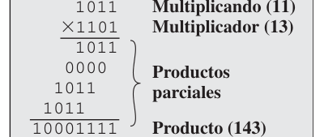

*Fig. 9.7 — Multiplicación de enteros binarios sin signo.* · Stallings, *Organización y arquitectura de computadores*, 7ª ed., p. 336.

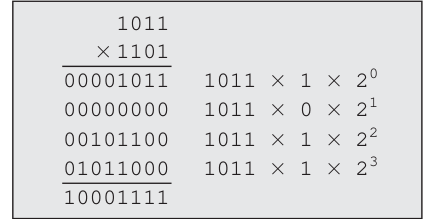

*Fig. 9.10 — Multiplicación de dos enteros sin signo de cuatro bits para producir* · Stallings, *Organización y arquitectura de computadores*, 7ª ed., p. 339.

#### Relacionado
[[9.2.2 Algoritmo de Booth]] · [[9.2.3 Arreglo multiplicador]] · [[9.1.2 Acarreo anticipado (G y P)]] · [[Hardware aritmético (resumen)]] · [[2.2.1 Registros PIPO y SISO]] · [[Glosario — Unidad 9]]

### 9.2.2 Algoritmo de Booth

> [!abstract] En una frase
> Booth **recodifica el multiplicador** mirando **pares** de bits `(Q0, Q−1)`: `01` ⇒ **sumar** `M`, `10` ⇒ **restar** `M`, `00`/`11` ⇒ **sólo desplazar**. Multiplica **números con signo en complemento a 2 sin separar el signo**, y hace **menos sumas** cuando el multiplicador tiene rachas largas de 1.

> [!note] Si la primera vez que ves esto
> En vez de sumar "por cada 1", Booth agrupa: una racha de unos `0111` = `1000 − 0001` ⇒ un **+** y un **−** en vez de tres sumas. Es la misma idea que `7 = 8 − 1`: escribir el número con menos dígitos.

#### Booth, con traza

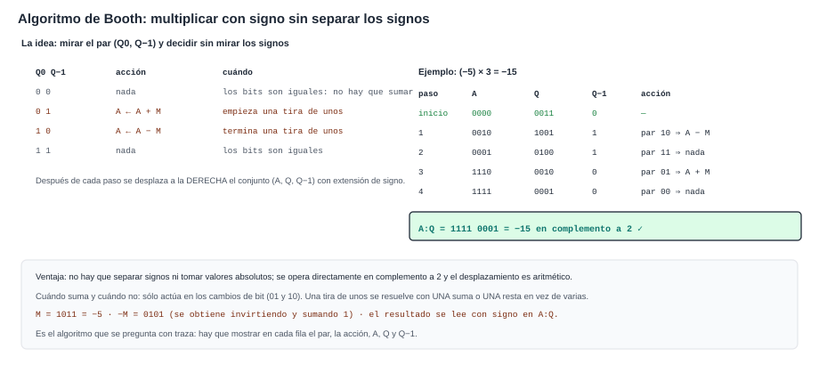

#### La regla de recodificación

| `(Q0, Q−1)` | Operación | Por qué |
|---|---|---|
| `00` | **nada** | en medio de una racha de ceros |
| `01` | `A ← A + M` | **empieza** una racha de unos |
| `10` | `A ← A − M` | **termina** una racha de unos |
| `11` | **nada** | en medio de una racha de unos |

Después de cada paso: **desplazamiento aritmético a la derecha** de `(A, Q, Q−1)` — el signo se replica.

**Hardware:** un sumador/**restador** (`M` o `M'`+1), lógica de recodificación (un XOR y poco más) y el registro `Q−1` de 1 bit.

#### Ejemplo resuelto: 6 × (−3)
`M = 0110` (+6) · `−M = 1010` · `Q = 1101` (−3) · `A = 0000` · `Q−1 = 0`.

| Iter | `(Q0, Q−1)` | Operación | `A` | `Q` | `Q−1` |
|---|---|---|---|---|---|
| inicio | — | — | `0000` | `1101` | `0` |
| 1 | `1 0` | **`A ← A − M`** = `0000 + 1010 = 1010` | `1010` → `**1101**` | `1101` → `**0110**` | `1` |
| 2 | `0 1` | **`A ← A + M`** = `1101 + 0110 = 1 0011` → `0011` | `0011` → `**0001**` | `0110` → `**1011**` | `0` |
| 3 | `1 0` | **`A ← A − M`** = `0001 + 1010 = 1011` | `1011` → `**1101**` | `1011` → `**1101**` | `1` |
| 4 | `1 1` | **nada** | `1101` → `**1110**` | `1101` → `**1110**` | `1` |

**Producto = `A Q` = `1110 1110`.** Verificación: `1110 1110` como 8 bits con signo = `256 − 18 =` **−18** ✔ y `6 × (−3) = −18` ✔

> [!important] Las dos comprobaciones que no fallan
> 1. **Decimal:** el producto de 8 bits con signo debe dar el producto real.
> 2. **Cantidad de sumas:** en el ejemplo fueron **2** (`−M` y `+M`) en lugar de 3 (los tres unos de `1101`).

#### Cuándo gana y cuándo no

| Multiplicador | Sumas con "sumas y desplazamientos" | Sumas con Booth |
|---|---|---|
| `00001111` (racha de 4) | 4 | **2** |
| `01010101` (alternado) | 4 | **8** (¡peor!) |
| `11111111` (−1) | 8 (con signo, imposible sin Booth) | **1** |
| `1101` (−3) | — | **2** |

**Conclusión:** Booth **no siempre es más rápido**, pero **siempre funciona con signo** y en promedio ayuda (las rachas son comunes en datos reales).

#### Variantes

| Variante | Idea |
|---|---|
| **Booth de 2 bits** (radix-4) | mira 3 bits ⇒ la mitad de iteraciones (`n/2`); procesa dígitos `0, ±1, ±2` |
| **Booth de 3 bits** (radix-8) | `n/3` iteraciones; usa también `±3M`, `±4M` |
| **Arreglo multiplicador con Booth** | `n²` celdas con celdas de Booth ⇒ combinacional y con signo |

En los procesadores reales se usa **radix-4**, porque reduce las iteraciones sin complicar demasiado el hardware.

> [!warning] Errores típicos
> - Decir que Booth sirve **sólo** para números sin signo (es justo al revés: su gracia es el **signo**).
> - Invertir la regla: `01` **suma** (empieza la racha), `10` **resta**.
> - Usar **desplazamiento lógico** en vez de **aritmético** (se pierde el signo).
> - Olvidar el registro `Q−1` (sin él no hay par que mirar).
> - Prometer que Booth siempre hace menos operaciones.

#### Figura del libro

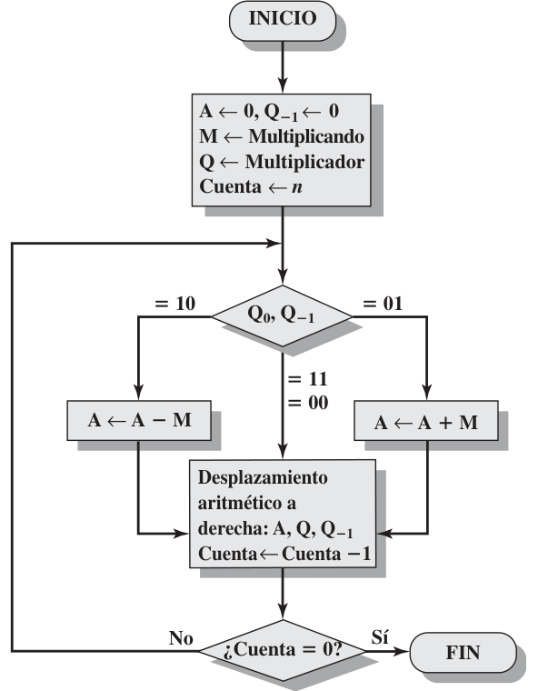

*Fig. 9.12 — Algoritmo de Booth para la multiplicación en complemento a dos.* · Stallings, *Organización y arquitectura de computadores*, 7ª ed., p. 340.

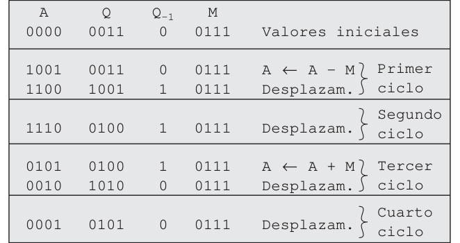

*Fig. 9.13 — Ejemplo de aplicación del algoritmo de Booth (7 3).* · Stallings, *Organización y arquitectura de computadores*, 7ª ed., p. 341.

#### Relacionado
[[9.2.1 Sumas y desplazamientos]] · [[9.2.3 Arreglo multiplicador]] · [[9.1.1 Complemento a 2 y desbordamiento]] · [[Hardware aritmético (resumen)]] · [[Glosario — Unidad 9]]

### 9.2.3 Arreglo multiplicador

> [!abstract] En una frase
> El **multiplicador de arreglo** pone **todos** los productos parciales en una matriz de sumadores y los suma en paralelo: es **combinacional** (no tiene ciclos, el producto aparece con el retardo de la matriz) a cambio de **`n²` celdas**.

> [!note] Si la primera vez que ves esto
> Es pasar de "cocinar de a un plato" (sumas y desplazamientos, `n` ciclos) a **una cocina con `n²` hornallas** donde todo se hace a la vez. Rapidísimo, carísimo, y cabe sólo si hay lugar en el chip.

#### La matriz

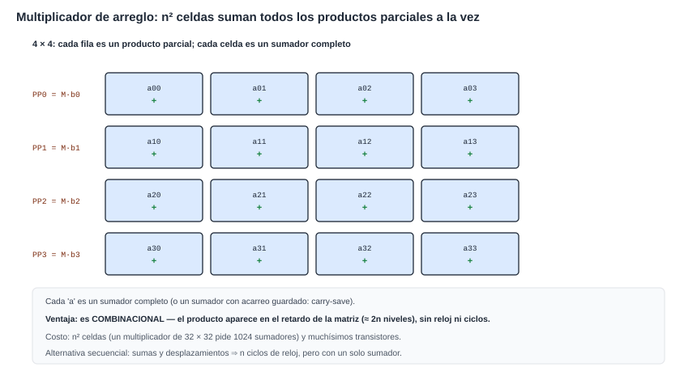

```
     M3 M2 M1 M0
  ×  Q3 Q2 Q1 Q0
  ─────────────────
  PP0 = M · Q0      (todo o nada, según Q0)
  PP1 = M · Q1  ←   un lugar a la izquierda
  PP2 = M · Q2  ←←
  PP3 = M · Q3  ←←←
  ─────────────────
  P7 … P0   (8 bits)
```
Cada fila se suma a la acumulación anterior con una fila de **sumadores completos**; el acarreo baja a la fila siguiente. Con `n = 4` son **16 celdas**; con `n = 32`, **1 024**.

| Implementación | Retardo | Área | Reloj |
|---|---|---|---|
| Sumas y desplazamientos | `n` ciclos | 1 sumador | sí |
| **Arreglo** | ≈ `2n` niveles de compuerta | **`n²`** sumadores | **no** (combinacional) |
| Arreglo con **carry-save** | ≈ `n` niveles (más rápido) | `n²` + registros | no |
| Arreglo **segmentado** (pipelined) | 1 producto por ciclo (después del llenado) | `n²` + registros de etapa | sí |

> [!important] El compromiso clásico
> El arreglo cambia **tiempo por área**: hace en nanosegundos lo que el secuencial hace en `n` ciclos, pero con `n²` sumadores. Por eso los procesadores reales usan **arreglos segmentados**: un arreglo (área) partido en etapas (frecuencia), y así sacan **un producto por ciclo** con un reloj alto.

#### Cómo se reduce el área

| Técnica | Idea |
|---|---|
| **Carry-save** | en vez de propagar el acarreo en cada fila, se **guarda** y se propaga al final (sumador final con CLA) |
| **Booth radix-4** | la mitad de filas (productos parciales) ⇒ casi la mitad de celdas |
| **Árbol de Wallace / Dadda** | suma los productos parciales en `log n` niveles en vez de `n` |
| **Multiplicador secuencial** | volver al 9.2.1 cuando el área importa más que la velocidad (microcontroladores) |

#### Dónde se ve

| Lugar | Por qué |
|---|---|
| **FPU** (punto flotante) | multiplicar mantisas es esto; de ahí la Unidad 9.4 |
| **GPU** | miles de multiplicadores chicos en paralelo (SIMD) |
| **DSP / filtros** | un `MAC` (multiplicar-acumular) por ciclo |
| **Microcontroladores baratos** | **no** tienen arreglo: usan sumas y desplazamientos |

> [!warning] Errores típicos
> - Decir `n` celdas (son **`n²`**).
> - Decir que el arreglo "tiene `n` ciclos" (es **combinacional**: no tiene ciclos; su límite es el retardo).
> - Olvidar el **producto de doble ancho** (`2n` bits).
> - Confundir *carry-save* (no propaga el acarreo hasta el final) con *carry-lookahead* (lo calcula antes).
> - Creer que "más rápido" siempre gana: el área y el consumo son el otro lado del compromiso.

#### Ejemplo resuelto (4 × 4)
Multiplicar `1011` (11) por `1101` (13) con la matriz:

- `PP0 = M · Q0 = 1011` (Q0 = 1) ⇒ se alinea en la columna 0.

- `PP1 = M · Q1 = 1011` desplazado 1 lugar (`Q1 = 1`).

- `PP2 = M · Q2 = 0000` (`Q2 = 0`).

- `PP3 = M · Q3 = 1011` desplazado 3 lugares (`Q3 = 1`).

- La suma de los cuatro productos parciales da **`1000 1111` = 143** (que es 11 × 13 ✓). Con `n = 4` son **16 celdas** y el resultado sale **sin reloj** (combinacional); con `n = 32`, **1024**.

#### Relacionado
[[9.2.1 Sumas y desplazamientos]] · [[9.2.2 Algoritmo de Booth]] · [[9.1.2 Acarreo anticipado (G y P)]] · [[9.4.1 Formato, normalización y operaciones]] · [[Hardware aritmético (resumen)]] · [[Glosario — Unidad 9]]

## 9.3 División

### 9.3.1 Restauración y no restauración

> [!abstract] En una frase
> Dividir es **restar y desplazar** `n` veces: el método **restaurativo** prueba `A − M`, y si da **negativo** lo **deshace** (`A + M`) poniendo `0` en el cociente; el **no restaurativo** deja el resto negativo y **compensa** en la iteración siguiente, ahorrando la mitad de las operaciones.

> [!note] Si la primera vez que ves esto
> Es la división larga del colegio: "¿cuántas veces entra el 3 en el 7?" ⇒ tanteás, si te pasaste **volvés atrás**. El restaurativo vuelve atrás; el no restaurativo **no** vuelve: sigue con el negativo y lo corrige después.

#### Restaurar el resto

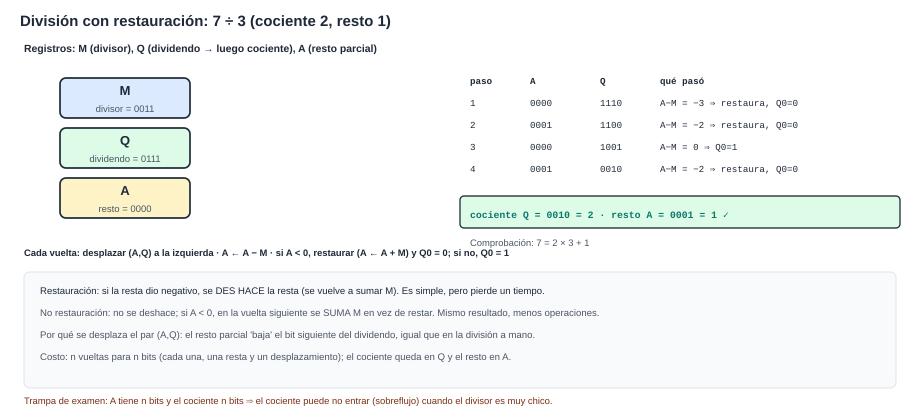

#### Los registros

| Registro | Ancho | Para qué |
|---|---|---|
| **`A`** | `n` | resto parcial (empieza en 0) |
| **`Q`** | `n` | **dividendo**; se convierte en el **cociente** |
| **`M`** | `n` | divisor (fijo) |

**Restricción:** el divisor debe ser **mayor** que la mitad del dividendo de `n` bits (si no, el cociente no entra): por eso se trabaja con el dividendo de **`2n`** bits y se controla el sobreflujo (9.3.2).

#### Algoritmo restaurativo

```
repetir n veces:
    1. desplazar a la izquierda (A, Q) en bloque
    2. A ← A − M
    3. si A ≥ 0  ⇒  Q0 ← 1                    (entra: cociente 1)
       si A < 0  ⇒  Q0 ← 0 ;  A ← A + M       (no entra: se RESTAURA)
al final:  cociente = Q  ·  resto = A
```

#### Ejemplo resuelto: 7 ÷ 3
`A = 0000` · `Q = 0111` (=7) · `M = 0011` (=3).

| Iter | Desplazar (A,Q) | `A − M` | ¿≥ 0? | Acción | `A` | `Q` |
|---|---|---|---|---|---|---|
| 1 | `0000 1110` | `1101` (−3) | **no** | `Q0 = 0`, restaurar | `0000` | `1110` |
| 2 | `0001 1100` | `1110` (−2) | **no** | `Q0 = 0`, restaurar | `0001` | `1100` |
| 3 | `0011 1000` | `0000` | **sí** | `Q0 = 1` | `0000` | `1001` |
| 4 | `0001 0010` | `1110` (−2) | **no** | `Q0 = 0`, restaurar | `0001` | `0010` |

**Cociente `Q` = `0010` = 2 · Resto `A` = `0001` = 1.** **Verificación:** `7 = 3 × 2 + 1` ✔ y `resto < divisor` ✔

#### Algoritmo no restaurativo

```
repetir n veces:
    1. desplazar a la izquierda (A, Q)
    2. si A ≥ 0  ⇒  A ← A − M        si A < 0  ⇒  A ← A + M
    3. si el nuevo A ≥ 0  ⇒  Q0 ← 1   si no  ⇒  Q0 ← 0
al final:  si A < 0  ⇒  A ← A + M     (corrección final)
```

Ya **no hay restauración**: se ahorra una suma por iteración (la mitad de las operaciones del paso 3 del otro método).

#### El mismo ejemplo, sin restaurar

| Iter | Desplazar (A,Q) | Signo de `A` antes | Operación | `A` nuevo | ¿≥ 0? | `Q0` | `Q` |
|---|---|---|---|---|---|---|---|
| 1 | `0000 1110` | ≥ 0 | `A − M` = `1101` | `1101` | no | 0 | `1110` |
| 2 | `1011 1100` | < 0 | `A + M` = `1110` | `1110` | no | 0 | `1100` |
| 3 | `1101 1000` | < 0 | `A + M` = `0000` | `0000` | sí | 1 | `1001` |
| 4 | `0001 0010` | ≥ 0 | `A − M` = `1110` | `1110` | no | 0 | `0010` |
| final | — | < 0 | **corrección:** `A + M` = `0001` | `0001` | — | — | `0010` |

**Cociente 2, resto 1** — el mismo resultado con **una** operación menos por iteración. ✔

#### Comparación

| | **Restaurativo** | **No restaurativo** |
|---|---|---|
| Operaciones por iteración | 1 resta + (a veces) 1 suma | **siempre 1** suma o resta |
| Pasos extra | la restauración | una corrección **final** |
| Lógica de control | simple | un poco más (mira el signo anterior) |
| Velocidad | más lento | **más rápido** |
| Se usa en | didáctico / hardware simple | hardware real |

> [!important] Lo que hay que poder dibujar
> El esquema **A–Q desplazándose a la izquierda** con el **sumador/restador** y la **línea de signo** que vuelve a la lógica de control. Es el mismo bloque que el multiplicador secuencial: **sumador + dos registros + control**.

> [!warning] Errores típicos
> - Restaurar cuando la resta **no** dio negativa (no hay nada que deshacer).
> - Olvidar la **corrección final** del no restaurativo (el resto queda negativo).
> - Desplazar **sólo `Q`** en vez de `(A, Q)` en bloque.
> - Invertir el sentido del cociente: `Q0 = 1` ⇔ **la resta entró** (resto ≥ 0).
> - Confundir el **resto** (`A`) con el cociente (`Q`).

#### Figura del libro

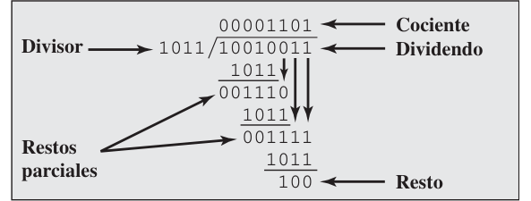

*Fig. 9.15 — División de enteros binarios sin signo.* · Stallings, *Organización y arquitectura de computadores*, 7ª ed., p. 344.

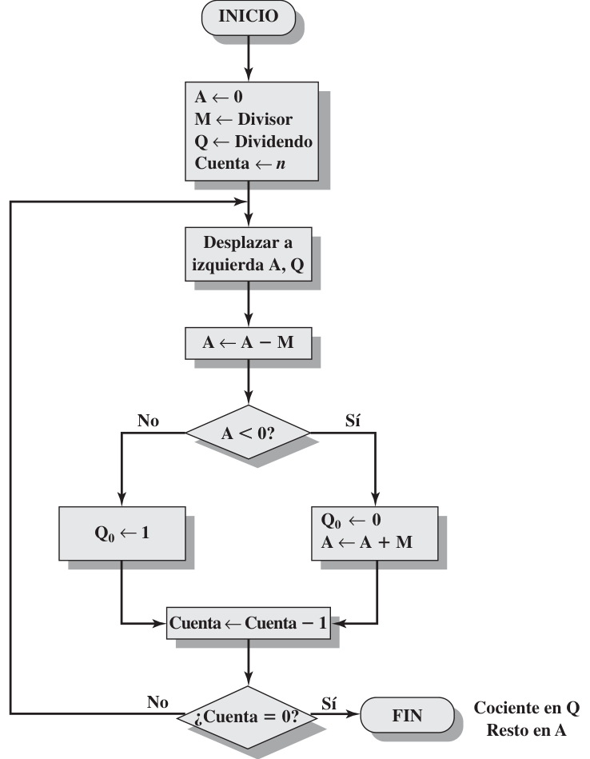

*Fig. 9.16 — Diagrama de flujo para la división de binarios sin signo.* · Stallings, *Organización y arquitectura de computadores*, 7ª ed., p. 345.

#### Relacionado
[[9.3.2 Sobreflujo y división con signo]] · [[9.2.1 Sumas y desplazamientos]] · [[9.1.1 Complemento a 2 y desbordamiento]] · [[Hardware aritmético (resumen)]] · [[Glosario — Unidad 9]]

### 9.3.2 Sobreflujo y división con signo

> [!abstract] En una frase
> La división tiene **dos** formas de fallar —**divisor 0** y **cociente que no entra** (`dividendo ≥ divisor × 2ⁿ`)— y con **signo** hay que decidir si se resuelve por **magnitudes** (signo aparte) o por **complemento a 2** con corrección.

> [!note] Si la primera vez que ves esto
> Es como repartir 300 caramelos entre 1 chico: el resultado "300" no entra en la cajita de 2 dígitos. No es que la cuenta esté mal: **el resultado no cabe**. Eso es sobreflujo, y hay que **avisar** (trap/interrupción) en vez de devolver un número truncado.

#### Signos y sobreflujo

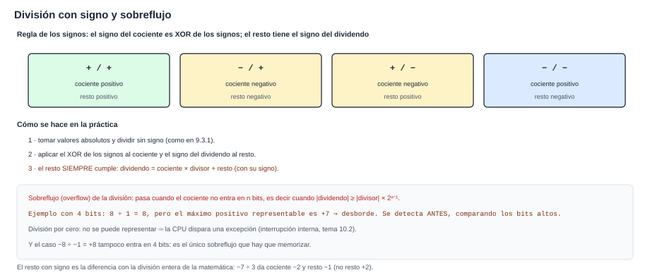

#### Cuándo hay sobreflujo

| Caso | Ejemplo (8 bits) | Qué pasa |
|---|---|---|
| **Divisor = 0** | `7 / 0` | **indefinido** ⇒ trap |
| **Cociente no entra en `n` bits** | `200 / 1 = 200`… cabe; pero en 4 bits `15 / 1 = 15` no entra en 4 bits con signo | overflow |
| **Regla formal** | `dividendo ≥ divisor × 2ⁿ` | el cociente ocuparía `> n` bits |

**Con `2n` bits de dividendo** (lo habitual): hay sobreflujo si la **mitad alta** (`A`) es **mayor o igual** que el divisor ⇒ es lo primero que se chequea, **antes** de empezar, y si pasa se genera la interrupción.

> [!example] Ejemplo resuelto
> "En una ALU de 8 bits se divide el dividendo de 16 bits `A:Q = 0000 0001 : 1110 1000` (`= 488`) por `M = 0000 0010` (`= 2`). ¿Hay sobreflujo? ¿Cuál es el resultado?"

1. División entera: `488 / 2 = 244`, resto `0`.

2. ¿Entra `244` en 8 bits? `244 ≤ 255` ⇒ **sí**, no hay sobreflujo.

3. Resultado: `Q = 1111 0100` (=244), `A = 0000 0000` (resto 0).

4. **Pero** si el cociente hubiera sido `300` (dividendo `600`), `300 > 255` ⇒ **sobreflujo** aunque la cuenta sea exacta: `600 = 2 × 300 + 0`.

#### División con signo: dos caminos

| Camino | Cómo | Costo |
|---|---|---|
| **Magnitudes** | `signo = sA ⊕ sB`; dividir magnitudes; aplicar signo | conversiones a/desde complemento a 2 |
| **Complemento a 2 directo** | usar el algoritmo no restaurativo con **desplazamiento aritmético** y corregir el **signo del resto** al final | más lógica de control |

**Regla del resto:** en la división con signo, el signo del **resto** sigue al del **dividendo** (`−7 / 3 = −2` con resto `−1`); el del **cociente** es el XOR de los signos. Esto se pregunta mucho.

| Operación | Cociente | Resto |
|---|---|---|
| `7 / 3` | `2` | `1` |
| `−7 / 3` | `−2` | `−1` |
| `7 / −3` | `−2` | `1` |
| `−7 / −3` | `2` | `−1` |

Comprobación de la fila 2: `−2 × 3 + (−1) = −7` ✔ — el resto **siempre cumple** `dividendo = cociente × divisor + resto`.

#### El caso extremo de complemento a 2
En 8 bits, `−128 / −1 = +128`, que **no existe** (el máximo es `+127`) ⇒ **sobreflujo** aunque el divisor no sea 0. Es el mismo caso borde que `−(−128)` en la negación (9.1.1).

| Operación | Resultado | Flag |
|---|---|---|
| `−128 / −1` (8 bits) | indefinido | **overflow** |
| `x / 0` | indefinido | **división por cero** |
| `0 / x` | `0` | normal |

> [!important] Cómo lo resuelve el hardware real
> Una instrucción `DIV` **no** devuelve un resultado silencioso: si hay divisor 0 o cociente que no entra, genera una **excepción** (en el 8086, `INT 0` para división por cero). El sistema operativo decide qué hacer. **La ALU no "redondea"**: avisa.

> [!warning] Errores típicos
> - Decir que sólo hay sobreflujo con divisor 0 (también con cociente que no entra).
> - Dar `−7 / 3` con resto `+1` (es **−1**: el resto sigue al dividendo).
> - Poner el signo del cociente como `sA · sB` (es **XOR**).
> - Olvidar el chequeo **previo** de la mitad alta del dividendo.
> - Creer que la división entera redondea: **trunca** (y por eso `−7/3` da `−2`, no `−3`).

#### Relacionado
[[9.3.1 Restauración y no restauración]] · [[9.1.1 Complemento a 2 y desbordamiento]] · [[5.5.2 Máscara, pila y RTI]] · [[Hardware aritmético (resumen)]] · [[Glosario — Unidad 9]]

## 9.4 Punto flotante

### 9.4.1 Formato, normalización y operaciones

> [!abstract] En una frase
> Un número en punto flotante se guarda como **signo · exponente (con exceso) · mantisa normalizada**, y vale `(−1)ˢ × 1.M × 2^(E − exceso)`. Operar exige **alinear** exponentes (suma), **sumar/restar** exponentes (multiplicación), **normalizar** y **redondear**.

> [!note] Si la primera vez que ves esto
> Es la **notación científica** de la física: `6,02 × 10²³`. Cambia la base 10 por base 2 y agrega el signo. La ventaja es la misma: representar números **enormes y diminutos** con la misma cantidad de dígitos.

#### Normalizar

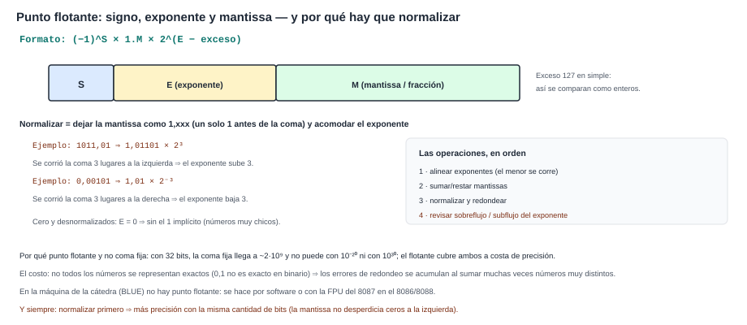

#### El formato

```
┌───────┬──────────────────┬─────────────────────────────┐
│ signo │    exponente     │        mantisa (M)          │
│  1    │  (con exceso)    │     normalizada: 1.M        │
└───────┴──────────────────┴─────────────────────────────┘
```
```
valor = (−1)^S × 1.M × 2^(E − exceso)
```

| Parte | Qué aporta | Detalle |
|---|---|---|
| **signo `S`** | `+` o `−` | 1 bit (0 = positivo) |
| **exponente `E`** | la **escala** (potencia de 2) | se guarda **con exceso** (`E = e + exceso`) para no necesitar signo |
| **mantisa `M`** | los **dígitos significativos** | **normalizada**: el 1 de adelante es implícito (no se guarda) |

**Normalizar** = dejar el número como `1.xxxx × 2^e`: un solo 1 antes de la coma. Así se **gana un bit** de precisión (el 1 no se almacena) y la representación es **única**.

| Número | Binario | Normalizado | `S` · `M` · `e` |
|---|---|---|---|
| 6,5 | `110,1` | **`1,101 × 2²`** | `0` · `101` · `2` |
| 0,375 | `0,011` | **`1,1 × 2⁻²`** | `0` · `1` · `−2` |
| −12 | `−1100` | **`−1,1 × 2³`** | `1` · `1` · `3` |

#### Las tres operaciones

##### Suma / resta (la difícil)

| Paso | Qué hace | Por qué |
|---|---|---|
| 1 | **comparar exponentes** | hay que trabajar a la misma escala |
| 2 | **alinear**: desplazar la mantisa del **menor** | si no, se suman peras con manzanas |
| 3 | **sumar/restar mantisas** | con el sumador de 9.1 |
| 4 | **normalizar** | el resultado puede salir `10,xx` o `0,001x` |
| 5 | **redondear** | al ancho de la mantisa |

> [!example] Ejemplo resuelto: 6,5 + 1,5
> 1. `6,5 = 1,101 × 2²` · `1,5 = 1,1 × 2¹` (¡exponentes distintos!)
> 2. **Alinear** al mayor (`2²`): `1,1 × 2¹ = 0,11 × 2²` (desplazar la mantisa **1** lugar a la derecha).
> 3. **Sumar**: `1,101 + 0,011 = 10,000` ⇒ `10,000 × 2²`.
> 4. **Normalizar**: `10,000 = 1,000 × 2¹` ⇒ `1,000 × 2³`.
> 5. **Redondear**: ya tiene 3 bits ⇒ queda `1,000 × 2³ = 1000₂ =` **8** ✔ (`6,5 + 1,5 = 8`)

##### Multiplicación

| Paso | Qué hace |
|---|---|
| 1 | **sumar exponentes** y **restar el exceso** (`e = e1 + e2`) |
| 2 | **multiplicar mantisas** (9.2: arreglo multiplicador) |
| 3 | **normalizar** (`1,1 × 1,1 = 10,01` ⇒ `1,001 × 2¹`) y **redondear** |
| 4 | `signo = S1 ⊕ S2` |

##### División

| Paso | Qué hace |
|---|---|
| 1 | **restar exponentes** (`e = e1 − e2`) |
| 2 | **dividir mantisas** (9.3) |
| 3 | **normalizar** y **redondear** |
| 4 | `signo = S1 ⊕ S2` |

#### Los bits que salvan la precisión

| Bit | Para qué |
|---|---|
| **guarda** (*guard*) | 1 bit extra a la derecha de la mantisa |
| **redondeo** (*round*) | otro bit extra |
| **pegajoso** (*sticky*) | **OR** de todo lo que se descartó: si algo se perdió, queda en 1 |

Sin estos bits, `(a + b) + c` puede dar distinto que `a + (b + c)`: la **suma deja de ser asociativa** en punto flotante (uno de los errores conceptuales más preguntados).

#### Lo que sale mal

| Problema | Causa |
|---|---|
| **Pérdida de precisión** | alinear un número muy chico con uno muy grande (los bits chicos "desaparecen") |
| **Cancelación catastrófica** | restar dos números casi iguales ⇒ el resultado es pura basura de redondeo |
| **No asociativa** | `(1e20 + 1) − 1e20 = 0` pero `1e20 + (1 − 1e20) = ...` |
| **No distributiva** | por el redondeo |

> [!warning] Errores típicos
> - Sumar mantisas **sin alinear** los exponentes.
> - Olvidar **normalizar** después de operar (`10,xx` no es válido).
> - Guardar el **1 implícito** en la mantisa (se ahorra un bit justamente por eso).
> - Restar el exceso **dos veces** al multiplicar (es `e1 + e2 − exceso`).
> - Creer que el punto flotante es exacto: **no** lo es, y por eso `0.1 + 0.2 ≠ 0.3` en una computadora.

#### Figura del libro

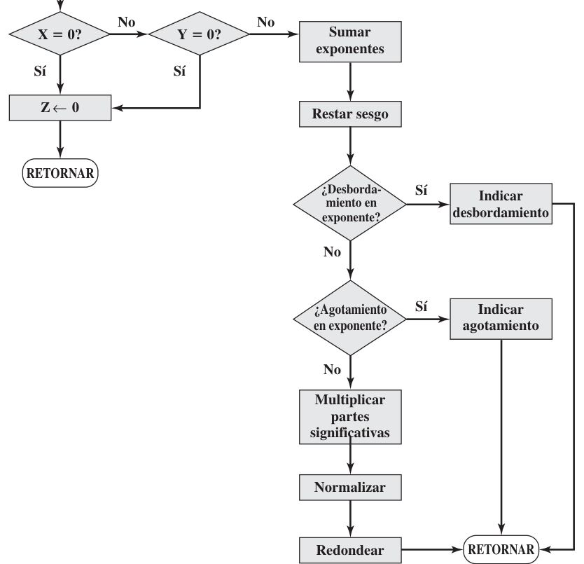

*Fig. 9.23 — Multiplicación en coma flotante (Z ←X Y).* · Stallings, *Organización y arquitectura de computadores*, 7ª ed., p. 356.

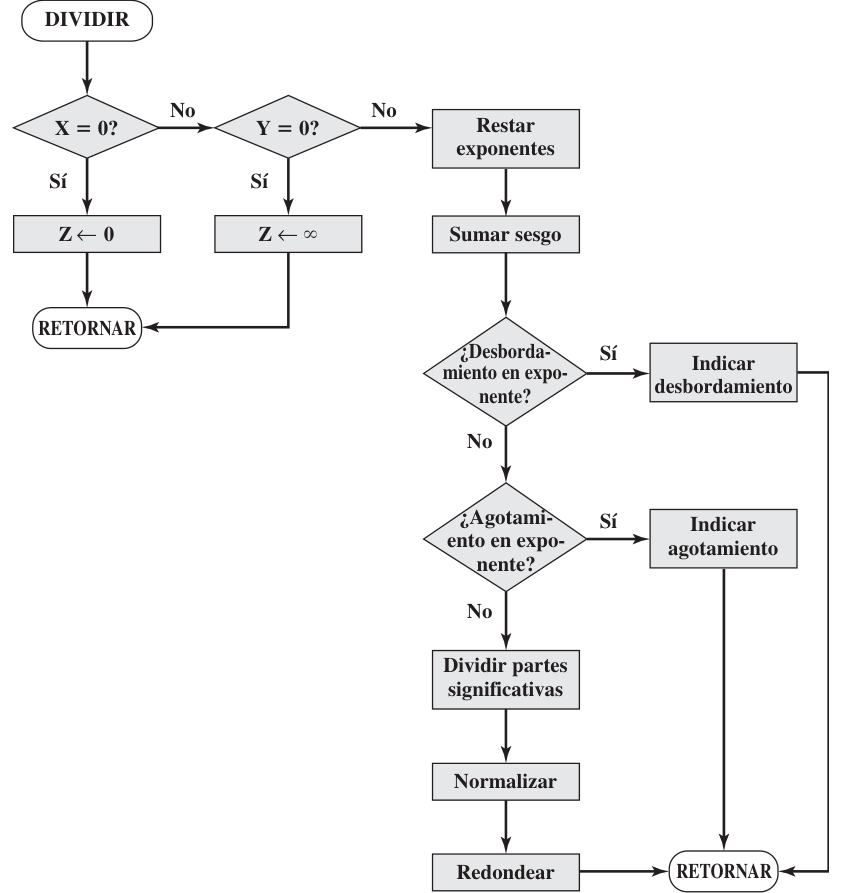

*Fig. 9.24 — División en coma flotante (Z ←X/Y).* · Stallings, *Organización y arquitectura de computadores*, 7ª ed., p. 357.

#### La convención de la cátedra: exceso 64 y mantisa entre 1/2 y 1

La cátedra escribe el formato como **S · E · M** con el exponente en **exceso 2ⁿ⁻¹** y la mantisa normalizada en el rango **1/2 ≤ M < 1** (o sea, `0,1xxx…`). Es la misma idea de IEEE 754, con la coma en otro lugar y otro exceso.

| Campo | Qué dice la cátedra |
|---|---|
| **S** | 1 bit: `0` positivo, `1` negativo |
| **E** | exponente con **convención exceso 2ⁿ⁻¹**: por ejemplo **exceso 64 con 7 bits** y **exceso 128 con 8 bits** |
| **M** | mantisa fraccionaria **normalizada**: el bit más significativo vale **1**, y `1/2 ≤ M < 1` |

| Operación | Signo | Exponente | Mantisa |
|---|---|---|---|
| **Multiplicación** `S1E1M1 × S2E2M2 = SpEpMp` | `Sp = 0` si `S1 = S2`; `Sp = 1` si `S1 ≠ S2` | `Ep = E1 + E2 − 64 − K` | `Mp = M1 × M2 × 2^K`, con `K` tal que `1/2 ≤ M1·M2·2^K < 1` |
| **División** `S1E1M1 ÷ S2E2M2 = SdEdMd` | `Sd = 0` si `S1 = S2` | `Ed = E1 − E2 + 64 + K` | `Md = (M1 / M2) × 2^K`, con `K` tal que `1/2 ≤ Md < 1` |

> [!example] Multiplicar con exceso 64
> `A = 0 1000100 1000…` (`E = 68 − 64 = 4`) y `B = 0 1000011 1100…` (`E = 67 − 64 = 3`), `M1 = 1/2`, `M2 = 3/4`. `M1 × M2 = 3/8`: ya está en `[1/2, 1)` ⇒ `K = 0`. `Ep = 68 + 67 − 64 = 71` ⇒ el exponente real es `71 − 64 = 7 = 4 + 3` ✓. Resultado: `0 1000111 110…`.

> [!warning] Las dos trampas de esta parte
> 1. **Restar el exceso una sola vez**: en la multiplicación se suman dos exponentes que **ya** traen el exceso, por
>    eso se resta **una** vez (`−64`). Si se resta dos veces, el resultado queda con la mitad del valor.
> 2. **`K` es 0, +1 o −1**, no un número libre: la mantisa del producto de dos fracciones en `[1/2, 1)` cae en
>    `[1/4, 1)`, así que a lo sumo hay que **correr la coma un lugar** y ajustar el exponente.

#### Relacionado
[[9.4.2 IEEE 754]] · [[9.2.3 Arreglo multiplicador]] · [[9.1.2 Acarreo anticipado (G y P)]] · [[8.1.1 Etapas segmentadas y suma de vectores]] · [[Hardware aritmético (resumen)]] · [[Glosario — Unidad 9]]

### 9.4.2 IEEE 754

> [!abstract] En una frase
> El estándar **IEEE 754** fija el formato: **simple** = `1 + 8 + 23` bits con **exceso 127**, **doble** = `1 + 11 + 52` con **exceso 1023**; y define los casos especiales (**±0**, **subnormales**, **±∞**, **NaN**) para que dos computadoras distintas den **el mismo resultado bit a bit**.

> [!note] Si la primera vez que ves esto
> Es el "**sistema internacional**" de los números reales en informática: sin él, cada fabricante guardaba los bits a su manera y una suma daba distinto en un Intel y en un Motorola. El estándar dice **cuántos bits** van en cada campo y **cómo** se redondea.

#### Simple y doble

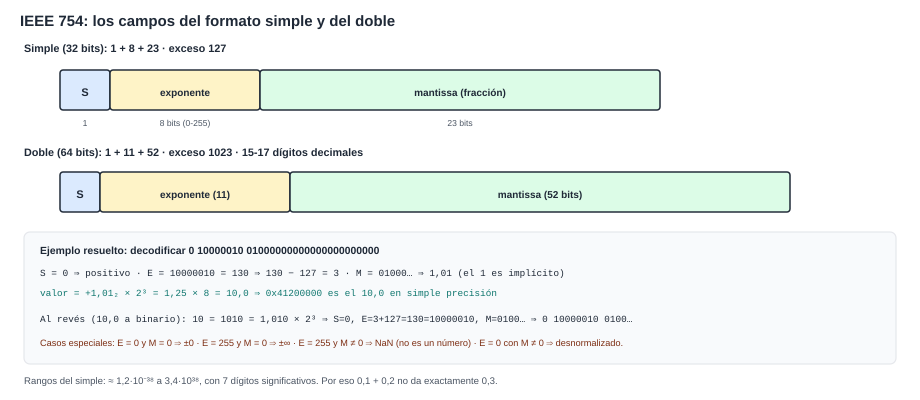

#### Los dos formatos

| | **Simple (binary32)** | **Doble (binary64)** |
|---|---|---|
| Signo | 1 | 1 |
| Exponente | **8** | **11** |
| Mantisa | **23** | **52** |
| Exceso (*bias*) | **127** | **1023** |
| Total | **32 bits** | **64 bits** |
| Precisión decimal | ~7 dígitos | ~16 dígitos |
| Menor normal | `2⁻¹²⁶ ≈ 1,18 × 10⁻³⁸` | `2⁻¹⁰²² ≈ 2,2 × 10⁻³⁰⁸` |
| Mayor | `≈ 3,4 × 10³⁸` | `≈ 1,8 × 10³⁰⁸` |
| Precisión de la mantisa | `2⁻²³ ≈ 1,19 × 10⁻⁷` | `2⁻⁵² ≈ 2,2 × 10⁻¹⁶` |

```
simple:   S EEEEEEEE MMMMMMMMMMMMMMMMMMMMMMM
          1    8               23
doble:    S EEEEEEEEEEE MMMMMMMMMMMMMMMMMMMMMMMMMMMMMMMMMMMMMMMMMMMM
          1       11                        52
```

#### Ejemplo resuelto 1: codificar −6,5 en simple

1. Magnitud: `6,5 = 110,1₂`.

2. **Normalizar:** `110,1 = 1,101 × 2²` ⇒ `M = 101`, `e = 2`.

3. `S = 1` (negativo).

4. Exponente con exceso: `E = 2 + 127 = 129 = 1000 0001₂`.

5. Mantisa a 23 bits: `101 0000 0000 0000 0000 0000`.

6. Ensamblar:
   ```
   1 10000001 10100000000000000000000
   = 1100 0000 1101 0000 0000 0000 0000 0000
   = C0D0 0000h   ✔
   ```

#### Ejemplo resuelto 2: decodificar `4120 0000h`

1. Binario: `0100 0001 0010 0000 0000 0000 0000 0000`.

2. `S = 0` (positivo) · `E = 1000 0010 = 130` · `M = 010 0…`.

3. Exponente real: `e = 130 − 127 = 3`.

4. Valor: `+1,010 × 2³ = 1010₂ =` **10** ✔

> [!tip] Los tres valores que conviene memorizar
> `3F80 0000h = 1,0` · `C0D0 0000h = −6,5` · `4120 0000h = 10,0`. Con esos tres se comprueba cualquier ejercicio de codificación/decodificación en segundos.

#### Los casos especiales (lo que distingue a IEEE 754)

| Exponente | Mantisa | Significado |
|---|---|---|
| Todos **0** | Todos **0** | **±0** (hay dos ceros, pero `+0 = −0` al comparar) |
| Todos **0** | **≠ 0** | **subnormal**: `0.M × 2⁻¹²⁶` (números diminutos, sin el 1 implícito) |
| **1 … 254** | cualquiera | número **normal** (`1.M`) |
| Todos **1** | Todos **0** | **±∞** (resultado de `1/0`, desborde) |
| Todos **1** | **≠ 0** | **NaN** (*not a number*): `0/0`, `∞ − ∞`, `√−1` |

> [!important] Por qué existen los subnormales
> Sin ellos habría un "**pozo**" entre 0 y el menor normal (`1,18 × 10⁻³⁸`): cualquier número menor sería 0. Los subnormales **gastan precisión** (menos bits significativos) para poder representar valores cada vez más chicos de forma **gradual** (*gradual underflow*).

#### El redondeo (también está normado)

| Modo | Regla |
|---|---|
| **Al más cercano, empates al par** (por defecto) | `2,5 → 2` y `3,5 → 4` |
| Hacia cero (truncar) | descarta |
| Hacia +∞ / −∞ | siempre para ese lado |

**Empates al par** se eligió porque **no acumula sesgo** al sumar millones de números.

#### Lo que hay que decir de la FPU

| Idea | Detalle |
|---|---|
| La FPU es una unidad **segmentada** | alinear / sumar / normalizar / redondear ⇒ **pipeline aritmético** (8.1) |
| Es **más lenta** que la ALU entera | más pasos y más bits |
| Usa **bits de guarda, redondeo y sticky** | para no perder precisión |
| Reemplazó a la FPU externa | el 8086 necesitaba el **8087**; hoy está en el chip |
| Explica `0,1 + 0,2 ≠ 0,3` | `0,1` no tiene representación exacta en binario (igual que `1/3` en decimal) |

> [!warning] Errores típicos
> - Usar exceso **128** en simple (es **127**).
> - Sumar el 1 implícito **dentro** de los 23 bits (no se guarda).
> - Decir que `−0` y `+0` son distintos al comparar (IEEE dice que son **iguales**).
> - Confundir **∞** (exponente todo 1, mantisa 0) con **NaN** (mantisa ≠ 0).
> - Creer que doble precisión "no tiene error" (tiene menos error, no cero).
> - Decir que el punto flotante es una representación exacta de los reales.

#### Figura del libro

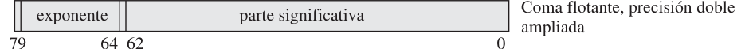

*Fig. 10.4 — Formatos de datos numéricos en el Pentium.* · Stallings, *Organización y arquitectura de computadores*, 7ª ed., p. 383.

#### Relacionado
[[9.4.1 Formato, normalización y operaciones]] · [[9.1.1 Complemento a 2 y desbordamiento]] · [[8.1.1 Etapas segmentadas y suma de vectores]] · [[Hardware aritmético (resumen)]] · [[Glosario — Unidad 9]]

## 9.5 Aritmética BCD

### 9.5.1 Suma decimal corregida

> [!abstract] En una frase
> En **BCD** cada dígito decimal ocupa **4 bits** (sólo `0000` a `1001` son válidos); al sumar con un sumador binario el resultado puede caer en los **6 códigos inválidos** (`1010`…`1111`) o pasar de 9 ⇒ se **suma `0110`** (6) y se **propaga acarreo** al dígito siguiente.

> [!note] Si la primera vez que ves esto
> Es como un **reloj de agujas** que en vez de pasar de 12 a 1 tuviera **seis horas de más**: cuando el resultado "se pasa" del 9, le das **un empujoncito de 6** para saltear los códigos que no existen y quede un dígito limpio. Los 6 salteados son justo los seis códigos inválidos: `1010, 1011, 1100, 1101, 1110, 1111`.

#### El +6

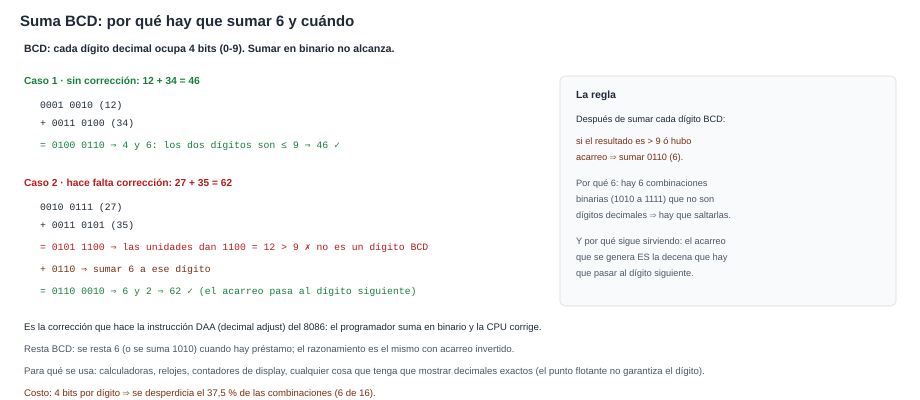

#### Por qué hace falta la corrección
```
BCD: 4 bits por dígito  ⇒  16 combinaciones  ⇒  sólo 10 sirven
válidos:   0000 0001 0010 0011 0100 0101 0110 0111 1000 1001   (0-9)
inválidos: 1010 1011 1100 1101 1110 1111                        (10-15)
```
El sumador binario **no sabe** de decimales: `8 + 5` le da `1101` (=13, inválido). Hay que corregir.

#### La regla (las dos condiciones)
```
si (resultado > 1001)  o  (hubo acarreo de salida)  ⇒  sumar 0110  y propagar acarreo
```

| Suma | Binario | ¿> 9? | Corrección | Resultado BCD |
|---|---|---|---|---|
| `4 + 3` | `0111` (7) | no | — | **7** |
| `8 + 5` | `1101` (13) | **sí** | `1101 + 0110 = 1 0011` | **3**, acarreo **1** ⇒ **13** |
| `9 + 9` | `1 0010` (18) | acarreo + `0010` | `0010 + 0110 = 1000` | **8**, acarreo **1** ⇒ **18** |
| `9 + 1` | `1010` (10) | **sí** | `1010 + 0110 = 1 0000` | **0**, acarreo **1** ⇒ **10** |

> [!important] Por qué exactamente 6
> Porque hay **6** códigos inválidos (`2⁴ − 10 = 6`). Sumar 6 hace que el dígito "salte" la zona prohibida y su acarreo salga **en el bit 4**, que es justo lo que hay que propagar al dígito siguiente.

#### Ejemplo resuelto: 47 + 38 = 85 (BCD empaquetado)
```
  A = 0100 0111   (4 7)
  B = 0011 1000   (3 8)
```
**Dígito de unidades:**
```
  0111 + 1000 = 1111   (15, inválido: > 1001)
  1111 + 0110 = 1 0101  ⇒ dígito 5, acarreo 1
```
**Dígito de decenas** (con el acarreo que entra):
```
  0100 + 0011 + 1 = 1000   (8, válido)  ⇒ no se corrige
```
**Resultado:** `1000 0101` = **85** ✔ (`47 + 38 = 85`)

**Verificación:** `47 + 38 = 85` ✔ · el acarreo se propagó **una vez** ✔ · ningún dígito quedó inválido ✔

#### La resta BCD

| Método | Cómo |
|---|---|
| **Complemento a 10** | `A − B = A + (10000 − B)` en 4 bits, con corrección |
| **Complemento a 9 y corregir** | complementar dígito a dígito y sumar 1 al final |
| **Regla práctica** | si al restar **hay préstamo**, se **resta 6** al resultado (el espejo de la suma) |

El 8086 tiene instrucciones para esto: **`DAA`** (*decimal adjust after addition*) y **`DAS`** (after subtraction) ajustan `AL` justamente con esta regla.

#### Dónde se usa

| Lugar | Por qué BCD y no binario |
|---|---|
| **Sistemas financieros / facturación** | el decimal es **exacto**: `0,10 + 0,20 = 0,30` sin errores de punto flotante |
| **Contadores de display** | coinciden con los 7 segmentos |
| **Relojes, instrumentos** | se leen dígito a dígito |
| **8086 / mainframes** | instrucciones BCD empaquetadas (`DAA`, `DAS`, `AAA`) |

**Costo:** se desperdicia el **37,5 %** del espacio (`6 de 16` códigos no se usan) y la suma necesita un **corrector** (detector de `>9` o acarreo + un sumador de 4 bits más).

> [!warning] Errores típicos
> - Sumar 6 **siempre** (sólo cuando `> 9` **o** hubo acarreo).
> - Olvidar **propagar** el acarreo al dígito siguiente.
> - Aplicar la corrección **antes** de sumar en vez de **después**.
> - Confundir BCD (`0100 0111` = 47) con binario (`0100 0111` = 71).
> - Decir que BCD es "más rápido": es más **lento** y más caro; se usa por **exactitud decimal**.

#### Relacionado
[[9.4.2 IEEE 754]] · [[9.1.1 Complemento a 2 y desbordamiento]] · [[4.2.2 Los 16 opcodes octales]] · [[Hardware aritmético (resumen)]] · [[00 Tema 9.5 — índice]] · [[Glosario — Unidad 9]]

---

## Al terminar la unidad

- Una pasada rápida: [[00 Síntesis — Unidad 9]].

- Los subtemas por separado: [[00 Unidad 9 — temas y subtemas]].

- Seguir de corrido: [[00 Materia completa (las 10 unidades en un archivo)]].

- Practicar: [[Banco de preguntas del final]] · [[Autoevaluación]] · [[Prácticas resueltas]].
