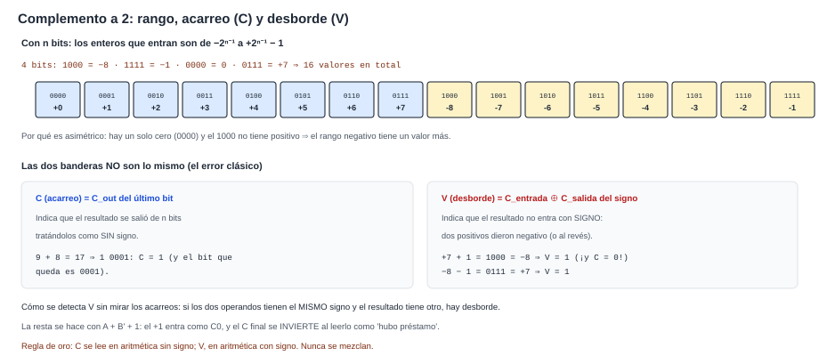
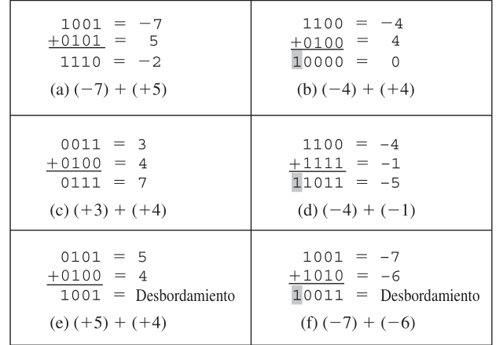
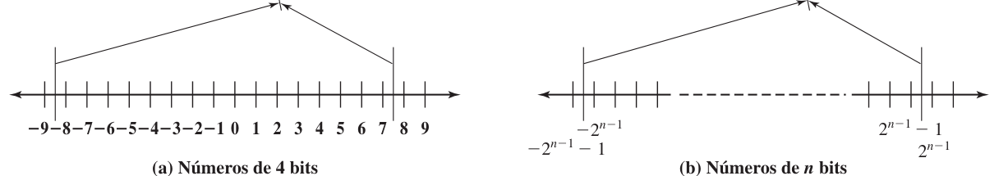

# 9.1.1 Complemento a 2 y desbordamiento

> [!abstract] En una frase
> En **complemento a 2** la resta es `A + B' + 1` ⇒ **un solo sumador** hace suma y resta, sin doble cero; el
> **desbordamiento** (`V`) ocurre cuando el resultado **no entra** y se detecta comparando los **dos** acarreos del
> bit de signo: `V = Cin ⊕ Cout`.

> [!note] Si la primera vez que ves esto
> Con magnitud y signo hay que **decidir** antes de operar ("¿signos iguales? sumo; distintos, resto y me quedo con
> el signo del mayor"). Con complemento a 2 **no se decide nada**: se suma siempre, y el hardware de control queda
> en una línea (`SUB`).

## Rango y banderas



## Las cuatro representaciones (n bits)

| Representación | Rango | Negativo de `+x` | Problema |
|---|---|---|---|
| **Magnitud y signo** | `−(2ⁿ⁻¹−1) … +(2ⁿ⁻¹−1)` | cambiar el bit de signo | **dos ceros** (`+0` y `−0`) |
| **Complemento a 1** | `−(2ⁿ⁻¹−1) … +(2ⁿ⁻¹−1)` | negar todos los bits | dos ceros; la resta pide **acarreo circular** |
| **Complemento a 2** | `−2ⁿ⁻¹ … +(2ⁿ⁻¹−1)` | negar todo y **sumar 1** | un número negativo **sin positivo** (`−128` en 8 bits) |
| **Sin signo** | `0 … 2ⁿ−1` | no aplica | — |

| n | Rango en complemento a 2 | Valor "raro" |
|---|---|---|
| 4 | **−8 … +7** | `1000` = −8 (no hay +8) |
| 8 | **−128 … +127** | `10000000` = −128 |
| 16 | −32 768 … +32 767 | — |
| 32 | −2 147 483 648 … +2 147 483 647 | — |

> [!important] Por qué complemento a 2 y no las otras
> 1. **Un solo circuito:** `A − B = A + B' + 1` (XOR en las entradas de `B` + acarreo de entrada = `SUB`).
> 2. **Un solo cero:** no hay que corregir `+0 = −0`.
> 3. **El acarreo de salida no se descarta con "vuelta"**: se ignora y listo.
> 4. Es la que usan **todas** las CPUs reales (y la BLUE, y el 8086).

## La resta con el mismo sumador
```
        B3 B2 B1 B0
          │  │  │  │
        ┌─┴──┴──┴──┴─┐
  SUB ─►│ XOR ×4     │   SUB = 0 ⇒ pasa B (suma)
        └─┬──┬──┬──┬─┘   SUB = 1 ⇒ pasa B' (resta)
          ▼  ▼  ▼  ▼
        ┌───────────┐
   SUB ─┤  SUMADOR  │──► S (resultado)
        └───────────┘       + C (acarreo de salida) + V (desbordamiento)
```
`A − B` se hace con `A + B' + SUB`, donde `SUB` **es** el acarreo de entrada `C0`.

## El desbordamiento (signed) vs el acarreo (unsigned)

| Concepto | Qué significa | Cómo se detecta |
|---|---|---|
| **`C`** (carry) | el resultado **sin signo** no entra en `n` bits | acarreo de **salida** del MSB |
| **`V`** (overflow) | el resultado **con signo** no entra | `V = Cin(MSB) ⊕ Cout(MSB)` |
| **`Z`** | resultado cero | todas las salidas en 0 |
| **`S`** (signo) | bit de signo del resultado | el MSB |

> [!example] Los dos casos, con 4 bits
> **Desbordamiento con signo:** `0111 + 0001`
> ```
>    0111   (+7)
>  + 0001   (+1)
>  ────────
>    1000   (−8)  ← ¡7 + 1 no puede dar −8!
> ```
> `Cin(MSB) = 1`, `Cout(MSB) = 0` ⇒ **`V = 1`**. El acarreo de salida `C = 0`.
>
> **Acarreo sin signo:** `1111 + 0001`
> ```
>    1111   (15)
>  + 0001   ( 1)
>  ────────
>  1 0000   (16 no entra en 4 bits)
> ```
> `C = 1`, pero `Cin(MSB) = 1` y `Cout = 1` ⇒ **`V = 0`**: como **con signo** el resultado es correcto
> (`1111` = −1, `0001` = +1, suma `0000` = 0 ✔).

**Regla mnemotécnica:** si los dos operandos tienen **el mismo signo** y el resultado tiene **signo distinto** ⇒
overflow. `+` con `+` da `−` ⇒ mal.

## Ejemplo resuelto completo
> "Calcule `A − B` con `A = 0110 (+6)` y `B = 1001 (−7)` en 4 bits, e indique `C`, `V` y `Z`."

1. `B' = 0110`; `B' + 1 = 0111` (complemento a 2 de `B` = `+7` ✔ porque `−(−7) = +7`).
2. `SUB = 1` ⇒ se suman `A + B' + 1 = 0110 + 0110 + 1`:
   ```
      0110
   +  0110
   +     1
   ────────
      1101
   ```
3. Resultado `1101` = **−3**. Verificación decimal: `6 − (−7) = 13`, que **no entra** en 4 bits con signo
   (máximo +7) ⇒ **tiene que haber overflow**.
4. Flags: `Cin(MSB)` = acarreo que entra al bit 3 → sumando `0110+0110+1`: bit2 genera acarreo (1+1+carry…), el
   acarreo hacia el bit 3 es **1**; `Cout(MSB)` = **0** ⇒ **`V = 1`** ✔. `C = 0`, `Z = 0`.
5. **La cuenta correcta con 5 bits** habría dado `01101 = +13` ✔: el resultado existe, no entraba.

> [!warning] Errores típicos
> - Detectar el overflow mirando **sólo** el acarreo de salida (`C` no es `V`).
> - Decir que `−(−8)` en 4 bits da `+8` (no entra: da `−8`; es el caso borde del complemento a 2).
> - Olvidar el `+1` al complementar (`B'` no es `−B`; `B' + 1` sí).
> - Confundir `Z` con `V`: `Z` mira el resultado, `V` mira los acarreos del MSB.
> - Decir que la magnitud y signo "es más simple": lo es para el humano, **no** para el hardware.

## Figura del libro



*Fig. 9.3 — Suma de números representados en complemento a dos.* · Stallings, *Organización y arquitectura de computadores*, 7ª ed., p. 333.



*Fig. 9.5 — Descripción geométrica de los enteros en complemento a dos.* · Stallings, *Organización y arquitectura de computadores*, 7ª ed., p. 335.

## Relacionado
[[9.1.2 Acarreo anticipado (G y P)]] · [[3.2.2 Operaciones aritméticas, lógicas y flags]] ·
[[1.5.2 Sumador de n bits y resta en complemento a 2]] · [[Hardware aritmético (resumen)]] · [[1.5.1 Semisumador y sumador completo]]
