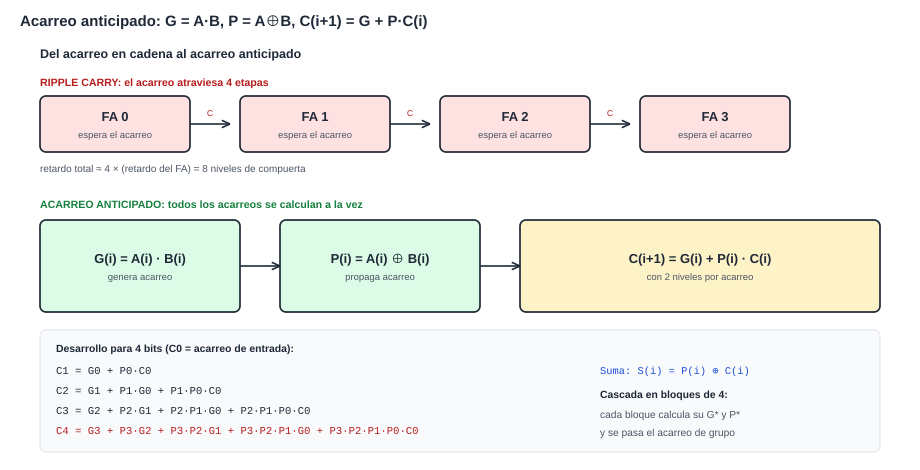
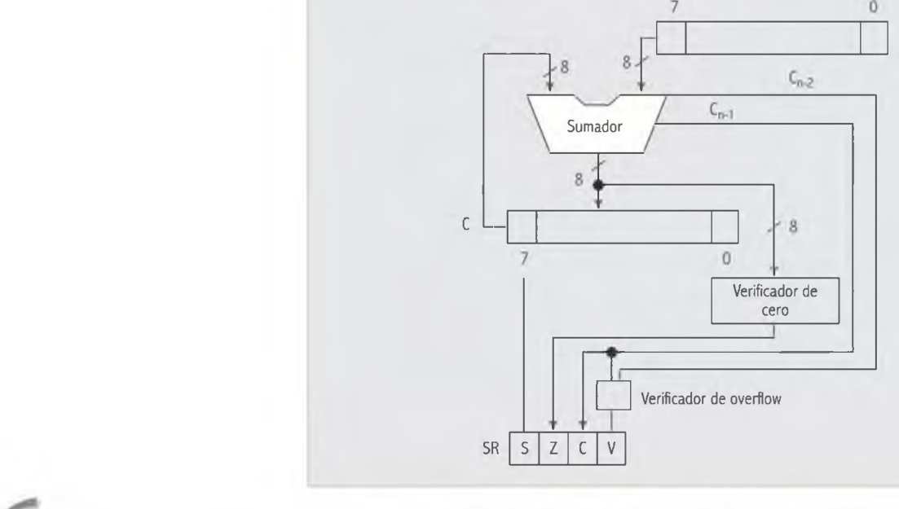
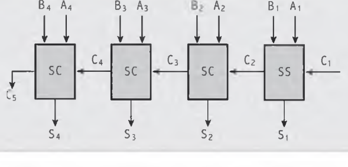

# 9.1.2 Acarreo anticipado (G y P)

> [!abstract] En una frase
> En un sumador de **acarreo en cadena** (*ripple carry*) el bit `i` no puede sumar hasta que llegó el acarreo del
> `i−1`: el retardo crece **linealmente** con los bits. Con **acarreo anticipado** (CLA) cada posición calcula su
> acarreo **en paralelo** usando **`G = A·B`** (genera) y **`P = A⊕B`** (propaga).

> [!note] Si la primera vez que ves esto
> Es el **efecto dominó** de una fila de personas pasándose un balde: el último no tiene agua hasta que le llegue.
> El acarreo anticipado es ponerle a cada uno **su propia manguera**, calculada con dos datos que ya tiene: si él
> y su vecino generan agua (`G`) o si la dejan pasar (`P`).

## El problema del ripple carry
```
FA0 ──C1──► FA1 ──C2──► FA2 ──C3──► FA3 ──► Cout
```
Cada `FA` tarda **2 niveles** de compuerta (un XOR de 3 entradas o dos XOR + el acarreo `AB + Cin(A⊕B)`).
Para `n = 32`: `32 × 2 =` **64 niveles** de retardo ⇒ **limita la frecuencia del reloj**.

## Las dos señales mágicas



| Señal | Fórmula | Significado |
|---|---|---|
| **`G(i)`** (generate) | `A(i) · B(i)` | **genera** acarreo por sí mismo (1+1) |
| **`P(i)`** (propagate) | `A(i) ⊕ B(i)` | **propaga** el acarreo que le llega |
| **Acarreo** | `C(i+1) = G(i) + P(i)·C(i)` | la ecuación de recurrencia |
| **Suma** | `S(i) = P(i) ⊕ C(i)` | la suma ya no depende del acarreo (sólo del `P` y `C`) |

> [!important] La idea en una frase
> `C(i+1) = G(i) + P(i)·C(i)` dice: **"hay acarreo si lo genero yo, o si me llega y lo dejo pasar"**. Y esa
> expresión se puede **expandir** hasta `C0` ⇒ ningún acarreo depende de otro acarreo, sólo de `G`, `P` y `C0`.

## Las ecuaciones expandidas (4 bits)
```
C1 = G0 + P0·C0
C2 = G1 + P1·G0 + P1·P0·C0
C3 = G2 + P2·G1 + P2·P1·G0 + P2·P1·P0·C0
C4 = G3 + P3·G2 + P3·P2·G1 + P3·P2·P1·G0 + P3·P2·P1·P0·C0
```
Todos los `C` se calculan **a la vez**, en **3 niveles** de compuerta (una AND de 5 entradas + una OR), en lugar de
`4 × 2 = 8`.

| Sumador | Niveles de retardo (4 bits) | 32 bits |
|---|---|---|
| **Ripple carry** | 8 | **64** |
| **CLA de 4 bits** | ~4 (G, P, C, S) | — |
| **CLA en bloques de 4** | 4 + 2 × 8 bloques ≈ 20 | ~20 |

## Ejemplo resuelto (con los `G` y `P`)
> "Sume `A = 1011` y `B = 0110` con acarreo anticipado de 4 bits y `C0 = 0`. Muestre todos los `G`, `P` y `C`."

| i | A | B | `G = A·B` | `P = A⊕B` |
|---|---|---|---|---|
| 0 | 1 | 0 | **0** | **1** |
| 1 | 1 | 1 | **1** | **0** |
| 2 | 0 | 1 | **0** | **1** |
| 3 | 1 | 0 | **0** | **1** |

```
C1 = G0 + P0·C0 = 0 + 1·0 = 0
C2 = G1 + P1·C1 = 1 + 0·0 = 1
C3 = G2 + P2·C2 = 0 + 1·1 = 1
C4 = G3 + P3·C3 = 0 + 1·1 = 1
```
```
S0 = P0 ⊕ C0 = 1 ⊕ 0 = 1
S1 = P1 ⊕ C1 = 0 ⊕ 0 = 0
S2 = P2 ⊕ C2 = 1 ⊕ 1 = 0
S3 = P3 ⊕ C3 = 1 ⊕ 1 = 0
C4 = 1  ⇒  resultado = 1 0001
```
**Verificación decimal:** `1011 = 11`, `0110 = 6` ⇒ `17 = 10001` ✔ (5 bits: `S3..S0` = `0001` y `C4` = 1).

## Cómo se escala: CLA en bloques
Con 32 bits no se hace una AND de 33 entradas: se agrupa en **bloques de 4** y cada bloque calcula su
**genera de grupo** `G*` y **propaga de grupo** `P*`:
```
G* = G3 + P3·G2 + P3·P2·G1 + P3·P2·P1·G0      (¿el bloque genera?)
P* = P3·P2·P1·P0                              (¿el bloque propaga?)
```
Con esos dos valores, la unidad de anticipación **entre** bloques funciona igual que dentro de un bloque.

| Estrategia | Retardo | Área |
|---|---|---|
| Ripple | `O(n)` | mínima |
| **CLA en bloques** | `O(n/k)` | media (lo normal en una ALU real) |
| Árbol de anticipación (*lookahead* completo) | `O(log n)` | grande |

> [!warning] Errores típicos
> - Confundir `G` y `P`: **G genera** (`A·B`), **P propaga** (`A⊕B`, ¡es un **XOR**, no un OR!).
> - Usar `P = A + B` en lugar de `A ⊕ B` (funciona para el acarreo, pero **rompe** la suma `S = P ⊕ C`).
> - Decir que el CLA **elimina** el retardo del acarreo: lo reduce de `O(n)` a `O(n/k)` o `O(log n)`.
> - Olvidar el acarreo de entrada `C0` en las expresiones (es el que permite restar).
> - Creer que el CLA es más "barato": gasta **más compuertas** por la velocidad.

## Figura del libro



*Fig. 4.1 — Esquema de registros para la suma de 8 bits, con el acarreo serie y las banderas S, Z, C y V.* · Quiroga, *Arquitectura de computadoras*, p. 100.

> [!tip] Qué mirar
> El acarreo va pasando de bloque en bloque y las banderas se actualizan al final: `C` es el acarreo de salida y `V` el desborde con signo.



*Fig. 5.16 — Sumador binario paralelo con acarreo serie (SS y SC en cadena).* · Quiroga, *Arquitectura de computadoras*, p. 126.

> [!tip] Qué mirar
> El problema que resuelve el acarreo anticipado: `C4` no puede empezar hasta que termina `C3`, y así hasta `C1`. Con `n` bits el retardo crece con `n`; con lógica `G`/`P` todos los acarreos se calculan en dos niveles.

## Relacionado
[[9.1.1 Complemento a 2 y desbordamiento]] · [[3.2.1 Estructura, G-P y señales de selección]] ·
[[1.5.1 Semisumador y sumador completo]] · [[Hardware aritmético (resumen)]] · [[TP5 Sumadores]] · [[Glosario — Unidad 9]]
