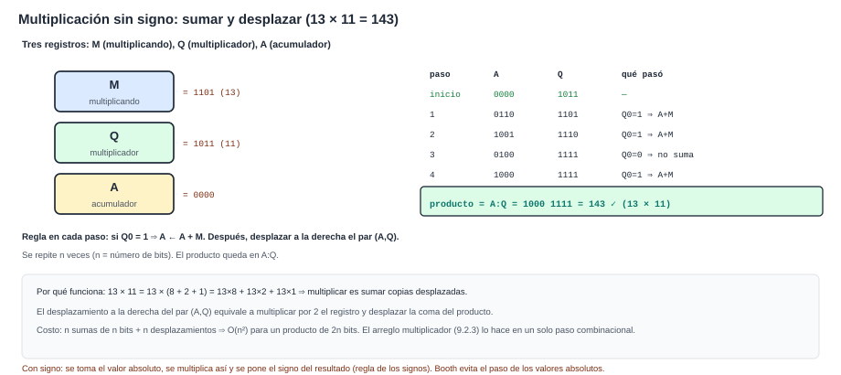

# 9.2.1 Sumas y desplazamientos

> [!abstract] En una frase
> Multiplicar a mano es sumar el multiplicando **desplazado** por cada bit del multiplicador que vale 1. El
> hardware lo hace con **un sumador, dos registros y un desplazamiento**: `n` pasos para `n` bits (el doble ancho en
> el resultado).

> [!note] Si la primera vez que ves esto
> `13 × 11` no es más que `13` + `13×2` + `13×8` = `13 + 26 + 104 = 143`. Cada "×2" es **un desplazamiento a la
> izquierda**; cada suma parcial es **un `ADD`**. Todo el algoritmo es eso.

## Sumar y desplazar



## El algoritmo (sin signo, n bits)

```
M = multiplicando     Q = multiplicador     A = 0 (acumulador)     C = 0 (bit que se pierde)

repetir n veces:
    1. si Q0 = 1  ⇒  A ← A + M        (si no, nada)
    2. desplazar a la derecha (C, A, Q) en bloque de 1 bit
resultado = A (parte alta) · Q (parte baja)
```

| Registro | Ancho | Para qué |
|---|---|---|
| **`M`** | `n` | multiplicando (fijo) |
| **`Q`** | `n` | multiplicador; se va convirtiendo en la **parte baja** del producto |
| **`A`** | `n` | acumulador; termina siendo la **parte alta** |
| **`C`** | 1 | guarda el bit que sale de `A` al desplazar |

**Producto de doble ancho:** `2n` bits (`A` `Q`). Por eso una `MUL` de 8 bits da 16.

## Ejemplo resuelto: 13 × 11
`M = 1101` (13) · `Q = 1011` (11) · `A = 0000` · `C = 0`. Cuatro iteraciones:

| Iter | `Q0` | Acción | `A` (con el `C` en el MSB) | Desplazar `(C,A,Q)` ⇒ `A` / `Q` |
|---|---|---|---|---|
| 1 | **1** | `A ← A + M` = `1101`, `C = 0` | `0 1101` | `0110` / `1101` |
| 2 | **1** | `A ← A + M` = `0110 + 1101 = 1 0011` ⇒ `A = 0011`, **`C = 1`** | `1 0011` | `1001` / `1110` |
| 3 | **0** | no suma | `0 1001` | `0100` / `1111` |
| 4 | **1** | `A ← A + M` = `0100 + 1101 = 1 0001` ⇒ `A = 0001`, **`C = 1`** | `1 0001` | `1000` / `1111` |

**Producto = `A Q` = `1000 1111` = 143** ✔

### La verificación por productos parciales (la misma cuenta, a mano)
```
        1101          (13)
      × 1011          (11)
      ──────
        1101          ← bit 0 = 1  ⇒  13
       1101·          ← bit 1 = 1  ⇒  26
      0000··          ← bit 2 = 0  ⇒   0
     1101···          ← bit 3 = 1  ⇒ 104
     ────────
    10001111          = 143 ✔
```
| Comprobación | Cuenta |
|---|---|
| Binario | `10001111` = `128 + 8 + 4 + 2 + 1 = 143` ✔ |
| Decimal | `13 × 11 = 143` ✔ |
| Productos parciales | `13 + 26 + 0 + 104 = 143` ✔ |

> [!important] El detalle que se olvida
> El **`C`** no es decorativo: cuando la suma desborda los `n` bits del acumulador, ese 1 **entra al `A` al
> desplazar** (iteraciones 2 y 4 de la tabla). Si se descarta, el producto sale mal. En cambio el `C` **anterior**
> siempre vuelve a 0 después del desplazamiento.

## Tiempo
| Implementación | Ciclos | Hardware |
|---|---|---|
| Sumas y desplazamientos | **`n`** (más el llenado) | 1 sumador de `n` bits + 2 registros |
| `n` bits, `n = 32` | 32 ciclos | — |
| Booth | `n` (pero menos sumas) | sumador/restador + lógica |
| Arreglo | 0 (combinacional) | `n²` sumadores |

## Con signo: la vía simple
| Método | Cómo |
|---|---|
| **Magnitud y signo** | `signo = sA ⊕ sB`, multiplicar las **magnitudes**, aplicar el signo |
| **Complemento a 2 (sin Booth)** | convertir a positivo, multiplicar, y **negar** si el signo es negativo |
| **Booth** (9.2.2) | opera directo sobre complemento a 2 |

> [!warning] Errores típicos
> - Quedarse con `n` bits de producto (son **`2n`**: `8 × 8 ⇒ 16`).
> - Mezclar desplazamiento del acumulador con desplazamiento del multiplicando **en la misma tabla**.
> - Olvidar que el último paso **no necesita** sumar si el bit ya se procesó.
> - Signar el resultado con `sA · sB` (es **XOR**: `1·1 = 0`, o sea `− × − = +`).
> - Decir que la multiplicación se hace "en un ciclo" en un procesador común (tarda `n` o usa un arreglo).

## Relacionado
[[9.2.2 Algoritmo de Booth]] · [[9.2.3 Arreglo multiplicador]] · [[9.1.2 Acarreo anticipado (G y P)]] ·
[[Hardware aritmético (resumen)]] · [[2.2.1 Registros PIPO y SISO]]
