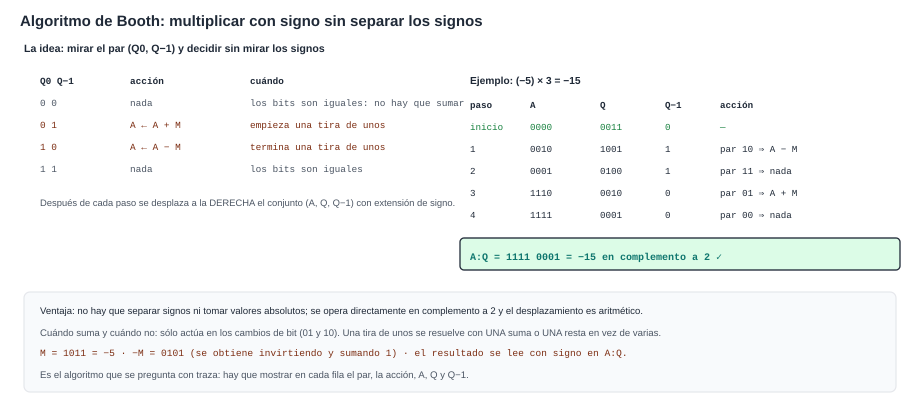
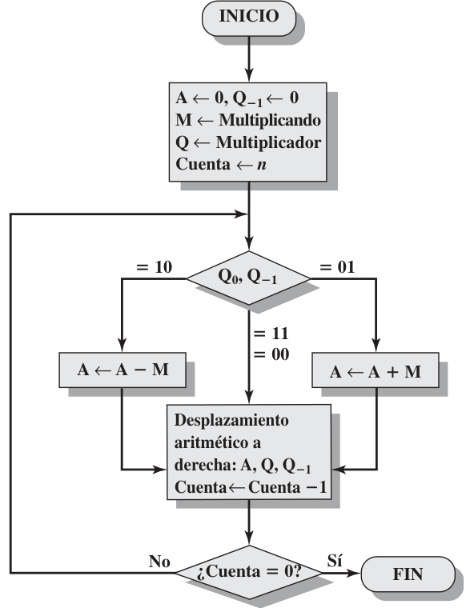
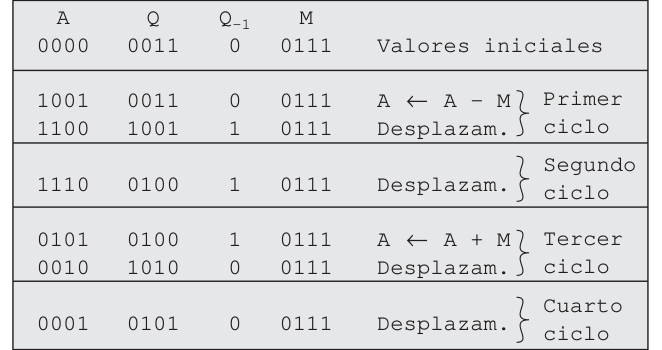

# 9.2.2 Algoritmo de Booth

> [!abstract] En una frase
> Booth **recodifica el multiplicador** mirando **pares** de bits `(Q0, Q−1)`: `01` ⇒ **sumar** `M`, `10` ⇒
> **restar** `M`, `00`/`11` ⇒ **sólo desplazar**. Multiplica **números con signo en complemento a 2 sin separar el
> signo**, y hace **menos sumas** cuando el multiplicador tiene rachas largas de 1.

> [!note] Si la primera vez que ves esto
> En vez de sumar "por cada 1", Booth agrupa: una racha de unos `0111` = `1000 − 0001` ⇒ un **+** y un **−** en vez
> de tres sumas. Es la misma idea que `7 = 8 − 1`: escribir el número con menos dígitos.

## Booth, con traza

## La regla de recodificación

| `(Q0, Q−1)` | Operación | Por qué |
|---|---|---|
| `00` | **nada** | en medio de una racha de ceros |
| `01` | `A ← A + M` | **empieza** una racha de unos |
| `10` | `A ← A − M` | **termina** una racha de unos |
| `11` | **nada** | en medio de una racha de unos |

Después de cada paso: **desplazamiento aritmético a la derecha** de `(A, Q, Q−1)` — el signo se replica.

**Hardware:** un sumador/**restador** (`M` o `M'`+1), lógica de recodificación (un XOR y poco más) y el registro
`Q−1` de 1 bit.

## Ejemplo resuelto: 6 × (−3)
`M = 0110` (+6) · `−M = 1010` · `Q = 1101` (−3) · `A = 0000` · `Q−1 = 0`.

| Iter | `(Q0, Q−1)` | Operación | `A` | `Q` | `Q−1` |
|---|---|---|---|---|---|
| inicio | — | — | `0000` | `1101` | `0` |
| 1 | `1 0` | **`A ← A − M`** = `0000 + 1010 = 1010` | `1010` → `**1101**` | `1101` → `**0110**` | `1` |
| 2 | `0 1` | **`A ← A + M`** = `1101 + 0110 = 1 0011` → `0011` | `0011` → `**0001**` | `0110` → `**1011**` | `0` |
| 3 | `1 0` | **`A ← A − M`** = `0001 + 1010 = 1011` | `1011` → `**1101**` | `1011` → `**1101**` | `1` |
| 4 | `1 1` | **nada** | `1101` → `**1110**` | `1101` → `**1110**` | `1` |

**Producto = `A Q` = `1110 1110`.** Verificación: `1110 1110` como 8 bits con signo =
`256 − 18 =` **−18** ✔ y `6 × (−3) = −18` ✔

> [!important] Las dos comprobaciones que no fallan
> 1. **Decimal:** el producto de 8 bits con signo debe dar el producto real.
> 2. **Cantidad de sumas:** en el ejemplo fueron **2** (`−M` y `+M`) en lugar de 3 (los tres unos de `1101`).

## Cuándo gana y cuándo no

| Multiplicador | Sumas con "sumas y desplazamientos" | Sumas con Booth |
|---|---|---|
| `00001111` (racha de 4) | 4 | **2** |
| `01010101` (alternado) | 4 | **8** (¡peor!) |
| `11111111` (−1) | 8 (con signo, imposible sin Booth) | **1** |
| `1101` (−3) | — | **2** |

**Conclusión:** Booth **no siempre es más rápido**, pero **siempre funciona con signo** y en promedio ayuda (las
rachas son comunes en datos reales).

## Variantes
| Variante | Idea |
|---|---|
| **Booth de 2 bits** (radix-4) | mira 3 bits ⇒ la mitad de iteraciones (`n/2`); procesa dígitos `0, ±1, ±2` |
| **Booth de 3 bits** (radix-8) | `n/3` iteraciones; usa también `±3M`, `±4M` |
| **Arreglo multiplicador con Booth** | `n²` celdas con celdas de Booth ⇒ combinacional y con signo |

En los procesadores reales se usa **radix-4**, porque reduce las iteraciones sin complicar demasiado el hardware.

> [!warning] Errores típicos
> - Decir que Booth sirve **sólo** para números sin signo (es justo al revés: su gracia es el **signo**).
> - Invertir la regla: `01` **suma** (empieza la racha), `10` **resta**.
> - Usar **desplazamiento lógico** en vez de **aritmético** (se pierde el signo).
> - Olvidar el registro `Q−1` (sin él no hay par que mirar).
> - Prometer que Booth siempre hace menos operaciones.

## Figura del libro

*Fig. 9.12 — Algoritmo de Booth para la multiplicación en complemento a dos.* · Stallings, *Organización y arquitectura de computadores*, 7ª ed., p. 340.

*Fig. 9.13 — Ejemplo de aplicación del algoritmo de Booth (7 3).* · Stallings, *Organización y arquitectura de computadores*, 7ª ed., p. 341.

## Relacionado
[[9.2.1 Sumas y desplazamientos]] · [[9.2.3 Arreglo multiplicador]] · [[9.1.1 Complemento a 2 y desbordamiento]] ·
[[Hardware aritmético (resumen)]] · [[Glosario — Unidad 9]]
