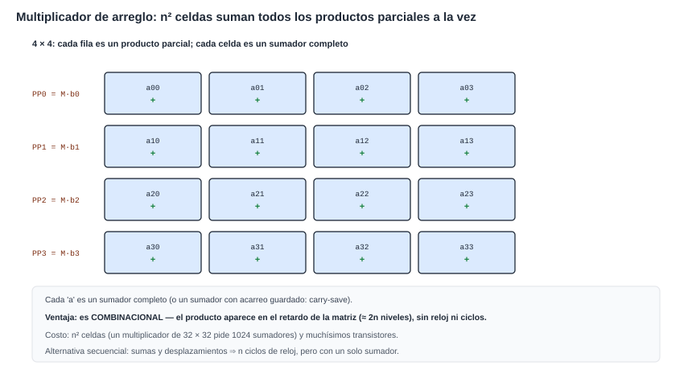

# 9.2.3 Arreglo multiplicador

> [!abstract] En una frase
> El **multiplicador de arreglo** pone **todos** los productos parciales en una matriz de sumadores y los suma en
> paralelo: es **combinacional** (no tiene ciclos, el producto aparece con el retardo de la matriz) a cambio de
> **`n²` celdas**.

> [!note] Si la primera vez que ves esto
> Es pasar de "cocinar de a un plato" (sumas y desplazamientos, `n` ciclos) a **una cocina con `n²` hornallas**
> donde todo se hace a la vez. Rapidísimo, carísimo, y cabe sólo si hay lugar en el chip.

## La matriz



```
     M3 M2 M1 M0
  ×  Q3 Q2 Q1 Q0
  ─────────────────
  PP0 = M · Q0      (todo o nada, según Q0)
  PP1 = M · Q1  ←   un lugar a la izquierda
  PP2 = M · Q2  ←←
  PP3 = M · Q3  ←←←
  ─────────────────
  P7 … P0   (8 bits)
```
Cada fila se suma a la acumulación anterior con una fila de **sumadores completos**; el acarreo baja a la fila
siguiente. Con `n = 4` son **16 celdas**; con `n = 32`, **1 024**.

| Implementación | Retardo | Área | Reloj |
|---|---|---|---|
| Sumas y desplazamientos | `n` ciclos | 1 sumador | sí |
| **Arreglo** | ≈ `2n` niveles de compuerta | **`n²`** sumadores | **no** (combinacional) |
| Arreglo con **carry-save** | ≈ `n` niveles (más rápido) | `n²` + registros | no |
| Arreglo **segmentado** (pipelined) | 1 producto por ciclo (después del llenado) | `n²` + registros de etapa | sí |

> [!important] El compromiso clásico
> El arreglo cambia **tiempo por área**: hace en nanosegundos lo que el secuencial hace en `n` ciclos, pero con
> `n²` sumadores. Por eso los procesadores reales usan **arreglos segmentados**: un arreglo (área) partido en etapas
> (frecuencia), y así sacan **un producto por ciclo** con un reloj alto.

## Cómo se reduce el área
| Técnica | Idea |
|---|---|
| **Carry-save** | en vez de propagar el acarreo en cada fila, se **guarda** y se propaga al final (sumador final con CLA) |
| **Booth radix-4** | la mitad de filas (productos parciales) ⇒ casi la mitad de celdas |
| **Árbol de Wallace / Dadda** | suma los productos parciales en `log n` niveles en vez de `n` |
| **Multiplicador secuencial** | volver al 9.2.1 cuando el área importa más que la velocidad (microcontroladores) |

## Dónde se ve
| Lugar | Por qué |
|---|---|
| **FPU** (punto flotante) | multiplicar mantisas es esto; de ahí la Unidad 9.4 |
| **GPU** | miles de multiplicadores chicos en paralelo (SIMD) |
| **DSP / filtros** | un `MAC` (multiplicar-acumular) por ciclo |
| **Microcontroladores baratos** | **no** tienen arreglo: usan sumas y desplazamientos |

> [!warning] Errores típicos
> - Decir `n` celdas (son **`n²`**).
> - Decir que el arreglo "tiene `n` ciclos" (es **combinacional**: no tiene ciclos; su límite es el retardo).
> - Olvidar el **producto de doble ancho** (`2n` bits).
> - Confundir *carry-save* (no propaga el acarreo hasta el final) con *carry-lookahead* (lo calcula antes).
> - Creer que "más rápido" siempre gana: el área y el consumo son el otro lado del compromiso.

## Relacionado
[[9.2.1 Sumas y desplazamientos]] · [[9.2.2 Algoritmo de Booth]] · [[9.1.2 Acarreo anticipado (G y P)]] ·
[[9.4.1 Formato, normalización y operaciones]] · [[Hardware aritmético (resumen)]]
