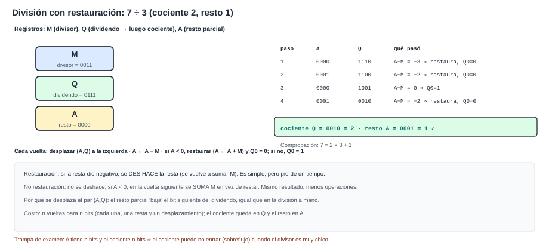
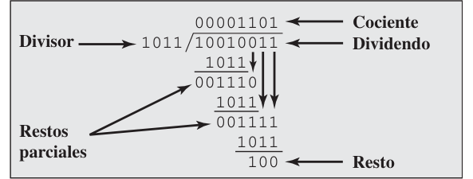
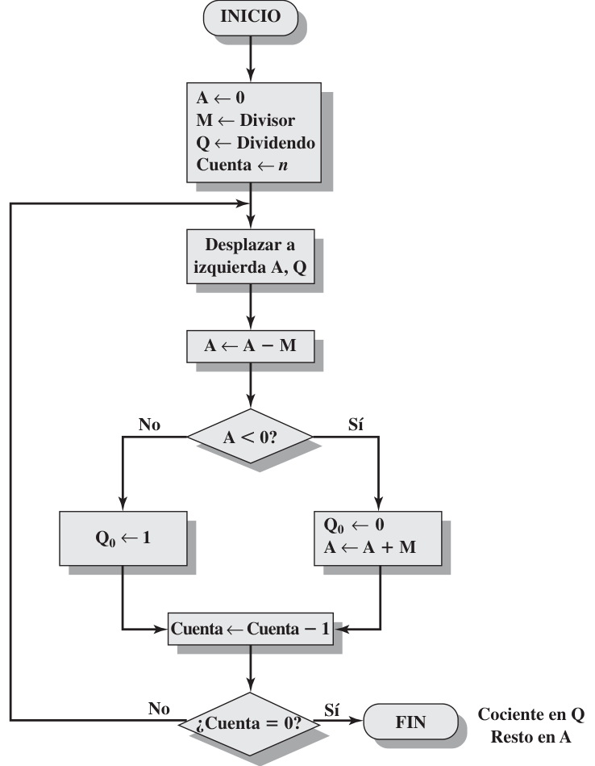

# 9.3.1 Restauración y no restauración

> [!abstract] En una frase
> Dividir es **restar y desplazar** `n` veces: el método **restaurativo** prueba `A − M`, y si da **negativo** lo
> **deshace** (`A + M`) poniendo `0` en el cociente; el **no restaurativo** deja el resto negativo y **compensa** en
> la iteración siguiente, ahorrando la mitad de las operaciones.

> [!note] Si la primera vez que ves esto
> Es la división larga del colegio: "¿cuántas veces entra el 3 en el 7?" ⇒ tanteás, si te pasaste **volvés atrás**.
> El restaurativo vuelve atrás; el no restaurativo **no** vuelve: sigue con el negativo y lo corrige después.

## Restaurar el resto



## Los registros

| Registro | Ancho | Para qué |
|---|---|---|
| **`A`** | `n` | resto parcial (empieza en 0) |
| **`Q`** | `n` | **dividendo**; se convierte en el **cociente** |
| **`M`** | `n` | divisor (fijo) |

**Restricción:** el divisor debe ser **mayor** que la mitad del dividendo de `n` bits (si no, el cociente no
entra): por eso se trabaja con el dividendo de **`2n`** bits y se controla el sobreflujo (9.3.2).

## Algoritmo restaurativo

```
repetir n veces:
    1. desplazar a la izquierda (A, Q) en bloque
    2. A ← A − M
    3. si A ≥ 0  ⇒  Q0 ← 1                    (entra: cociente 1)
       si A < 0  ⇒  Q0 ← 0 ;  A ← A + M       (no entra: se RESTAURA)
al final:  cociente = Q  ·  resto = A
```

## Ejemplo resuelto: 7 ÷ 3
`A = 0000` · `Q = 0111` (=7) · `M = 0011` (=3).

| Iter | Desplazar (A,Q) | `A − M` | ¿≥ 0? | Acción | `A` | `Q` |
|---|---|---|---|---|---|---|
| 1 | `0000 1110` | `1101` (−3) | **no** | `Q0 = 0`, restaurar | `0000` | `1110` |
| 2 | `0001 1100` | `1110` (−2) | **no** | `Q0 = 0`, restaurar | `0001` | `1100` |
| 3 | `0011 1000` | `0000` | **sí** | `Q0 = 1` | `0000` | `1001` |
| 4 | `0001 0010` | `1110` (−2) | **no** | `Q0 = 0`, restaurar | `0001` | `0010` |

**Cociente `Q` = `0010` = 2 · Resto `A` = `0001` = 1.**
**Verificación:** `7 = 3 × 2 + 1` ✔ y `resto < divisor` ✔

## Algoritmo no restaurativo

```
repetir n veces:
    1. desplazar a la izquierda (A, Q)
    2. si A ≥ 0  ⇒  A ← A − M        si A < 0  ⇒  A ← A + M
    3. si el nuevo A ≥ 0  ⇒  Q0 ← 1   si no  ⇒  Q0 ← 0
al final:  si A < 0  ⇒  A ← A + M     (corrección final)
```

Ya **no hay restauración**: se ahorra una suma por iteración (la mitad de las operaciones del paso 3 del otro
método).

## El mismo ejemplo, sin restaurar

| Iter | Desplazar (A,Q) | Signo de `A` antes | Operación | `A` nuevo | ¿≥ 0? | `Q0` | `Q` |
|---|---|---|---|---|---|---|---|
| 1 | `0000 1110` | ≥ 0 | `A − M` = `1101` | `1101` | no | 0 | `1110` |
| 2 | `1011 1100` | < 0 | `A + M` = `1110` | `1110` | no | 0 | `1100` |
| 3 | `1101 1000` | < 0 | `A + M` = `0000` | `0000` | sí | 1 | `1001` |
| 4 | `0001 0010` | ≥ 0 | `A − M` = `1110` | `1110` | no | 0 | `0010` |
| final | — | < 0 | **corrección:** `A + M` = `0001` | `0001` | — | — | `0010` |

**Cociente 2, resto 1** — el mismo resultado con **una** operación menos por iteración. ✔

## Comparación

| | **Restaurativo** | **No restaurativo** |
|---|---|---|
| Operaciones por iteración | 1 resta + (a veces) 1 suma | **siempre 1** suma o resta |
| Pasos extra | la restauración | una corrección **final** |
| Lógica de control | simple | un poco más (mira el signo anterior) |
| Velocidad | más lento | **más rápido** |
| Se usa en | didáctico / hardware simple | hardware real |

> [!important] Lo que hay que poder dibujar
> El esquema **A–Q desplazándose a la izquierda** con el **sumador/restador** y la **línea de signo** que vuelve a
> la lógica de control. Es el mismo bloque que el multiplicador secuencial: **sumador + dos registros + control**.

> [!warning] Errores típicos
> - Restaurar cuando la resta **no** dio negativa (no hay nada que deshacer).
> - Olvidar la **corrección final** del no restaurativo (el resto queda negativo).
> - Desplazar **sólo `Q`** en vez de `(A, Q)` en bloque.
> - Invertir el sentido del cociente: `Q0 = 1` ⇔ **la resta entró** (resto ≥ 0).
> - Confundir el **resto** (`A`) con el cociente (`Q`).

## Figura del libro



*Fig. 9.15 — División de enteros binarios sin signo.* · Stallings, *Organización y arquitectura de computadores*, 7ª ed., p. 344.



*Fig. 9.16 — Diagrama de flujo para la división de binarios sin signo.* · Stallings, *Organización y arquitectura de computadores*, 7ª ed., p. 345.

## Relacionado
[[9.3.2 Sobreflujo y división con signo]] · [[9.2.1 Sumas y desplazamientos]] · [[9.1.1 Complemento a 2 y desbordamiento]] ·
[[Hardware aritmético (resumen)]]
