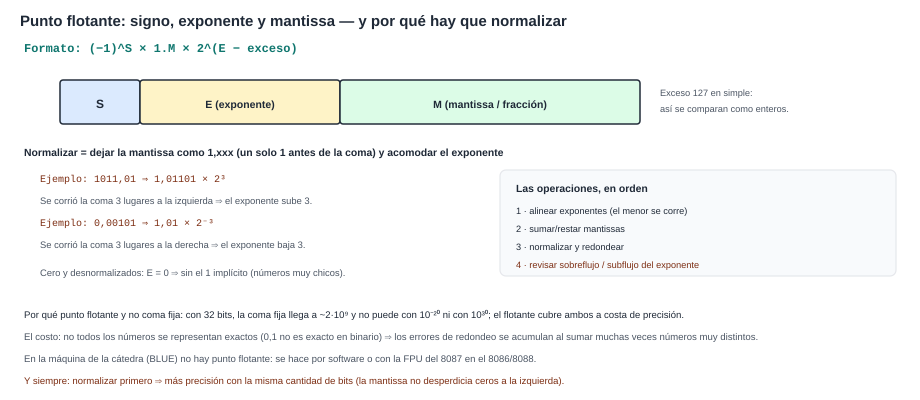
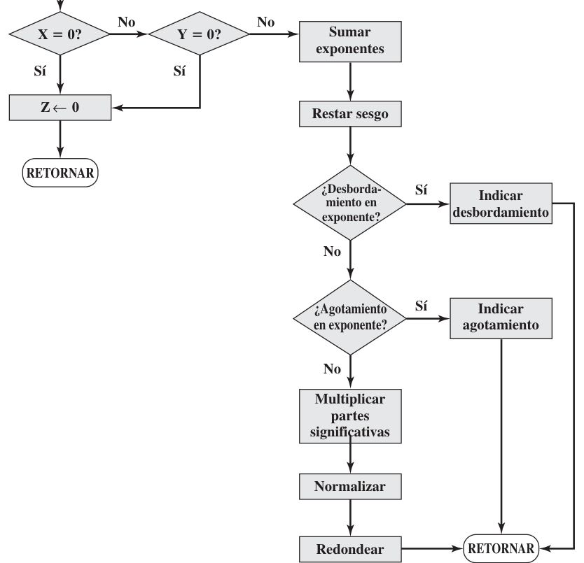
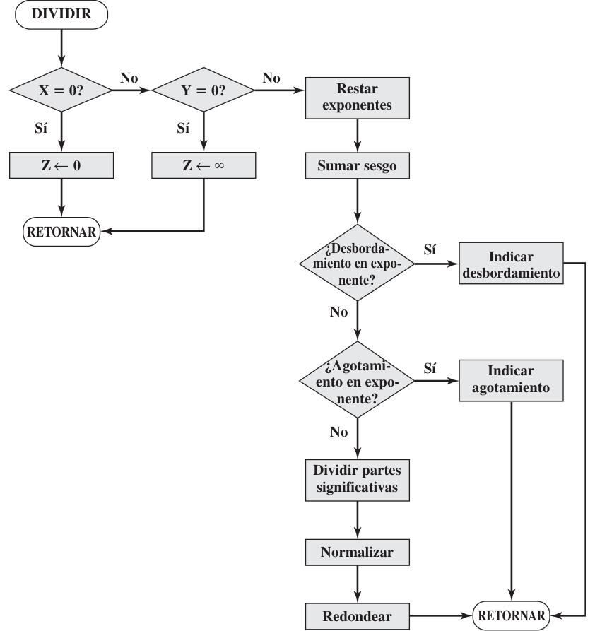

# 9.4.1 Formato, normalización y operaciones

> [!abstract] En una frase
> Un número en punto flotante se guarda como **signo · exponente (con exceso) · mantisa normalizada**, y vale
> `(−1)ˢ × 1.M × 2^(E − exceso)`. Operar exige **alinear** exponentes (suma), **sumar/restar** exponentes
> (multiplicación), **normalizar** y **redondear**.

> [!note] Si la primera vez que ves esto
> Es la **notación científica** de la física: `6,02 × 10²³`. Cambia la base 10 por base 2 y agrega el signo. La
> ventaja es la misma: representar números **enormes y diminutos** con la misma cantidad de dígitos.

## Normalizar



## El formato

```
┌───────┬──────────────────┬─────────────────────────────┐
│ signo │    exponente     │        mantisa (M)          │
│  1    │  (con exceso)    │     normalizada: 1.M        │
└───────┴──────────────────┴─────────────────────────────┘
```
```
valor = (−1)^S × 1.M × 2^(E − exceso)
```

| Parte | Qué aporta | Detalle |
|---|---|---|
| **signo `S`** | `+` o `−` | 1 bit (0 = positivo) |
| **exponente `E`** | la **escala** (potencia de 2) | se guarda **con exceso** (`E = e + exceso`) para no necesitar signo |
| **mantisa `M`** | los **dígitos significativos** | **normalizada**: el 1 de adelante es implícito (no se guarda) |

**Normalizar** = dejar el número como `1.xxxx × 2^e`: un solo 1 antes de la coma. Así se **gana un bit** de
precisión (el 1 no se almacena) y la representación es **única**.

| Número | Binario | Normalizado | `S` · `M` · `e` |
|---|---|---|---|
| 6,5 | `110,1` | **`1,101 × 2²`** | `0` · `101` · `2` |
| 0,375 | `0,011` | **`1,1 × 2⁻²`** | `0` · `1` · `−2` |
| −12 | `−1100` | **`−1,1 × 2³`** | `1` · `1` · `3` |

## Las tres operaciones

### Suma / resta (la difícil)
| Paso | Qué hace | Por qué |
|---|---|---|
| 1 | **comparar exponentes** | hay que trabajar a la misma escala |
| 2 | **alinear**: desplazar la mantisa del **menor** | si no, se suman peras con manzanas |
| 3 | **sumar/restar mantisas** | con el sumador de 9.1 |
| 4 | **normalizar** | el resultado puede salir `10,xx` o `0,001x` |
| 5 | **redondear** | al ancho de la mantisa |

> [!example] Ejemplo resuelto: 6,5 + 1,5
> 1. `6,5 = 1,101 × 2²` · `1,5 = 1,1 × 2¹` (¡exponentes distintos!)
> 2. **Alinear** al mayor (`2²`): `1,1 × 2¹ = 0,11 × 2²` (desplazar la mantisa **1** lugar a la derecha).
> 3. **Sumar**: `1,101 + 0,011 = 10,000` ⇒ `10,000 × 2²`.
> 4. **Normalizar**: `10,000 = 1,000 × 2¹` ⇒ `1,000 × 2³`.
> 5. **Redondear**: ya tiene 3 bits ⇒ queda `1,000 × 2³ = 1000₂ =` **8** ✔ (`6,5 + 1,5 = 8`)

### Multiplicación
| Paso | Qué hace |
|---|---|
| 1 | **sumar exponentes** y **restar el exceso** (`e = e1 + e2`) |
| 2 | **multiplicar mantisas** (9.2: arreglo multiplicador) |
| 3 | **normalizar** (`1,1 × 1,1 = 10,01` ⇒ `1,001 × 2¹`) y **redondear** |
| 4 | `signo = S1 ⊕ S2` |

### División
| Paso | Qué hace |
|---|---|
| 1 | **restar exponentes** (`e = e1 − e2`) |
| 2 | **dividir mantisas** (9.3) |
| 3 | **normalizar** y **redondear** |
| 4 | `signo = S1 ⊕ S2` |

## Los bits que salvan la precisión

| Bit | Para qué |
|---|---|
| **guarda** (*guard*) | 1 bit extra a la derecha de la mantisa |
| **redondeo** (*round*) | otro bit extra |
| **pegajoso** (*sticky*) | **OR** de todo lo que se descartó: si algo se perdió, queda en 1 |

Sin estos bits, `(a + b) + c` puede dar distinto que `a + (b + c)`: la **suma deja de ser asociativa** en punto
flotante (uno de los errores conceptuales más preguntados).

## Lo que sale mal
| Problema | Causa |
|---|---|
| **Pérdida de precisión** | alinear un número muy chico con uno muy grande (los bits chicos "desaparecen") |
| **Cancelación catastrófica** | restar dos números casi iguales ⇒ el resultado es pura basura de redondeo |
| **No asociativa** | `(1e20 + 1) − 1e20 = 0` pero `1e20 + (1 − 1e20) = ...` |
| **No distributiva** | por el redondeo |

> [!warning] Errores típicos
> - Sumar mantisas **sin alinear** los exponentes.
> - Olvidar **normalizar** después de operar (`10,xx` no es válido).
> - Guardar el **1 implícito** en la mantisa (se ahorra un bit justamente por eso).
> - Restar el exceso **dos veces** al multiplicar (es `e1 + e2 − exceso`).
> - Creer que el punto flotante es exacto: **no** lo es, y por eso `0.1 + 0.2 ≠ 0.3` en una computadora.

## Figura del libro



*Fig. 9.23 — Multiplicación en coma flotante (Z ←X Y).* · Stallings, *Organización y arquitectura de computadores*, 7ª ed., p. 356.



*Fig. 9.24 — División en coma flotante (Z ←X/Y).* · Stallings, *Organización y arquitectura de computadores*, 7ª ed., p. 357.

## La convención de la cátedra: exceso 64 y mantisa entre 1/2 y 1

La cátedra escribe el formato como **S · E · M** con el exponente en **exceso 2ⁿ⁻¹** y la mantisa normalizada en
el rango **1/2 ≤ M < 1** (o sea, `0,1xxx…`). Es la misma idea de IEEE 754, con la coma en otro lugar y otro exceso.

| Campo | Qué dice la cátedra |
|---|---|
| **S** | 1 bit: `0` positivo, `1` negativo |
| **E** | exponente con **convención exceso 2ⁿ⁻¹**: por ejemplo **exceso 64 con 7 bits** y **exceso 128 con 8 bits** |
| **M** | mantisa fraccionaria **normalizada**: el bit más significativo vale **1**, y `1/2 ≤ M < 1` |

| Operación | Signo | Exponente | Mantisa |
|---|---|---|---|
| **Multiplicación** `S1E1M1 × S2E2M2 = SpEpMp` | `Sp = 0` si `S1 = S2`; `Sp = 1` si `S1 ≠ S2` | `Ep = E1 + E2 − 64 − K` | `Mp = M1 × M2 × 2^K`, con `K` tal que `1/2 ≤ M1·M2·2^K < 1` |
| **División** `S1E1M1 ÷ S2E2M2 = SdEdMd` | `Sd = 0` si `S1 = S2` | `Ed = E1 − E2 + 64 + K` | `Md = (M1 / M2) × 2^K`, con `K` tal que `1/2 ≤ Md < 1` |

> [!example] Multiplicar con exceso 64
> `A = 0 1000100 1000…` (`E = 68 − 64 = 4`) y `B = 0 1000011 1100…` (`E = 67 − 64 = 3`), `M1 = 1/2`,
> `M2 = 3/4`. `M1 × M2 = 3/8`: ya está en `[1/2, 1)` ⇒ `K = 0`. `Ep = 68 + 67 − 64 = 71` ⇒ el exponente real es
> `71 − 64 = 7 = 4 + 3` ✓. Resultado: `0 1000111 110…`.

> [!warning] Las dos trampas de esta parte
> 1. **Restar el exceso una sola vez**: en la multiplicación se suman dos exponentes que **ya** traen el exceso, por
>    eso se resta **una** vez (`−64`). Si se resta dos veces, el resultado queda con la mitad del valor.
> 2. **`K` es 0, +1 o −1**, no un número libre: la mantisa del producto de dos fracciones en `[1/2, 1)` cae en
>    `[1/4, 1)`, así que a lo sumo hay que **correr la coma un lugar** y ajustar el exponente.


## Relacionado
[[9.4.2 IEEE 754]] · [[9.2.3 Arreglo multiplicador]] · [[9.1.2 Acarreo anticipado (G y P)]] ·
[[8.1.1 Etapas segmentadas y suma de vectores]] · [[Hardware aritmético (resumen)]] · [[Glosario — Unidad 9]]
