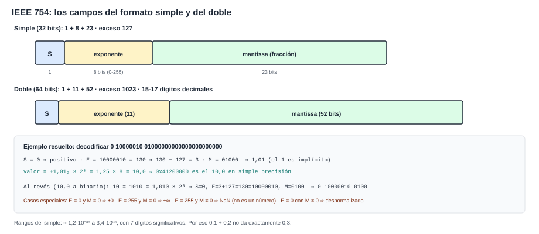
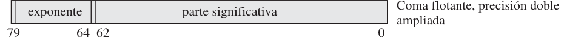

# 9.4.2 IEEE 754

> [!abstract] En una frase
> El estándar **IEEE 754** fija el formato: **simple** = `1 + 8 + 23` bits con **exceso 127**, **doble** = `1 + 11 + 52` con **exceso 1023**; y define los casos especiales (**±0**, **subnormales**, **±∞**, **NaN**) para que dos computadoras distintas den **el mismo resultado bit a bit**.

> [!note] Si la primera vez que ves esto
> Es el "**sistema internacional**" de los números reales en informática: sin él, cada fabricante guardaba los bits a su manera y una suma daba distinto en un Intel y en un Motorola. El estándar dice **cuántos bits** van en cada campo y **cómo** se redondea.

## Simple y doble



## Los dos formatos

| | **Simple (binary32)** | **Doble (binary64)** |
|---|---|---|
| Signo | 1 | 1 |
| Exponente | **8** | **11** |
| Mantisa | **23** | **52** |
| Exceso (*bias*) | **127** | **1023** |
| Total | **32 bits** | **64 bits** |
| Precisión decimal | ~7 dígitos | ~16 dígitos |
| Menor normal | `2⁻¹²⁶ ≈ 1,18 × 10⁻³⁸` | `2⁻¹⁰²² ≈ 2,2 × 10⁻³⁰⁸` |
| Mayor | `≈ 3,4 × 10³⁸` | `≈ 1,8 × 10³⁰⁸` |
| Precisión de la mantisa | `2⁻²³ ≈ 1,19 × 10⁻⁷` | `2⁻⁵² ≈ 2,2 × 10⁻¹⁶` |

```
simple:   S EEEEEEEE MMMMMMMMMMMMMMMMMMMMMMM
          1    8               23
doble:    S EEEEEEEEEEE MMMMMMMMMMMMMMMMMMMMMMMMMMMMMMMMMMMMMMMMMMMM
          1       11                        52
```

## Ejemplo resuelto 1: codificar −6,5 en simple

1. Magnitud: `6,5 = 110,1₂`.

2. **Normalizar:** `110,1 = 1,101 × 2²` ⇒ `M = 101`, `e = 2`.

3. `S = 1` (negativo).

4. Exponente con exceso: `E = 2 + 127 = 129 = 1000 0001₂`.

5. Mantisa a 23 bits: `101 0000 0000 0000 0000 0000`.

6. Ensamblar:
   ```
   1 10000001 10100000000000000000000
   = 1100 0000 1101 0000 0000 0000 0000 0000
   = C0D0 0000h   ✔
   ```

## Ejemplo resuelto 2: decodificar `4120 0000h`

1. Binario: `0100 0001 0010 0000 0000 0000 0000 0000`.

2. `S = 0` (positivo) · `E = 1000 0010 = 130` · `M = 010 0…`.

3. Exponente real: `e = 130 − 127 = 3`.

4. Valor: `+1,010 × 2³ = 1010₂ =` **10** ✔

> [!tip] Los tres valores que conviene memorizar
> `3F80 0000h = 1,0` · `C0D0 0000h = −6,5` · `4120 0000h = 10,0`. Con esos tres se comprueba cualquier ejercicio de codificación/decodificación en segundos.

## Los casos especiales (lo que distingue a IEEE 754)

| Exponente | Mantisa | Significado |
|---|---|---|
| Todos **0** | Todos **0** | **±0** (hay dos ceros, pero `+0 = −0` al comparar) |
| Todos **0** | **≠ 0** | **subnormal**: `0.M × 2⁻¹²⁶` (números diminutos, sin el 1 implícito) |
| **1 … 254** | cualquiera | número **normal** (`1.M`) |
| Todos **1** | Todos **0** | **±∞** (resultado de `1/0`, desborde) |
| Todos **1** | **≠ 0** | **NaN** (*not a number*): `0/0`, `∞ − ∞`, `√−1` |

> [!important] Por qué existen los subnormales
> Sin ellos habría un "**pozo**" entre 0 y el menor normal (`1,18 × 10⁻³⁸`): cualquier número menor sería 0. Los subnormales **gastan precisión** (menos bits significativos) para poder representar valores cada vez más chicos de forma **gradual** (*gradual underflow*).

## El redondeo (también está normado)

| Modo | Regla |
|---|---|
| **Al más cercano, empates al par** (por defecto) | `2,5 → 2` y `3,5 → 4` |
| Hacia cero (truncar) | descarta |
| Hacia +∞ / −∞ | siempre para ese lado |

**Empates al par** se eligió porque **no acumula sesgo** al sumar millones de números.

## Lo que hay que decir de la FPU

| Idea | Detalle |
|---|---|
| La FPU es una unidad **segmentada** | alinear / sumar / normalizar / redondear ⇒ **pipeline aritmético** (8.1) |
| Es **más lenta** que la ALU entera | más pasos y más bits |
| Usa **bits de guarda, redondeo y sticky** | para no perder precisión |
| Reemplazó a la FPU externa | el 8086 necesitaba el **8087**; hoy está en el chip |
| Explica `0,1 + 0,2 ≠ 0,3` | `0,1` no tiene representación exacta en binario (igual que `1/3` en decimal) |

> [!warning] Errores típicos
> - Usar exceso **128** en simple (es **127**).
> - Sumar el 1 implícito **dentro** de los 23 bits (no se guarda).
> - Decir que `−0` y `+0` son distintos al comparar (IEEE dice que son **iguales**).
> - Confundir **∞** (exponente todo 1, mantisa 0) con **NaN** (mantisa ≠ 0).
> - Creer que doble precisión "no tiene error" (tiene menos error, no cero).
> - Decir que el punto flotante es una representación exacta de los reales.

## Figura del libro



*Fig. 10.4 — Formatos de datos numéricos en el Pentium.* · Stallings, *Organización y arquitectura de computadores*, 7ª ed., p. 383.

## Relacionado
[[9.4.1 Formato, normalización y operaciones]] · [[9.1.1 Complemento a 2 y desbordamiento]] · [[8.1.1 Etapas segmentadas y suma de vectores]] · [[Hardware aritmético (resumen)]] · [[Glosario — Unidad 9]]
