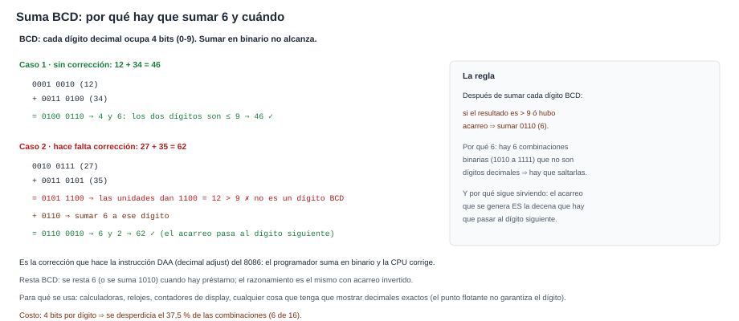

# 9.5.1 Suma decimal corregida

> [!abstract] En una frase
> En **BCD** cada dígito decimal ocupa **4 bits** (sólo `0000` a `1001` son válidos); al sumar con un sumador binario el resultado puede caer en los **6 códigos inválidos** (`1010`…`1111`) o pasar de 9 ⇒ se **suma `0110`** (6) y se **propaga acarreo** al dígito siguiente.

> [!note] Si la primera vez que ves esto
> Es como un **reloj de agujas** que en vez de pasar de 12 a 1 tuviera **seis horas de más**: cuando el resultado "se pasa" del 9, le das **un empujoncito de 6** para saltear los códigos que no existen y quede un dígito limpio. Los 6 salteados son justo los seis códigos inválidos: `1010, 1011, 1100, 1101, 1110, 1111`.

## El +6



## Por qué hace falta la corrección
```
BCD: 4 bits por dígito  ⇒  16 combinaciones  ⇒  sólo 10 sirven
válidos:   0000 0001 0010 0011 0100 0101 0110 0111 1000 1001   (0-9)
inválidos: 1010 1011 1100 1101 1110 1111                        (10-15)
```
El sumador binario **no sabe** de decimales: `8 + 5` le da `1101` (=13, inválido). Hay que corregir.

## La regla (las dos condiciones)
```
si (resultado > 1001)  o  (hubo acarreo de salida)  ⇒  sumar 0110  y propagar acarreo
```

| Suma | Binario | ¿> 9? | Corrección | Resultado BCD |
|---|---|---|---|---|
| `4 + 3` | `0111` (7) | no | — | **7** |
| `8 + 5` | `1101` (13) | **sí** | `1101 + 0110 = 1 0011` | **3**, acarreo **1** ⇒ **13** |
| `9 + 9` | `1 0010` (18) | acarreo + `0010` | `0010 + 0110 = 1000` | **8**, acarreo **1** ⇒ **18** |
| `9 + 1` | `1010` (10) | **sí** | `1010 + 0110 = 1 0000` | **0**, acarreo **1** ⇒ **10** |

> [!important] Por qué exactamente 6
> Porque hay **6** códigos inválidos (`2⁴ − 10 = 6`). Sumar 6 hace que el dígito "salte" la zona prohibida y su acarreo salga **en el bit 4**, que es justo lo que hay que propagar al dígito siguiente.

## Ejemplo resuelto: 47 + 38 = 85 (BCD empaquetado)
```
  A = 0100 0111   (4 7)
  B = 0011 1000   (3 8)
```
**Dígito de unidades:**
```
  0111 + 1000 = 1111   (15, inválido: > 1001)
  1111 + 0110 = 1 0101  ⇒ dígito 5, acarreo 1
```
**Dígito de decenas** (con el acarreo que entra):
```
  0100 + 0011 + 1 = 1000   (8, válido)  ⇒ no se corrige
```
**Resultado:** `1000 0101` = **85** ✔ (`47 + 38 = 85`)

**Verificación:** `47 + 38 = 85` ✔ · el acarreo se propagó **una vez** ✔ · ningún dígito quedó inválido ✔

## La resta BCD

| Método | Cómo |
|---|---|
| **Complemento a 10** | `A − B = A + (10000 − B)` en 4 bits, con corrección |
| **Complemento a 9 y corregir** | complementar dígito a dígito y sumar 1 al final |
| **Regla práctica** | si al restar **hay préstamo**, se **resta 6** al resultado (el espejo de la suma) |

El 8086 tiene instrucciones para esto: **`DAA`** (*decimal adjust after addition*) y **`DAS`** (after subtraction) ajustan `AL` justamente con esta regla.

## Dónde se usa

| Lugar | Por qué BCD y no binario |
|---|---|
| **Sistemas financieros / facturación** | el decimal es **exacto**: `0,10 + 0,20 = 0,30` sin errores de punto flotante |
| **Contadores de display** | coinciden con los 7 segmentos |
| **Relojes, instrumentos** | se leen dígito a dígito |
| **8086 / mainframes** | instrucciones BCD empaquetadas (`DAA`, `DAS`, `AAA`) |

**Costo:** se desperdicia el **37,5 %** del espacio (`6 de 16` códigos no se usan) y la suma necesita un **corrector** (detector de `>9` o acarreo + un sumador de 4 bits más).

> [!warning] Errores típicos
> - Sumar 6 **siempre** (sólo cuando `> 9` **o** hubo acarreo).
> - Olvidar **propagar** el acarreo al dígito siguiente.
> - Aplicar la corrección **antes** de sumar en vez de **después**.
> - Confundir BCD (`0100 0111` = 47) con binario (`0100 0111` = 71).
> - Decir que BCD es "más rápido": es más **lento** y más caro; se usa por **exactitud decimal**.

## Relacionado
[[9.4.2 IEEE 754]] · [[9.1.1 Complemento a 2 y desbordamiento]] · [[4.2.2 Los 16 opcodes octales]] · [[Hardware aritmético (resumen)]] · [[00 Tema 9.5 — índice]] · [[Glosario — Unidad 9]]
