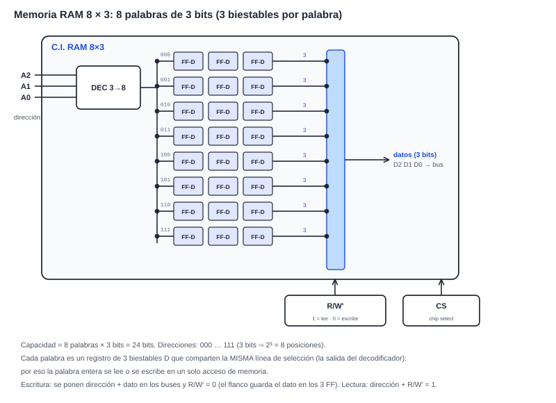

# Memoria RAM 8×3

> [!note] Si es la primera vez que ves esto
> Una memoria es **un mueble con cajones numerados**. Cada cajón (celda o palabra) tiene un número (la
> dirección) y guarda algo de tamaño fijo (el dato). La RAM 8×3 es el mueble más chico posible que sirve para
> explicar todo: **8 cajones de 3 bits**. Para usarla hacen falta tres cosas: **decir qué cajón** (dirección
> de 3 bits → decodificador 3→8), **decir qué hacer** (leer o escribir, con la señal L/E) y **llevar o traer
> el dato** (3 bits por el bus de datos). En el final se pide dibujarla entera: 8 celdas, el decodificador a
> la izquierda y las señales de control.

> [!abstract] En una frase
> Una RAM de **8 palabras × 3 bits**: tiene **8 posiciones** (por eso 3 bits de dirección, 2³ = 8) y
> cada posición guarda **3 bits** (por eso 3 líneas de datos). Capacidad = **24 bits**. Direccionarla es
> aplicar la dirección en el decodificador 3→8, elegir la palabra y leer o escribir sus 3 bits a la vez.

> [!note] "8×3" o "3×8": las dos formas que vas a escuchar
> En la matriz del final aparece como **"memoria RAM 3×8"** y en los apuntes como **8×3**. Significan lo
> mismo, con dos convenciones: **8 palabras de 3 bits** (filas × columnas: 8 filas, 3 columnas) o
> **3 bits × 8 posiciones**. En el oral conviene decirlo así: *"8 posiciones, cada una de 3 bits; capacidad
> total 8 × 3 = **24 bits**"*. Si el profesor dice 3×8, seguí su orden sin corregirlo.

## Los números, que es lo primero que se pregunta
| Parámetro | Valor | Cuenta |
|---|---|---|
| Palabras | 8 | 2³ ⇒ **3 líneas de dirección** (A2 A1 A0) |
| Bits por palabra | 3 | **3 líneas de datos** (D2 D1 D0) |
| Capacidad total | 24 bits | 8 × 3 |
| Rango de direcciones | 000 a 111 | 0 a 7 en decimal |



## Estructura interna
1. **Decodificador 3→8**: recibe A2 A1 A0 y activa **una** de las 8 líneas de selección (mintérminos
   de la dirección). Ver [[Decodificador]].
2. **Matriz de 8 palabras**, cada una con **3 celdas** (3 flip-flops D o latch, ver
   [[Celda elemental de memoria]]) que comparten la misma línea de selección.
3. **Buffer de datos de tres estados**: conecta las celdas seleccionadas al bus de datos (D2 D1 D0) y deja
   el resto en alta impedancia.
4. **Señales de control**:
   - **CS (chip select)**: habilita el chip completo. Con CS = 0 el chip queda "desconectado" del bus
     (imprescindible para conectar varios chips en el mismo bus).
   - **R/W'**: `1` = lectura, `0` = escritura.

## Mapa de direcciones
| Dirección (A2A1A0) | Decimal | Palabra habilitada |
|---|---|---|
| 000 | 0 | palabra 0 (3 bits) |
| 001 | 1 | palabra 1 |
| 010 | 2 | palabra 2 |
| 011 | 3 | palabra 3 |
| 100 | 4 | palabra 4 |
| 101 | 5 | palabra 5 |
| 110 | 6 | palabra 6 |
| 111 | 7 | palabra 7 |

## Operación de lectura (paso a paso)
1. La CPU pone la dirección en el **bus de direcciones** ⇒ entra al decodificador.
2. `CS = 1` (chip habilitado) y `R/W' = 1` (lectura).
3. El decodificador activa **una** línea de selección: la palabra elegida vuelca sus 3 bits.
4. Los buffers de tres estados ponen esos 3 bits en el **bus de datos**.
5. La CPU (o el MBR) toma el dato. `CS = 0` desconecta el chip.

## Operación de escritura
1. Dirección en el bus de direcciones.
2. Dato en el **bus de datos** (3 bits).
3. `CS = 1`, `R/W' = 0`.
4. En el flanco de escritura, los 3 flip-flops de la palabra seleccionada **cargan** el dato.
5. El dato queda almacenado hasta la próxima escritura (o hasta que se corte la alimentación, si es RAM
   volátil).

## Conexión a la CPU (lo que vale en el oral)
```
   CPU                                   RAM 8×3
 ┌──────────┐   bus de direcciones (3)   ┌──────────┐
 │    PC    │───────────────────────────→│ A2 A1 A0 │
 │   MAR    │                           │          │
 │   MBR    │←──── bus de datos (3) ─────│ D2 D1 D0 │
 │    UC    │──── CS, R/W' ─────────────→│ CS  R/W' │
 └──────────┘                           └──────────┘
```
- **MAR** (o la dirección de la instrucción) va al bus de direcciones.
- **MBR** recibe/entrega el dato por el bus de datos.
- La **UC** genera `CS` y `R/W'` (señales de control).
En BLUE la memoria es de 4096×16: 12 bits de dirección, 16 de datos; la RAM 8×3 es el mismo esquema
en miniatura.

## Expansión (pregunta clásica: "cómo haría una RAM 16×6 con chips 8×3")
- **Horizontal (palabras más anchas):** dos chips en paralelo con la **misma dirección** y la **misma señal
  CS/R-W'**; el bus de datos se arma con 3 bits de cada uno ⇒ 8×6.
- **Vertical (más palabras):** dos chips con el bus de datos y el control compartidos, y **el bit más alto
  de la dirección decodificado** habilita el `CS` de uno u otro ⇒ 16×3.
- Combinando las dos: **16×6** con cuatro chips 8×3 (2 en vertical × 2 en horizontal).

> [!tip] Regla para el pizarrón
> `cantidad de líneas de dirección = log₂(cantidad de palabras)`, `líneas de datos = bits por palabra`,
> `capacidad = palabras × bits`. Si te dan la capacidad, la factorizás para deducir la organización.

> [!example] Conexión con los TPs
> El [[TP12 Memoria principal|TP12]] pide las características de RAM/ROM/caché y el **cuadro comparativo**; el
> [[TP18 Direccionamiento de memoria|TP18]], el cálculo de **espacio de direccionamiento y bits de CodOp**
> para memorias grandes. La RAM 8×3 es el mismo esquema en miniatura: memorias grandes = este circuito con más
> bits.

## Cómo responderlo en el final (pregunta principal #5)
1. Decir la organización y la capacidad: 8 palabras × 3 bits, 3 bits de dirección, 3 de datos, 24 bits.
2. Dibujar el bloque: decodificador 3→8, 8 palabras de 3 FF, buffers de tres estados, CS y R/W'.
3. Describir lectura y escritura con el rol de cada señal.
4. Mencionar el mapa de direcciones (000…111) y la **conexión a la CPU** (MAR → dirección, MBR → datos,
   UC → control).
5. Cerrar con expansión: horizontal (más ancho) y vertical (más palabras con CS decodificado).

## Errores típicos
- Confundir 3 líneas de dirección con 3 líneas de datos (¡coinciden en este ejemplo por casualidad!).
- Decir "8×3 = 8 palabras de 8 bits": la segunda cifra son **bits por palabra**.
- Olvidar el buffer de tres estados: sin él no se puede compartir el bus de datos.
- No aclarar que la RAM es **volátil** (pierde el contenido sin alimentación).

## Relacionado
[[Celda elemental de memoria]] · [[Decodificador]] · [[Memoria ROM y sus tipos]] · [[Jerarquía de memorias]] · [[Ciclo de búsqueda (7 y 8 pulsos)]]
