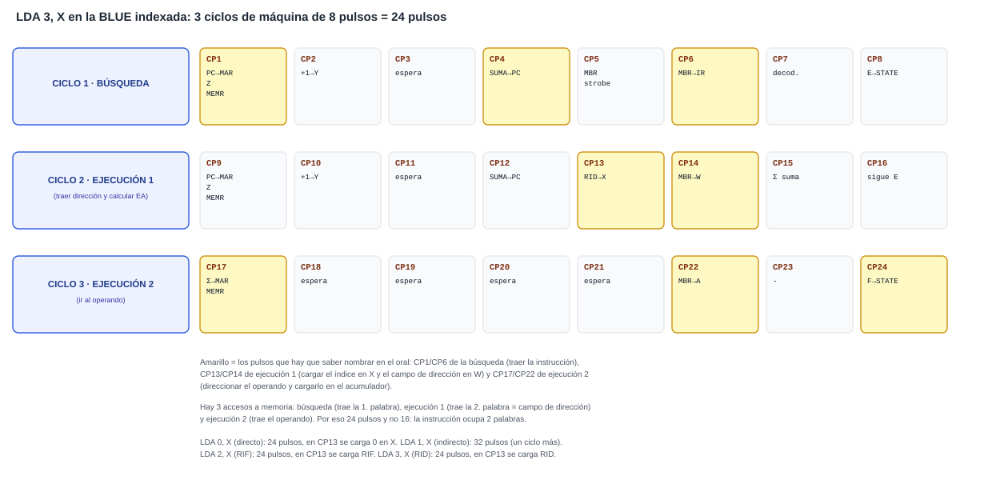

# Ciclo de ejecución — todas las operaciones (BLUE sin indexar y BLUE indexada)

> [!abstract] En una frase
> Terminada la **búsqueda** (la instrucción ya está en el IR), empieza la **ejecución**: una secuencia de
> ciclos de máquina de 8 pulsos que hace lo que la instrucción pide. Hay **cuatro familias** —transferencia
> (LDA/STA), aritmético-lógicas (ADD/XOR/AND/IOR), de control (JMP/JMA/SRJ/NOP/HLT/RAL/NOT/CSA) y de E/S
> (INP/OUT)— y en la **BLUE indexada** se agrega un ciclo previo para **calcular la dirección efectiva**, con lo
> que las instrucciones con referencia a memoria pasan de **16 a 24 pulsos** (y a **32** en modo indirecto).

> [!note] Si es la primera vez que ves esto
> Ya está la instrucción en el registro de instrucción. Ahora la máquina tiene que **hacer** lo que dice. Ese
> "hacer" consiste en mover datos: traer un dato de memoria al acumulador, guardarlo, sumarlo, saltar a otra
> dirección, o esperar a un periférico. Y como todo pasa por **un bus único**, cada paso es una transferencia
> por pulso. Aprenderte las 16 no es memorizar 16 tablas: es entender **cuatro moldes** y ver que cada
> instrucción es uno de esos moldes con otra operación de ALU o con otra condición.

---

## 1. El mapa completo de la ejecución

| Familia | Instrucciones | Qué hace la ejecución | Ciclos de máquina (además de la búsqueda) | Pulsos totales (BLUE) |
|---|---|---|---|---|
| **Transferencia** | **LDA**, **STA** | mueve un dato entre el AC y la memoria | 1 | **16** |
| **Aritmético-lógica** | **ADD, XOR, AND, IOR** | opera el AC con un dato de memoria | 1 | **16** |
| **De control** | **JMP, JMA, SRJ, HLT, NOP** | cambia el PC o detiene la máquina | 0 (se resuelven en la búsqueda) | **8** |
| **De registro** | **NOT, RAL, CSA** | opera sobre el AC con la ALU o con las llaves | 0 | **8** |
| **De E/S** | **INP, OUT** | transfiere 8 bits con un periférico | 1 + n (espera) | **16+** |
| **(indexada) con memoria** | LDA, STA, ADD… | agrega el cálculo de la **EA** | 2 (3 en indirecto) | **24** (32 indirecto) |

> [!important] La regla que resume todo
> **Buscar es siempre igual; ejecutar depende de si la instrucción va a memoria.** Si **no** va a memoria, se
> resuelve en los pulsos CP7/CP8 de la propia búsqueda. Si **va** a memoria, necesita un ciclo de ejecución
> completo. Y si es **indexada**, dos (porque la dirección del operando hay que traerla y sumarle el índice).

---

## 2. Familia 1 — Transferencia: LDA y STA

### LDA (`AC ← M[dir]`) — traer de memoria al acumulador
| CP | Acción | Microoperación |
|---|---|---|
| 1 | Envíe IR, Cargue MAR · **orden de lectura** | `MAR ← IR(dir)` |
| 2-3 | — | (espera de memoria) |
| 4 | Strobe MBR | `MBR ← M[MAR]` |
| 5 | Envíe MBR, Cargue A | `AC ← MBR` |
| 6-7 | — | |
| 8 | `F → STATE` | fin de la instrucción |

### STA (`M[dir] ← AC`) — guardar el acumulador en memoria
| CP | Acción | Microoperación |
|---|---|---|
| 1 | Envíe IR, Cargue MAR | `MAR ← IR(dir)` |
| 2-3 | — | |
| 4 | Envíe A, Cargue MBR · **orden de escritura** | `MBR ← AC`, empieza la escritura |
| 5-8 | — y `F → STATE` | la memoria termina de escribir sola |

> [!tip] La simetría que hay que ver
> **LDA y STA son el mismo camino, al revés**: LDA termina con `MBR → AC` (en CP5); STA empieza con
> `AC → MBR` (en CP4) y la memoria se encarga. Si entendés uno, el otro sale solo. **Y las dos destruyen algo**:
> LDA destruye el contenido anterior del AC; STA, el de la celda.

---

## 3. Familia 2 — Aritmético-lógicas: ADD, XOR, AND, IOR
Son **cuatro instrucciones que se diferencian sólo en el último pulso**: qué salida de la ALU se habilita.

| CP | Acción | Microoperación | Nota |
|---|---|---|---|
| 1 | Envíe IR, Cargue MAR · lectura | `MAR ← IR(dir)` | |
| 2 | **Envíe A, Cargue Z** | `Z ← AC` | el AC entra a la ALU por **Z** |
| 3-4 | — | (espera) | |
| 5 | Strobe MBR | `MBR ← M[MAR]` | |
| 6 | **Envíe MBR, Cargue Y** | `Y ← MBR` | el dato entra por **Y** |
| 7 | — | (la ALU estabiliza) | |
| 8 | **Envíe SUM / XOR / AND / OR, Cargue A** y `F → STATE` | `AC ← ALU(Y,Z)` | **lo único que cambia** |

> [!important] Por qué la ALU tiene dos registros de entrada (Y y Z)
> Porque las dos entradas tienen que estar **presentes al mismo tiempo** y el bus es único: no se puede cargar
> una y después la otra por el mismo cable sin guardar la primera. El apunte lo explica con la "gratis": la
> salida del **primer semisumador** de la ALU **ya es la XOR**, así que la XOR no cuesta hardware extra.

---

## 4. Familia 3 — Control y registro: se resuelven en la búsqueda

| Instrucción | CP7 | CP8 | Efecto |
|---|---|---|---|
| **JMP** | — | Envíe IR, Cargue PC | `PC ← dir` |
| **JMA** | — | Envíe IR, Cargue PC **si A15 = 1** | salto condicional por signo |
| **SRJ** | Envíe PC, Cargue A | Envíe IR, Cargue PC | guarda el retorno en AC y salta |
| **HLT** | Reset FF RUN | — | detiene |
| **NOP** | — | — | no hace nada |
| **NOT** | Envíe A, Cargue Z | Envíe Z', Cargue A | `AC ← AC'` |
| **RAL** | Envíe A, Cargue Z | Envíe 2·Z, Cargue A | rota a la izquierda |
| **CSA** | Envíe SR, Cargue A | — | copia las llaves |

Fijate el patrón: **todo lo que no va a memoria se hace con la ALU y el bus, en dos pulsos**, y **todo lo que
cambia el PC usa `IR → PC`**.

---

## 5. Familia 4 — Entrada/Salida: pueden no terminar nunca

| CP | Búsqueda (INP/OUT) | Ejecución |
|---|---|---|
| 7 | **TRA = 1** (se envían los 6 bits bajos del IR por las líneas de selección de dispositivo) | si **R = 1**: INP copia el dato a los 8 bits bajos del AC; se pone **TRA = 0** |
| 8 | `E → STATE` | si **TRA = 0** ⇒ `F → STATE`; **si no, se repite el ciclo de ejecución** |

- **TRA** (transferencia) avisa a los periféricos que hay una operación de E/S en curso.
- **R** (ready) dice si el dispositivo está listo. **Si no lo está, la máquina espera dando vueltas**: la
  instrucción puede tardar 16, 24, 32… pulsos.
- Ese es el gran defecto del esquema y **la razón de ser de las interrupciones**
  ([[Interrupciones y entrada-salida]]).

---

## 6. BLUE **sin indexar** vs **indexada** (la pregunta del final)

### Sin indexar (BLUE base)
- La instrucción ocupa **1 palabra** (16 bits: 4 de opcode + 12 de dirección) ⇒ la búsqueda la trae **completa**.
- La ejecución va **directo** al operando: `IR(dir) → MAR`.
- **LDA = 16 pulsos** (2 ciclos de máquina).

### Indexada
- La instrucción ocupa **2 palabras** (32 bits: 5 + 2 + 9 + 16) ⇒ la búsqueda trae **sólo la primera**.
- La ejecución tiene **dos partes**:
  1. **traer la segunda palabra** (el campo de dirección) **y calcular la EA** con el sumador de direcciones
     (`EA = W + X`, con X = 0/directo, RIF o RID);
  2. **ir al operando**.
- **LDA directa o indexada = 24 pulsos** (3 ciclos) · **LDA indirecta = 32 pulsos** (4 ciclos).

| | **Sin indexar** | **Indexada** |
|---|---|---|
| Palabras por instrucción | 1 | 2 (las que tienen campo de dirección) |
| Modos | 1 (directo) | 4 (directo, indirecto, RIF, RID) |
| Quién calcula la dirección | nadie: la dirección **es** el campo | el **sumador de direcciones** (`+RIF`/`+RID`) |
| Pulsos de LDA | **16** | **24** (32 indirecta) |
| Se gana | velocidad y simplicidad | recorrer arreglos, más memoria, reubicación |

> [!example] El mismo programa contado en pulsos
> Programa: `LDA 500` · `ADD 501` · `STA 502`.
> | | Sin indexar | Indexada |
> |---|---|---|
> | LDA | 2 ciclos = 16 | 3 ciclos = 24 |
> | ADD | 2 ciclos = 16 | 3 ciclos = 24 |
> | STA | 2 ciclos = 16 | 3 ciclos = 24 |
> | **Total** | **6 ciclos = 48 pulsos** | **9 ciclos = 72 pulsos** |
>
> La indexada es **50 % más lenta** en este programa… pero ese mismo programa, bien escrito con `INI` y un lazo,
> recorre **cualquier** arreglo con **una sola** `LDA 2, 0` en lugar de 100 instrucciones. **Ahí gana.**

---

## 7. La ejecución de la LDA indexada, en su tabla (24 pulsos)
| Ciclo | Pulsos | Qué pasa |
|---|---|---|
| Búsqueda | 1–8 | trae la **1.ª palabra**; `PC ← PC + 1` |
| Ejecución 1 | 9–16 | trae la **2.ª palabra** a W; **CP13: RID→X**; CP14: MBR→W; el Σ calcula `W + X` |
| Ejecución 2 | 17–24 | **CP17: Σ→MAR** y lectura; **CP22: MBR→AC**; CP24: `F→STATE` |

Con la explicación completa: [[Ciclo de LDA indexada (los 24 pulsos)]].

---

## 8. Cómo responderlo en el final (4–5 minutos)

**Movimiento 1 — encuadre (20 s).** "Terminada la búsqueda, la ejecución depende de **si la instrucción va a
memoria**: si no va, se resuelve en CP7-CP8; si va, necesita un ciclo de 8 pulsos; si es indexada, dos."

**Movimiento 2 — dibujo (60 s).** Tres columnas: *sin memoria (8)* · *con memoria (16)* · *indexada (24)*, con
las microoperaciones clave de cada una.

**Movimiento 3 — desarrollo (120 s).**
1. **LDA y STA**: simétricas; CP5 `MBR→AC` vs CP4 `AC→MBR`.
2. **Las cuatro aritméticas**: CP2 `A→Z`, CP6 `MBR→Y`, CP8 la operación. La diferencia es **una señal**.
3. **Control**: `IR→PC` en CP8; `SRJ` guarda el retorno en el AC.
4. **E/S**: TRA y R, con la posibilidad de repetir el ciclo (por eso las interrupciones).
5. **La indexada**: por qué 24 (dos palabras + sumador de direcciones).

**Movimiento 4 — cierre (20 s).** "La ejecución no es un misterio: es una lista de transferencias. Cambia
**cuántas** y **qué sale de la ALU**; el bus y los pulsos son siempre los mismos."

### Repreguntas típicas
| Repregunta | Respuesta corta |
|---|---|
| ¿Por qué LDA carga el MBR antes del AC y no directo? | Porque **todo lo que viene de memoria pasa por el MBR**; es el registro buffer de la memoria |
| ¿Qué instrucción tarda más? | **INP/OUT** (puede no terminar) y la **LDA indirecta indexada** (32 pulsos) |
| ¿Por qué la resta no está en la lista? | La BLUE **no tiene SUB**: se resta sumando el complemento a dos (NOT + ADD + 1) |
| ¿Qué cambia entre ADD y XOR en el ciclo? | **Sólo el CP8**: qué salida de la ALU se habilita |
| ¿Dónde se actualizan los flags Z y C? | En la BLUE mínima el **bit 15 del AC** hace de condición para `JMA`; en máquinas reales hay un registro de flags que se actualiza en el pulso de la operación |
| ¿Cómo sé cuántos pulsos tiene una instrucción? | Contando **ciclos de máquina × 8** (y sumando los de espera de E/S) |

---

## 9. Errores típicos
- Ponerle ciclo de ejecución a **JMP** (se resuelve en CP8 de la búsqueda).
- Confundir el **CP2 de las aritméticas** (`A→Z`) con el **CP6** (`MBR→Y`).
- Decir "16 pulsos" para la LDA indexada (son **24**; 16 es la de la BLUE base).
- Olvidar que **STA escribe en CP4**, no al final.
- Creer que en INP/OUT el ciclo de ejecución siempre dura 8: **puede repetirse** hasta que R = 1.
- Confundir `SRJ` (guarda el PC en el AC) con `JMP` (no guarda nada).

---

## 10. Para ampliar: qué leer y qué buscar

| Fuente | Dónde | Qué buscar | Para qué te sirve |
|---|---|---|---|
| **`blue.pdf`** (Foster) | **Tabla 3** (las 8 de un ciclo), **Tabla 4** (INP/OUT), **Tabla 5** (LDA/STA), **Tabla 7** (ADD/XOR/AND/IOR) y **figs. 20-29** (las compuertas de la UC) | las tablas pulso por pulso **originales** | **Es la fuente exacta**: si copiás estas tablas en el pizarrón, está perfecto |
| **Apuntes de cátedra**, *Unidad 5* | sección **"Ciclos de instrucción"** de la BLUE indexada (LDA 3, LDA 1, LDA 0, INI, ENI) | las tablas de 3 y 4 ciclos, y las notas de "1 a 4 ciclos según instrucción y modo" | La versión **indexada** con los 24 pulsos |
| **[[TP16 Ciclo de instrucción básico]]** | el TP | un programa de 3 instrucciones descrito en 6 pasos | Practicar el relato sobre un caso chico |
| **[[Las 16 instrucciones de BLUE — ciclo completo pulso por pulso]]** | la nota de la bóveda | la tabla maestra de las 16 | Repaso antes del oral |
| **Hamacher, Vranesic, Zaky, *Organización de computadoras*** | capítulo de **microoperaciones** y de **control** | la notación de microoperaciones (`PC ← PC + 1`, `MAR ← PC`) y su secuenciamiento | Te da el vocabulario formal para decir lo mismo con más rigor |
| **Patterson & Hennessy, *Estructura y diseño de computadores*** | capítulo del **procesador** (ciclo único y multiciclo) | cómo una instrucción `lw` se parte en etapas | Ver el mismo concepto en una CPU RISC real (y preparar el paralelo con pipeline) |
| **Tanenbaum, *Estructura de computadores*** | capítulos del **ciclo de ejecución** y **microprogramación** | el ciclo como microinstrucciones de una memoria de control | Conecta con [[Cómo se implementa la Unidad de Control]] |
| **Stallings, *Organización y arquitectura de computadores*** | capítulo de **el ciclo de instrucción** | el diagrama de estados y el detalle de cada fase | Otra fuente de tablas equivalentes |
| **[[TP20 Lenguaje máquina]]** | el TP | cómo se escribe un programa en lenguaje de máquina de la BLUE | Para poder trazar la ejecución de un programa real |

---

## Relacionado
[[Las 16 instrucciones de BLUE — ciclo completo pulso por pulso]] · [[Ciclo de LDA indexada (los 24 pulsos)]] ·
[[Ciclo de máquina]] · [[Ciclo de búsqueda (7 y 8 pulsos)]] · [[Ciclo de la instrucción LDA (24 pulsos)]] ·
[[ALU]] · [[Interrupciones y entrada-salida]] · [[Programar en BLUE — ejemplos]]
