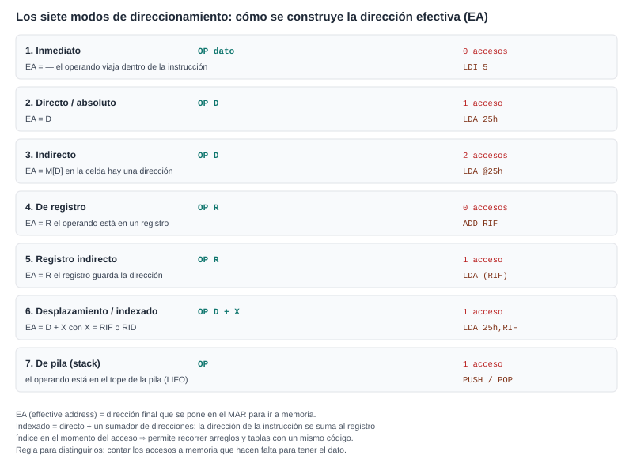

# Modos de direccionamiento

> [!abstract] En una frase
> El modo de direccionamiento es **cómo se calcula la dirección efectiva (EA)** —la que finalmente se pone en
> el MAR— a partir de lo que dice la instrucción. La cátedra trabaja con **siete modos**: inmediato, directo,
> indirecto, de registro, registro indirecto, de desplazamiento y de pila.

## La dirección efectiva (EA)
`EA` = dirección que se envía a la memoria para acceder al operando. Cada modo es una forma distinta de
calcularla; algunos modos **no acceden a memoria** (inmediato, registro), otros acceden **una vez** y uno
accede **dos veces** (indirecto).



## Los siete modos de la cátedra (TP19)
| # | Modo | Cómo se calcula la EA | Accesos a memoria | Ventaja | Desventaja |
|---|---|---|---|---|---|
| 1 | **Inmediato** | no hay EA: el operando **es** el campo de la instrucción | **0** | rápido, sin acceso | el dato queda limitado a los bits de la instrucción |
| 2 | **Directo (absoluto)** | `EA = D` | 1 | simple y fácil de usar | limitado a la memoria direccionable |
| 3 | **Indirecto** | `EA = M[D]` (en D hay una dirección) | **2** | direcciona mucha más memoria | más lento |
| 4 | **De registro** | el operando está **en un registro** | **0** | el más rápido; menos tráfico de bus | pocos registros |
| 5 | **Registro indirecto** | `EA = R` (el registro contiene la dirección) | 1 | registro usado como **puntero** (listas, arrays) | igual hay un acceso |
| 6 | **De desplazamiento / indexado** | `EA = base + desplazamiento` | 1 | ideal para **arrays, tablas y estructuras** | sobrecarga de cálculo; offset limitado |
| 7 | **De pila (stack)** | el operando está en el **tope de la pila** (LIFO) | 1 | automatiza subrutinas y contexto | riesgo de desbordamiento |

> [!tip] Cómo distinguirlos de un vistazo
> Preguntate **cuántas veces hay que ir a memoria para tener el dato**:
> inmediato = 0 · registro = 0 · directo = 1 · registro indirecto = 1 · desplazamiento = 1 · indirecto = **2**.
> Y si la dirección hay que **sumarle algo** ⇒ es de desplazamiento (indexado).

## Los dos que se confunden siempre
| | **Indirecto** | **Registro indirecto** |
|---|---|---|
| Qué guarda la "dirección" | una **celda de memoria** contiene la dirección | un **registro** contiene la dirección |
| Accesos a memoria | 2 (uno para el puntero, uno para el dato) | 1 |
| Analogía | puntero doble en memoria | puntero en la mano (registro) |

## Ejemplo con un vector: por qué el indexado cambia todo
Supongamos `V` desde la dirección 100 y hay que sumar `V[0] + V[1] + V[2]`.

**Sin indexado (directo puro):** una instrucción por elemento, y el código **depende de la posición**
```
LDA 100      ; V[0]
ADD 101      ; V[1]
ADD 102      ; V[2]
```
Para 50 elementos habría que escribir 50 instrucciones.

**Con indexado:** una sola instrucción dentro de un lazo
```
        INI  RIF, 100     ; RIF ← 100  (puntero al arreglo)
        LDA  cero
        STA  suma
        LDA  tres
        STA  cont
lazo:   LDA  0, RIF       ; EA = 0 + RIF ⇒ V[i]
        ADD  suma
        STA  suma
        INC  RIF          ; siguiente elemento
        LDA  cont
        SUB  uno
        STA  cont
        JZ   fin
        JMP  lazo
fin:    HLT
```
**El mismo código sirve para cualquier posición y cualquier tamaño.** Eso es la ventaja del indexado.

## Ventajas del modo de desplazamiento/indexado (la pregunta del final)
1. **Recorrer arreglos y tablas sin reescribir el código** (un lazo en lugar de n instrucciones).
2. **Ahorro de bits**: la dirección de la instrucción es un desplazamiento chico y el resto lo aporta el
   registro índice.
3. **Reubicación**: el mismo programa funciona en cualquier zona de memoria si se cambia el contenido del
   registro.
4. **Implementación barata**: un **sumador de direcciones** y dos registros índice (RIF/RID).
5. Permite **estructuras de datos**: vectores, matrices, campos de un registro.
6. **Reduce el tráfico de instrucciones** con la memoria (programas más chicos).

## Cómo se implementa en hardware
```
  campo dirección (IR) ──→ ┌──────────────────┐
                          │  SUMADOR DE      │──→ EA ──→ MAR
      RIF / RID ─────────→│  DIRECCIONES     │
                          └──────────────────┘
```
El **modificador** de la instrucción decide qué registro se suma (o ninguno); hay un **multiplexor** que
elige entre 0, RIF y RID. Ver [[BLUE indexada (RIF, RID, nuevo formato)]].

## Otros modos que conviene nombrar (suben nota)
- **Relativo al PC**: `EA = PC + desplazamiento` (saltos relativos, código reubicable).
- **Base + índice**: `EA = base + índice + desplazamiento` (el clásico de x86 para matrices).
- **Autoincremento / autodecremento**: el registro se actualiza antes o después del acceso (pilas, recorridos).

## Cómo responderlo en el final
1. Definir dirección efectiva y modo de direccionamiento.
2. Recorrer **los siete modos** con la EA y los accesos a memoria de cada uno (una ventaja y una desventaja).
3. Diferenciar indirecto de registro indirecto.
4. Dar el ejemplo del vector: directo vs indexado.
5. Cerrar con las **ventajas del indexado** y su implementación (sumador de direcciones + RIF/RID).

## Errores típicos
- Confundir **indirecto** (la dirección está en memoria) con **indexado** (se suma un registro).
- Decir que el inmediato tiene dirección efectiva.
- Olvidar que el indirecto hace **dos** accesos a memoria.
- Confundir el **registro índice** (guarda la posición/desplazamiento) con el **registro base** (guarda el
  origen del bloque): se usan parecido, pero conceptualmente distinto.

## Relacionado
[[TP19 Modos de direccionamiento]] · [[BLUE indexada (RIF, RID, nuevo formato)]] · [[Formato de la instrucción (4 formatos)]] · [[Registros de la CPU]]
