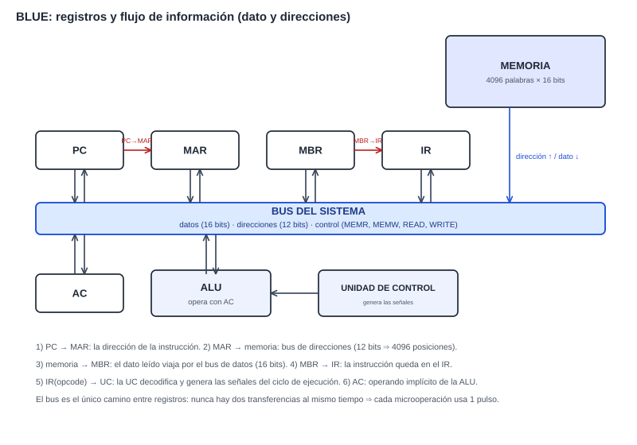

# Máquina BLUE — arquitectura y conjunto de instrucciones

> [!abstract] En una frase
> BLUE es la **computadora didáctica** de la cátedra: 4096 palabras de 16 bits, 5 registros visibles
> (PC, IR, MAR, MBR, AC), un bus único y 16 instrucciones de 4 bits de código + 12 bits de dirección.
> Sirve para que todo lo que dicen los libros se pueda ver en un diagrama de 20 cm.

## Especificación
| Parámetro | Valor | Consecuencia |
|---|---|---|
| Palabra | 16 bits | el bus de datos es de 16 bits |
| Memoria | 4096 × 16 bits | **12 bits de dirección** (2¹² = 4096) |
| Instrucción (sin indexar) | 16 bits | `opcode (4) + dirección (12)` |
| Instrucciones | 16 | 4 bits de opcode |
| Registros | PC (12), MAR (12), MBR (16), IR (16), AC (16) | ver [[Registros de la CPU]] |
| Buses | datos 16, direcciones 12, control | bus **único** ⇒ una transferencia por pulso |
| Unidades | UC + ALU + memoria + E/S | ver [[Estructura básica de un computador]] |

## Diagrama de bloques


## El conjunto de instrucciones (las 16)
| Opcode | Mnemónico | Qué hace | Microoperación |
|---|---|---|---|
| 0000 | **LDA** | carga el AC con el contenido de la dirección D | `AC ← M[D]` |
| 0001 | **STA** | almacena el AC en la dirección D | `M[D] ← AC` |
| 0010 | **ADD** | suma al AC el contenido de D | `AC ← AC + M[D]` |
| 0011 | **SUB** | resta al AC el contenido de D | `AC ← AC − M[D]` |
| 0100 | **AND** | AND bit a bit con el contenido de D | `AC ← AC ∧ M[D]` |
| 0101 | **OR** | OR bit a bit | `AC ← AC ∨ M[D]` |
| 0110 | **XOR** | OR exclusiva bit a bit | `AC ← AC ⊕ M[D]` |
| 0111 | **NOT** | complementa el AC (no usa dirección) | `AC ← AC'` |
| 1000 | **JMP** | salto incondicional a D | `PC ← D` |
| 1001 | **JZ** | salta si el resultado fue cero (Z = 1) | `si Z=1: PC ← D` |
| 1010 | **JC** | salta si hubo acarreo (C = 1) | `si C=1: PC ← D` |
| 1011 | **IN** | lee un dato del puerto de entrada al AC | `AC ← puerto` |
| 1100 | **OUT** | envía el AC al puerto de salida | `puerto ← AC` |
| 1101 | **NOP** | no hace nada (gasta un ciclo) | — |
| 1110 | **HLT** | detiene la máquina | `RUN ← 0` |
| 1111 | *(desplazamiento / libre)* | según apunte: SHL/SHR u otra | `AC ← despl(AC)` |

> [!warning] Verificá los 4 bits de opcode con tu apunte
> Lo que se evalúa es que puedas decir **16 instrucciones, 4 bits de opcode** y **qué hace cada una**.
> Los mnemónicos son los de siempre; la asignación exacta de códigos binarios y la 16.ª instrucción
> conviene copiarla del apunte de la cátedra.

> [!note] La tabla del simulador de la cátedra (TP16)
> En el simulador de la máquina elemental (Blue) que usa el [[TP16 Ciclo de instrucción básico|TP16]] los
> códigos son **decimales**: `1` = cargar (LDA), `2` = almacenar (STA) y `5` = sumar (ADD). La instrucción se
> escribe como `opcode` seguido de la dirección (por ejemplo `1650` = opcode 1, dirección 650).
> **En el final usá la tabla de tu apunte y aclaralo**; lo que se evalúa es la **secuencia del ciclo**, no el
> número.

## Los tres grupos funcionales## Los tres grupos funcionales
1. **Transferencia de datos** (`LDA`, `STA`): el AC habla con la memoria.
2. **Operaciones** (`ADD`, `SUB`, `AND`, `OR`, `XOR`, `NOT`): el AC habla con la ALU.
3. **Control de flujo** (`JMP`, `JZ`, `JC`, `HLT`, `NOP`) y **E/S** (`IN`, `OUT`).

**Sin instrucciones de registro a registro**: como hay un solo AC, todo operando de la ALU sale del AC y
vuelve al AC. Eso es lo que hace que BLUE sea "una dirección" (ver
[[Formato de la instrucción (4 formatos)]]) y lo que después la indexada mejora.

## Estados y señales propias de BLUE
| Elemento | Función |
|---|---|
| **RUN** | 1 = ejecutando; `HLT` lo apaga |
| **STATE** | F = búsqueda, E = ejecución |
| **CLOCK** | pulsos; una microoperación por pulso |
| **Z, C** | flags consultados por `JZ` y `JC` |
| **SI** (en la indexada) | habilita/deshabilita interrupciones |

## Cómo se programaría algo simple
```
        LDA  x       ; AC ← M[x]
        ADD  y       ; AC ← AC + M[y]
        STA  z       ; M[z] ← AC
        HLT
x:      .word 5      ; datos en memoria
y:      .word 7
z:      .word 0
```
Ver más en [[Programar en BLUE — ejemplos]].

## Cómo responderlo en el final
1. Definir BLUE como máquina didáctica de von Neumann con bus único.
2. Dar la especificación: 4096×16, 12 bits de dirección, 16 bits de palabra, 16 opcodes.
3. Dibujar el diagrama de bloques con los 5 registros y los 3 buses.
4. Recorrer la tabla de instrucciones por grupos y explicar **qué hace cada una**.
5. Mencionar RUN/STATE/CLOCK y que cada pulso ejecuta una microoperación.

## Errores típicos
- Decir que la instrucción tiene 16 bits de opcode (son 16 **combinaciones** de 4 bits).
- Confundir el AC (dato) con el IR (instrucción).
- Olvidar que `NOT`, `NOP`, `HLT` no necesitan dirección (usan los 16 bits completos o los ignoran).
- Decir que BLUE tiene registros de propósito general (¡tiene uno solo: el AC!).

## Relacionado
[[Flujo de información en BLUE (datos y direcciones)]] · [[Ciclo de máquina]] · [[Ciclo de búsqueda (7 y 8 pulsos)]] · [[BLUE indexada (RIF, RID, nuevo formato)]] · [[Programar en BLUE — ejemplos]]
