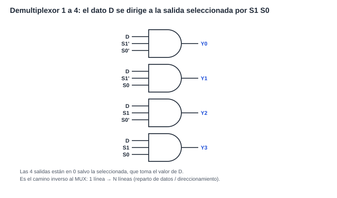

# Prácticas resueltas

> [!abstract] Cómo usar esta nota
> Las **7 prácticas del modelo de final**, resueltas como para entregarlas en el pizarrón: tabla de verdad,
> funciones y gráfico. Cada una indica qué se espera y los errores que descuentan.

---

## Práctica 1 — Sumador completo

**Se pide:** tabla de verdad, funciones y gráfico.

**1) Tabla de verdad**

| A | B | Cin | S | Cout |
|---|---|---|---|---|
| 0 | 0 | 0 | 0 | 0 |
| 0 | 0 | 1 | 1 | 0 |
| 0 | 1 | 0 | 1 | 0 |
| 0 | 1 | 1 | 0 | 1 |
| 1 | 0 | 0 | 1 | 0 |
| 1 | 0 | 1 | 0 | 1 |
| 1 | 1 | 0 | 0 | 1 |
| 1 | 1 | 1 | 1 | 1 |

**2) Funciones**
```
S    = Σm(1,2,4,7) = A'B'Cin + A'BCin' + AB'Cin' + ABC  = A ⊕ B ⊕ Cin
Cout = Σm(3,5,6,7) = A'BCin + AB'Cin + ABCin' + ABC     = A·B + Cin·(A⊕B)
```
Simplificación de Cout: `Cout = Cin(A'B + AB') + AB(Cin' + Cin) = Cin(A⊕B) + AB`
(acarreo **propagado** + acarreo **generado**).

**3) Gráfico**


2 XOR + 2 AND + 1 OR. Señales intermedias: `S1 = A⊕B`, `A·B`, `S1·Cin`.

**4) Cierre:** encadenando n sumadores completos (Cout → Cin del siguiente) se suma en n bits.

> [!warning] Descuenta
> Escribir `S = A+B+Cin` (eso es la OR, no la suma) · dar `Cout = A·B·Cin` · no nombrar las señales
> intermedias en el gráfico.

→ Desarrollo: [[Sumador completo]]

---

## Práctica 2 — Decodificador

**Se pide:** tabla de verdad, funciones y gráfico (se hace el 2→4; se menciona el 3→8).

**1) Tabla de verdad (2 a 4)**

| A1 | A0 | Y0 | Y1 | Y2 | Y3 |
|---|---|---|---|---|---|
| 0 | 0 | 1 | 0 | 0 | 0 |
| 0 | 1 | 0 | 1 | 0 | 0 |
| 1 | 0 | 0 | 0 | 1 | 0 |
| 1 | 1 | 0 | 0 | 0 | 1 |

**2) Funciones** (cada salida es un mintérmino)
```
Y0 = A1'·A0'      Y1 = A1'·A0
Y2 = A1 ·A0'      Y3 = A1 ·A0
```
**3) Gráfico**


2 inversores (generan A1', A0') + 4 compuertas AND de 2 entradas.

**4) El 3→8** (el de las memorias): 8 salidas, 3 bits de dirección ⇒ 8 palabras.


**5) Cierre:** aplicaciones — seleccionar palabra de memoria, habilitar un registro, decodificar el opcode.

> [!warning] Descuenta
> Activar dos salidas a la vez · escribir las funciones sin negar la variable de valor 0 · confundirlo con
> el codificador.

→ Desarrollo: [[Decodificador]]

---

## Práctica 3 — Demultiplexor

**Se pide:** tabla de verdad, funciones y gráfico (1→4).

**1) Tabla de verdad**

| S1 | S0 | Y0 | Y1 | Y2 | Y3 |
|---|---|---|---|---|---|
| 0 | 0 | D | 0 | 0 | 0 |
| 0 | 1 | 0 | D | 0 | 0 |
| 1 | 0 | 0 | 0 | D | 0 |
| 1 | 1 | 0 | 0 | 0 | D |

**2) Funciones**
```
Y0 = D·S1'·S0'     Y1 = D·S1'·S0
Y2 = D·S1 ·S0'     Y3 = D·S1 ·S0
```
**3) Gráfico**


4 compuertas AND de 3 entradas: el dato `D` entra a todas y el selector habilita una sola.

**4) Diferencia con el decodificador:** si `D = 1` siempre, el DEMUX **es** un decodificador.

**5) Cierre:** repartir un dato hacia uno de varios destinos (registros, periféricos, bancos de memoria).

> [!warning] Descuenta
> Omitir `D` en las ecuaciones · invertir entradas y salidas · decir que dos salidas pueden estar activas.

→ Desarrollo: [[Demultiplexor]]

---

## Práctica 4 — Multiplexor

**Se pide:** tabla de verdad, funciones y gráfico (4→1).

**1) Tabla de verdad**

| S1 | S0 | Z |
|---|---|---|
| 0 | 0 | D0 |
| 0 | 1 | D1 |
| 1 | 0 | D2 |
| 1 | 1 | D3 |

**2) Función (suma de productos)**
```
Z = S1'·S0'·D0 + S1'·S0·D1 + S1·S0'·D2 + S1·S0·D3
```
**3) Gráfico**


4 compuertas AND de 3 entradas (dato + dos selectores) y una OR de 4 entradas.

**4) Cierre:** es el **selector de datos**; es lo que decide qué fuente escribe en el bus de la CPU
(y por eso aparece en el [[Flujo de información en BLUE (datos y direcciones)|flujo de información]]).

> [!warning] Descuenta
> No negar los selectores · decir que el MUX tiene memoria · confundir el selector con el dato.

→ Desarrollo: [[Multiplexor]]

---

## Práctica 5 — Álgebra de Boole: definición, 3 postulados y DeMorgan

**1) Definición.** "El álgebra de Boole es un álgebra definida sobre un conjunto de dos elementos {0, 1},
cerrada respecto de dos operaciones binarias (OR y AND) y una unaria (NOT), que cumple los postulados de
identidad, conmutatividad, distributividad y complemento."

**2) Tres postulados**

| Postulado | Forma OR | Forma AND |
|---|---|---|
| **Identidad** | A + 0 = A | A · 1 = A |
| **Distributiva** | A + B·C = (A+B)(A+C) | A(B + C) = AB + AC |
| **Complemento** | A + A' = 1 | A · A' = 0 |

(Se pueden agregar conmutativa, asociativa y dominancia.)

**3) Leyes de DeMorgan**
```
(A + B)' = A' · B'        "el complemento de la suma es el producto de los complementos"
(A · B)' = A' + B'        "el complemento del producto es la suma de los complementos"
```
Demostración por tabla:

| A | B | A+B | (A+B)' | A'·B' |
|---|---|---|---|---|
| 0 | 0 | 0 | 1 | 1 |
| 0 | 1 | 1 | 0 | 0 |
| 1 | 0 | 1 | 0 | 0 |
| 1 | 1 | 1 | 0 | 0 |

**4) Consecuencia (esto es lo que suma puntos):** `(A·B)'` es una **NAND** = `A' + B'`; `(A+B)'` es una
**NOR** = `A'·B'`. Por eso NAND y NOR son **universales**: cualquier función se puede implementar con un
solo tipo de compuerta.

**5) Ejemplo de aplicación.** Simplificar `F = AB + AB' + A'B`:
```
F = A(B + B') + A'B = A·1 + A'B = A + A'B = A + B
```
De 4 compuertas a una OR.

> [!warning] Descuenta
> Negar sólo una variable en DeMorgan · cambiar el operador sin cambiar las variables · enunciar la ley
> sin demostrarla cuando la piden "demuestre".

→ Desarrollo: [[Álgebra de Boole — postulados y teoremas]] · [[Leyes de DeMorgan]]

---

## Práctica 6 — Conjunto de instrucciones, registro de instrucción y 3 ejemplos

**1) El registro de instrucción (IR).** Es el registro que guarda la **instrucción en ejecución**. Se carga
al final del ciclo de búsqueda (`IR ← MBR`) y su parte de **opcode** alimenta el decodificador de la UC; su
parte de **dirección** va al MAR (o al PC, si es un salto). Sin IR no hay nada que decodificar.

**2) Conjunto de instrucciones de BLUE** (16 opcodes, 4 bits)

| Opcode | Instrucción | Microoperación |
|---|---|---|
| LDA | cargar acumulador | `AC ← M[D]` |
| STA | almacenar acumulador | `M[D] ← AC` |
| ADD / SUB | sumar / restar | `AC ← AC ± M[D]` |
| AND / OR / XOR | operaciones lógicas | `AC ← AC op M[D]` |
| NOT | complemento a 1 | `AC ← AC'` |
| JMP | salto incondicional | `PC ← D` |
| JZ | salto si cero | `si Z=1: PC ← D` |
| JC | salto si acarreo | `si C=1: PC ← D` |
| IN / OUT | entrada / salida | `AC ← puerto` / `puerto ← AC` |
| NOP | sin operación | — |
| HLT | detener | `RUN ← 0` |

Formato: `opcode (4 bits) + dirección (12 bits)`.

**3) Tres ejemplos de instrucciones (ensambladas y explicadas)**

**a) `LDA 25h`** — cargar en el AC el contenido de la dirección 25h
```
 0000 | 0000 0010 0101
 opcode   dirección
```
Microoperaciones: `MAR ← IR(dir)`; `MEMR`; `MBR ← M[MAR]`; `AC ← MBR`; flags.

**b) `ADD 30h`** — sumar al AC el contenido de 30h
```
 0010 | 0000 0011 0000
```
Microoperaciones: `MAR ← IR(dir)`; `MEMR`; `MBR ← M[MAR]`; `AC ← AC + MBR` (ALUop = suma); `load flags`.

**c) `JZ 40h`** — salta a 40h si el último resultado fue cero
```
 1001 | 0000 0100 0000
```
Microoperaciones: **no accede a memoria**; consulta el flag Z y, si Z = 1, hace `PC ← IR(dir)`.

> [!warning] Descuenta
> Inventar registros de propósito general · olvidar que `ADD` opera **con memoria** (es CISC) · no aclarar
> que `JZ` usa el flag Z.

→ Desarrollo: [[Máquina BLUE — arquitectura y conjunto de instrucciones]] · [[Programar en BLUE — ejemplos]]

---

## Práctica 7 — Celda elemental y caché

### A) Celda elemental de memoria
Guarda **1 bit**. Está formada por:
1. Un **biestable** (flip-flop D o latch) que retiene el bit.
2. Una **línea de selección** (word line) que habilita la celda.
3. Una **línea de dato** (bit line) por donde entra o sale el bit.
4. Un **buffer de tres estados** que sólo conecta la celda al bus de datos cuando está seleccionada (las
   demás quedan en alta impedancia).
5. La señal **R/W'**: `0` escribe (el dato entra al FF), `1` lee (el FF vuelca su valor).

```
        selección (W)
             │
     dato ──[FF D]── dato (bit line) ──[buffer 3 estados]── bus
             │
          R/W'
```
**SRAM** = latch de 6 transistores, no necesita refresco (caché). **DRAM** = 1 transistor + 1 capacitor,
necesita refresco y lectura destructiva (memoria principal).

### B) Memoria caché
**Definición.** Memoria pequeña y rápida que guarda **copias de bloques** de la memoria principal; el
programa no la ve (es transparente). Funciona por **localidad** temporal y espacial.

**Partes de la dirección:** `etiqueta (tag) | índice (línea o conjunto) | desplazamiento`.
Cada línea guarda: `bit de validez + etiqueta + bloque de datos (+ bit dirty)`.


**Los tres mapeos**

| Mapeo | Dónde puede ir el bloque | Ventaja | Desventaja |
|---|---|---|---|
| **Directo** | una sola línea (`bloque mod nº líneas`) | 1 comparador: simple y rápido | conflictos (thrashing) |
| **Asociativo total** | cualquier línea | mínimos conflictos | comparar con todas: caro |
| **Por conjuntos** (k vías) | un conjunto fijo y cualquier vía del conjunto | el compromiso real (L1/L2/L3) | necesita política de reemplazo |

**Escritura:** *write-through* (escribe en caché y en RAM: coherente, mucho tráfico) o *write-back* (escribe
sólo en caché y marca *dirty*: baja a memoria al desalojar).
**Reemplazo:** LRU, FIFO, aleatorio.
**Inicialización:** al arrancar todas las líneas tienen **validez = 0**; se "vacía" poniendo los bits de
validez en 0 (y bajando los *dirty* si es write-back).

> [!warning] Descuenta
> Decir que la caché guarda sólo la palabra pedida · confundir write-through con mapeo directo · olvidar el
> bit de validez.

→ Desarrollo: [[Celda elemental de memoria]] · [[Memoria caché]]
