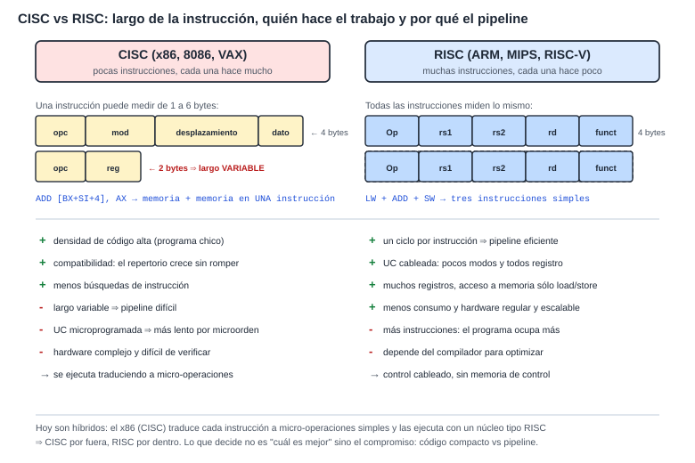

# Arquitectura CISC y RISC

> [!abstract] En una frase
> Son dos filosofías para diseñar el **repertorio de instrucciones** de una CPU. **CISC** (*Complex Instruction
> Set Computer*): **pocas instrucciones pero complejas**, de longitud variable, que pueden operar directamente
> sobre memoria y se implementan con **control microprogramado** (ej.: x86). **RISC** (*Reduced Instruction Set
> Computer*): **muchas instrucciones pero simples**, todas del mismo largo, con acceso a memoria **sólo** por
> `load`/`store`, muchos registros y **control cableado**, lo que permite **pipeline** (ej.: ARM, MIPS).

> [!note] Si es la primera vez que ves esto
> Es la diferencia entre un **cuchillo multiuso** y un **juego de cuchillos especializados**. El multiuso hace de
> todo con un solo objeto (y por eso está en el bolsillo de todos = menos instrucciones, cada una hace mucho). El
> juego de especializados tiene una pieza para cada cosa: si sabés cuál agarrar, cortás **más rápido y mejor**,
> pero tenés que saber cuál (más instrucciones, cada una hace poquito). Las CPUs actuales son **híbridas**: por
> fuera hablan "multiuso" (x86) y por dentro trabajan con "especializados" (micro-operaciones tipo RISC).

---

## 1. De dónde salen las dos ideas (contexto)

**Los años 60-70: el repertorio crece sin freno.** Cada nueva función se agregaba como una instrucción nueva. La
justificación era la **"brecha semántica"**: acercar el lenguaje de máquina al de alto nivel, para que el
compilador tenga menos trabajo y el programa ocupe menos memoria (que era **carísima**). Así aparecen
instrucciones complejas, de longitud variable, con muchos modos de direccionamiento, que operan directamente
sobre memoria. Esa es la línea **CISC**.

**Los años 80: la reacción RISC.** Dos observaciones cambiaron todo:
1. Los compiladores **casi no usaban** las instrucciones complejas (usaban el 20 % del repertorio en el 80 % del
   código).
2. Las instrucciones complejas **tardaban muchos ciclos** y hacían imposible el **pipeline** prolijo.

La propuesta: repertorio **chico y regular**, instrucciones simples, **load/store**, muchos registros,
**control cableado**: cada instrucción en **un ciclo** y todas del **mismo tamaño**, que es justo lo que el
pipeline necesita.

---

## 2. La comparación, punto por punto (la tabla que se pide)



| | **CISC** | **RISC** |
|---|---|---|
| Cantidad de instrucciones | **pocas y complejas** (100–300) | **muchas y simples** (~100–200 pero regulares) |
| Longitud de la instrucción | **variable** (1 a 6 bytes o más) | **fija** (4 bytes, por ejemplo) |
| Modos de direccionamiento | **muchos** | **pocos** (casi todos registro + desplazamiento) |
| Acceso a memoria | **cualquier instrucción** puede operar sobre memoria | **sólo** `LOAD` y `STORE` |
| Operandos | 1 o 2 por instrucción, muchos implícitos | **3** registros explícitos (`ADD R1, R2, R3`) |
| Registros | pocos | **muchos** (32 o más) |
| Unidad de control | **microprogramada** | **cableada** |
| Pipeline | difícil (por el largo variable y los modos) | **natural** (ideal para pipeline) |
| Ciclos por instrucción | varios (2–10 o más) | **casi 1** |
| Densidad de código | **alta** (el programa ocupa menos) | menor (más instrucciones, pero todas iguales) |
| Complejidad del compilador | alta (elegir entre muchas opciones) | **baja** (pocas formas de hacer lo mismo) |
| Consumo / área | mayor | menor |
| Ejemplos | **x86**, 8086/8088, VAX, IBM 360 | **ARM**, MIPS, PowerPC, RISC-V |

---

## 3. La misma operación en las dos arquitecturas (ejemplo resuelto)

Objetivo: **sumar a la posición de memoria `[BX + SI + 4]` el contenido de `AX`**.

**CISC (x86)** — una sola instrucción, compleja:
```asm
ADD [BX+SI+4], AX     ; calcula la dirección (base + índice + desplazamiento)
                      ; lee de memoria, suma, escribe en memoria
```
Una instrucción, **una línea de código**, pero: largo variable, un modo de direccionamiento complicado, **dos
accesos a memoria** (leer y escribir), y en el chip se ejecuta como **varias microoperaciones**.

**RISC (tipo MIPS)** — hay que hacerlo con tres instrucciones simples:
```asm
LW   R1, 4(R2)        ; carga: R1 ← M[R2 + 4]     (acceso a memoria permitido)
ADD  R3, R1, R4       ; suma registro con registro (sin memoria)
SW   4(R2), R3        ; guarda: M[R2 + 4] ← R3
```
Tres instrucciones, **más código**, pero: todas del mismo largo, todas en un ciclo, y cada una se puede solapar
con las otras en el pipeline.

> [!important] Lo que hay que saber decir de este ejemplo
> "El CISC gasta **menos memoria** y **menos instrucciones**; el RISC gasta **más instrucciones** pero las
> ejecuta **más rápido y en paralelo**. Ninguno es mejor en todo: es un **compromiso**."

---

## 4. ¿Por qué CISC usa control microprogramado y RISC cableado?

| | **CISC + microprograma** | **RISC + cableado** |
|---|---|---|
| Por qué | con instrucciones complejas, "cablear" cada caso sería un circuito enorme e ingobernable; el microcódigo lo ordena y permite **cambiar el repertorio** con otra ROM | con instrucciones simples y regulares, la lógica es chica ⇒ se puede **cablear** y es **más rápida** |
| Costo | cada microinstrucción cuesta un acceso a la memoria de control ⇒ más lento | más rápido, pero repertorio **fijo** |

Desarrollo de la UC: [[Cómo se implementa la Unidad de Control]] · [[Unidad de control cableada y microprogramada]].
El **8088** es el ejemplo de la cátedra: UC **microprogramada** con **ROM de 504 × 21 bits** y ~90
microprocedimientos.

---

## 5. Ventajas y desventajas (lo que piden los TPs)

**CISC**
- ✅ **Densidad de código**: programa más chico (importante cuando la memoria era cara).
- ✅ **Menos instrucciones** por tarea ⇒ menos búsquedas de instrucción.
- ✅ **Compatibilidad**: los repertorios crecen sin romper lo anterior (por eso x86 sigue vivo).
- ✅ Mejor para tareas **complejas y poco repetitivas** (sistemas embebidos chicos, código compacto).
- ❌ Instrucciones de **duración variable** ⇒ pipeline difícil.
- ❌ Control microprogramado ⇒ **más lento** por microorden.
- ❌ Hardware **complejo** y difícil de verificar.

**RISC**
- ✅ **Un ciclo por instrucción** ⇒ pipeline eficiente ⇒ **más rendimiento**.
- ✅ Hardware **simple y regular** ⇒ más fácil de diseñar, escalar y verificar; **menos consumo**.
- ✅ **Muchos registros** ⇒ menos accesos a memoria.
- ✅ Compilador más simple (pocas formas de hacer lo mismo).
- ❌ **Más instrucciones** y programa más grande (más presión sobre la caché de instrucciones).
- ❌ Depende del **compilador** para optimizar (registros, programación del pipeline).
- ❌ Peor densidad de código (problema en sistemas muy chicos).

> [!tip] El argumento que cierra la respuesta
> "Con compiladores optimizadores y memorias baratas, el costo del CISC (código grande) dejó de importar; y con
> la necesidad de velocidad, el pipeline del RISC pasó a mandar. Por eso **hoy casi todo es RISC por dentro**."

---

## 6. El presente: híbridos

- **x86 (CISC)** moderno: el hardware **traduce** cada instrucción compleja a **micro-operaciones** simples y las
  ejecuta con un núcleo **tipo RISC** (superscalar, con pipeline). Es decir: **CISC por fuera, RISC por dentro**.
- **ARM (RISC)**: domina móviles y servidores; eficiencia energética.
- **RISC-V**: repertorio abierto, muy usado para enseñar (es el "MIPS de hoy").
- En la cátedra, el ejemplo de CPU real es el **8088**, que es **CISC microprogramado**
  ([[El 8086 como CPU convencional (TP21)]]).

---

## 7. Cómo responderlo en el final (3–4 minutos)

**Movimiento 1 — definición (20 s).** Las dos siglas y la idea: pocas instrucciones complejas vs muchas simples.

**Movimiento 2 — la tabla (60 s).** Los 6 ejes que importan: **cantidad y longitud**, **modos y acceso a
memoria**, **registros**, **unidad de control**, **pipeline/CPI**, **densidad de código**.

**Movimiento 3 — el ejemplo (60 s).** `ADD [BX+SI+4], AX` (CISC) contra `LW + ADD + SW` (RISC), y decir el
compromiso de cada uno.

**Movimiento 4 — el porqué del control (40 s).** Complejo ⇒ **microprogramado**; simple ⇒ **cableado** y pipeline.

**Movimiento 5 — cierre (20 s).** "Hoy son **híbridos**: x86 es CISC por fuera y RISC por dentro; ARM y RISC-V
son RISC. La tendencia fue hacia RISC porque el rendimiento lo exige."

### Repreguntas típicas
| Repregunta | Respuesta corta |
|---|---|
| ¿Cuál es mejor? | **Ninguno**: CISC gana en densidad de código y compatibilidad; RISC en velocidad, consumo y pipeline |
| ¿Por qué el RISC necesita más instrucciones? | Porque cada una hace **menos**: el trabajo se arma combinando (load/store + operaciones registro-registro) |
| ¿Por qué el CISC no tiene buen pipeline? | Por las **instrucciones de largo variable** y de duración variable: no se pueden solapar parejo |
| ¿Qué significa "load/store architecture"? | Que **sólo** las instrucciones `LOAD`/`STORE` tocan memoria; lo demás es registro-registro |
| ¿Dónde entra la UC? | CISC ⇒ **microprogramada**; RISC ⇒ **cableada** (ver [[Cómo se implementa la Unidad de Control]]) |
| ¿El 8086 es RISC o CISC? | **CISC**, microprogramado (ROM de 504 × 21 bits) |
| ¿Por qué ARM está en todos lados si x86 domina las PC? | Porque RISC es más **eficiente en energía** y escalable, clave en móviles |
| ¿Y la "brecha semántica"? | Fue el argumento **a favor** del CISC; se debilitó cuando los compiladores se volvieron buenos |

---

## 8. Errores típicos
- Decir "RISC = menos instrucciones". Es **al revés**: RISC tiene **instrucciones más simples** (y suele tener más
  cantidad de instrucciones distintas).
- Decir que RISC "no usa memoria": usa memoria, pero **sólo** con load/store.
- Confundir **longitud fija** con "instrucciones de un byte": fija quiere decir **todas iguales** (4 bytes, por
  ejemplo).
- Decir que el CISC es "viejo y obsoleto": el x86 factura más que nunca; lo que cambió es **cómo se ejecuta por
  dentro**.
- Olvidar el compromiso de la **densidad de código** (es la ventaja histórica del CISC).

---

## 9. Para ampliar: qué leer y qué buscar

| Fuente | Dónde | Qué buscar | Para qué te sirve |
|---|---|---|---|
| **Apuntes de cátedra**, *Unidad 5* (sección del **8088**) y el cierre de la materia | la descripción del 8088 y las consideraciones sobre microprogramación | el ejemplo real de CISC microprogramado, con sus números (ROM 504 × 21, 90 microprocedimientos) | **Es el anclaje que usa la cátedra** |
| **`Resumen final arqui.pdf`** (material que pasó el profesor) | sección **"Arquitectura CISC"** y **"Arquitectura RISC"** | la lista de características y ventajas/desventajas tal como se dicta | Alineación con lo que se espera escuchar |
| **[[TP20 Lenguaje máquina]]** | el TP | la comparación RISC/CISC pedida con ventajas y desventajas | Lo que se entrega por escrito |
| **Patterson & Hennessy, *Estructura y diseño de computadores*** | capítulo 1 (**"Las ideas grandes"**) y el de **ISA** | el argumento original del RISC y por qué ganó el pipeline | **La mejor ampliación**: el RISC nació de estos autores |
| **Stallings, *Organización y arquitectura de computadores*** | capítulo de **repertorio de instrucciones** / **RISC vs CISC** | tablas comparativas clásicas y la evolución histórica | Para dar contexto con fechas |
| **Tanenbaum, *Estructura de computadores*** | capítulo de **arquitecturas RISC y CISC** | la "brecha semántica" y su crítica | El argumento del debate, explicado |
| **Hamacher, Vranesic, Zaky, *Organización de computadoras*** | capítulo de **repertorio y estilos** | ejemplos de instrucciones complejas vs simples | Ejercicios de comparación |
| **Brey, *Los microprocesadores Intel 8086/8088*** | capítulo de **repertorio del 8086** | modos de direccionamiento y formatos variables | Ver el CISC por dentro |
| **[[Cómo se implementa la Unidad de Control]]** · **[[Pipeline]]** | notas de la bóveda | el vínculo control ↔ estilo, y pipeline ↔ RISC | Los dos puentes que hay que mencionar |

---

## Relacionado
[[Pipeline]] · [[Cómo se implementa la Unidad de Control]] · [[Unidad de control cableada y microprogramada]] ·
[[Lenguaje máquina y clasificación de instrucciones]] · [[Técnicas para aumentar la velocidad]] ·
[[El 8086 como CPU convencional (TP21)]] · [[Formato de la instrucción (4 formatos)]]
