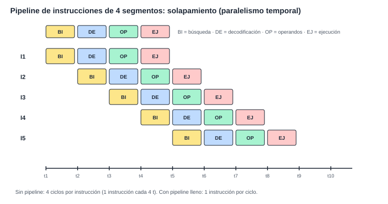
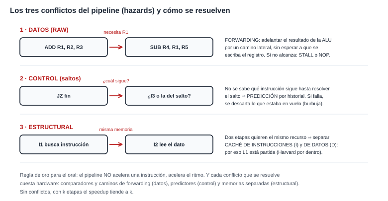

# Pipeline (segmentación de instrucciones)

> [!abstract] En una frase
> El **pipeline** es una técnica de **paralelismo a nivel de instrucciones**: se parte la ejecución en **etapas
> fijas** (búsqueda, decodificación, cálculo de direcciones, búsqueda de operandos, ejecución) y cada etapa
> trabaja **en una instrucción distinta al mismo tiempo**. El resultado: con `k` etapas y `n` instrucciones se
> tardan `k + (n − 1)` ciclos en lugar de `k·n`, y el **speedup** tiende a `k`.

> [!note] Si es la primera vez que ves esto
> Pensá en una **lavandería** con una sola persona: lavar 30 min, secar 30, doblar 30. Si hace todo sola, cada
> carga le cuesta 90 min. Con **tres personas** (una lava, otra seca, otra dobla), la primera carga tarda igual
> 90 min en salir, pero **una carga nueva sale cada 30 min**. El tiempo de **una** tarea no mejora; mejora el
> **ritmo de producción**. Eso es exactamente el pipeline: no hace más rápida una instrucción, hace que se
> **terminen más por unidad de tiempo**.

---

## 1. Las cinco etapas (la versión de la cátedra)

| Etapa | Qué hace | Equivalente en la BLUE |
|---|---|---|
| **1. Búsqueda (fetch)** | traer la instrucción de memoria | CP1-CP6 del ciclo de búsqueda |
| **2. Decodificación** | averiguar qué instrucción es y qué operandos necesita | CP6-CP7 (cuando el IR se carga y la UC decodifica) |
| **3. Cálculo de direcciones** | calcular la dirección efectiva del operando | el sumador de direcciones de la BLUE indexada (`EA = D + RIF/RID`) |
| **4. Búsqueda de operandos** | leer los operandos (registros o memoria) | `MBR → Y` / `AC → Z` |
| **5. Ejecución** | hacer la operación y escribir el resultado | CP8 (`SUM/XOR/AND/OR → A`) |

> [!tip] Por qué las etapas se eligen así
> Porque cada etapa la puede hacer **un bloque de hardware distinto** (memoria, decodificador, sumador, ALU).
> Si dos etapas usaran **el mismo** recurso, no podrían trabajar a la vez: eso es un **conflicto estructural**
> (y es la razón por la que existe la caché separada de instrucciones y datos).

---

## 2. El ejemplo de la cátedra: 8 pulsos, 3 operaciones



> [!example] "En 8 pulsos pude hacer 3 operaciones, cuando sin pipeline necesitaba 8 por cada una"
> Sin pipeline:
> ```
>   A: ████████ (8)   B: ████████ (8)   C: ████████ (8)   ⇒ 24 pulsos
> ```
> Con pipeline (mientras **ejecuto A**, **decodifico B** y **busco C**):
> ```
>   pulso:   1  2  3  4  5  6  7  8
>   A:      B  D  CD BO E                 ← las 5 etapas de A
>   B:         B  D  CD BO E
>   C:            B  D  CD BO E
>   ⇒ en 8 pulsos, las tres avanzaron y A terminó
> ```
> Las tres primeras instrucciones "entran" una por ciclo; a partir de ahí **sale una instrucción por ciclo**.

**La cuenta general**:
```
   sin pipeline:  k · n          ciclos      (k = etapas, n = instrucciones)
   con pipeline:  k + (n − 1)    ciclos
   speedup:       k·n / (k + n − 1)   →  tiende a k cuando n es grande

   Ejemplo k = 4, n = 10:  sin = 40 ; con = 4 + 9 = 13 ⇒ speedup ≈ 3,1
   Ejemplo k = 5, n = 100: sin = 500 ; con = 5 + 99 = 104 ⇒ speedup ≈ 4,8
```

---

## 3. Los tres conflictos (*hazards*) y sus soluciones



| Conflicto | Cuándo ocurre | Ejemplo | Solución |
|---|---|---|---|
| **Estructural** | dos etapas quieren **el mismo recurso** | búsqueda y acceso a datos quieren la misma memoria | memorias separadas (**caché I y D**), o etapas duplicadas |
| **De datos (RAW)** | una instrucción **necesita el resultado** de otra que todavía no terminó | `ADD R1, R2, R3` y después `SUB R4, R1, R5` | **forwarding / bypass** (adelantar el resultado), **stall** (esperar), insertar **NOP**, renombrar registros |
| **De control** | no se sabe cuál es la próxima instrucción hasta resolver un **salto** | un `JMP` o un `JZ` | **predicción** de saltos, **retardo** del salto (llenar con instrucciones útiles), *branch target buffer* |

> [!important] El conflicto de datos explicado como la cátedra
> "D = A + B + C: para calcular D necesito el resultado de C. El problema es **discernir cuándo** necesito el
> resultado de la operación anterior." Si no está listo ⇒ **stall** (burbuja en el pipeline) o **NOP** insertado
> por el compilador. El **forwarding** es mejor: en vez de esperar, se **adelanta** el dato por un camino
> lateral.

---

## 4. Por qué el pipeline "pide" RISC

| Requisito del pipeline | Cómo lo cumple RISC | Problema en CISC |
|---|---|---|
| Instrucciones de **longitud fija** | todas de 4 bytes | largo variable ⇒ no se sabe dónde empieza la siguiente |
| **Etapas parejas** | cada instrucción hace más o menos lo mismo | una instrucción puede tardar 2 ciclos y otra 20 |
| **Pocos modos de direccionamiento** | casi todos registro + desplazamiento | modos complejos ⇒ cálculo de dirección impredecible |
| **Acceso a memoria sólo load/store** | la etapa de memoria es simple y corta | operar sobre memoria alarga la etapa |
| **Muchos registros** | menos accesos a memoria, menos espera | pocos registros ⇒ más tráfico |

Por eso: **RISC nació para poder hacer pipeline**, y por eso los x86 (CISC) **traducen** sus instrucciones a
micro-operaciones simples para poder segmentarlas ([[CISC y RISC]]).

---

## 5. Ejemplo resuelto con tabla de tiempo (para el pizarrón)

Cuatro etapas: **B** (búsqueda), **D** (decodificación), **O** (operandos), **E** (ejecución). Tres
instrucciones: `I1`, `I2`, `I3`.

| Ciclo | 1 | 2 | 3 | 4 | 5 | 6 |
|---|---|---|---|---|---|---|
| **I1** | B | D | O | E | | |
| **I2** | | B | D | O | E | |
| **I3** | | | B | D | O | E |

- **Fin de I1**: ciclo 4 (igual que sin pipeline, ¡ojo!).
- **Fin de I3**: ciclo 6. Sin pipeline habría sido el ciclo 12.
- **A partir del ciclo 4, sale una instrucción por ciclo** (el "ritmo de producción").

---

## 6. Más allá: superpipeline, superscalar y sus límites

| Técnica | Qué agrega |
|---|---|
| **Superpipeline** | más etapas (más finas) ⇒ más frecuencia de reloj, pero más penalidad por conflicto |
| **Superscalar** | **varios pipelines en paralelo** ⇒ más de una instrucción por ciclo |
| **Ejecución fuera de orden** | el hardware reordena para no esperar |
| **Multihilo (SMT/Hyper-Threading)** | dos flujos de instrucciones compartiendo el mismo núcleo |

**Los límites prácticos**: dependencias entre instrucciones, saltos, y que **el pipeline sólo ayuda si hay muchas
instrucciones seguidas** que se puedan solapar. Además, un pipeline profundo castiga mucho cuando hay un salto
mal predicho (se tira todo lo que estaba en vuelo).

---

## 7. Cómo responderlo en el final (3–4 minutos)

**Movimiento 1 — definición (20 s).** "Paralelismo a nivel de instrucciones: etapas fijas que trabajan en
simultáneo sobre instrucciones distintas."

**Movimiento 2 — el dibujo (60 s).** Las **5 etapas** en columnas y el **diagrama de tiempo** con I1, I2, I3
"bajando en escalera". Marcar que **una instrucción no se hace más rápido**: se hacen más por unidad de tiempo.

**Movimiento 3 — la cuenta (40 s).** `k + (n − 1)` contra `k·n`, y el speedup que tiende a `k`. Con el ejemplo de
la cátedra (8 pulsos, 3 operaciones).

**Movimiento 4 — los conflictos (60 s).** Estructural / de datos / de control, con su solución (caché I-D,
forwarding y stalls, predicción).

**Movimiento 5 — cierre (20 s).** "El pipeline es la razón por la que **RISC ganó** y por la que un x86 moderno
traduce a micro-operaciones: el rendimiento hoy se gana **solapando**, no haciendo instrucciones más complejas."

### Repreguntas típicas
| Repregunta | Respuesta corta |
|---|---|
| ¿Una instrucción tarda menos? | **No**: tarda lo mismo (o más por el overhead de los registros de etapa). Lo que mejora es el **rendimiento global** |
| ¿Cuánto se gana? | Hasta `k` veces con `k` etapas, cuando hay muchas instrucciones y ningún conflicto |
| ¿Qué es un stall? | Una **burbuja**: se detiene una etapa porque el dato todavía no está |
| ¿Qué es forwarding? | **Adelantar** el resultado de la ALU a la etapa siguiente sin esperar a que se escriba el registro |
| ¿Cómo se resuelven los saltos? | **Predicción** (se apuesta a que no salta / se usa el historial) y, si falla, se descarta lo que estaba en vuelo |
| ¿Por qué RISC es más apto? | Instrucciones **de largo fijo y un ciclo**: todas las etapas duran lo mismo |
| ¿Pipeline y multicore son lo mismo? | No: el pipeline es paralelismo **dentro** de un flujo; multicore es **varios flujos** en núcleos distintos |
| ¿Dónde se ve en la BLUE? | En el ciclo de máquina: mientras la memoria trae la instrucción (CP1-CP5), la ALU **incrementa el PC** (CP2-CP4). ¡Eso ya es solapar! |

---

## 8. Errores típicos
- Decir que el pipeline **reduce la latencia** de una instrucción (reduce el **tiempo por instrucción promedio**).
- Olvidar los conflictos: "con pipeline todo es k veces más rápido" (falso: por hazards y llenado).
- Confundir **pipeline** (etapas de una instrucción) con **paralelismo de datos** (procesar varios datos a la vez).
- Decir que un salto no afecta: cada salto mal predicho **vacía** el pipeline.
- Confundir **stall** con **NOP**: el NOP es una instrucción que no hace nada; el stall es detener la etapa.

---

## 9. Para ampliar: qué leer y qué buscar

| Fuente | Dónde | Qué buscar | Para qué te sirve |
|---|---|---|---|
| **`Resumen final arqui.pdf`** (material del profesor) | sección **"Pipeline"** | las **5 etapas** que enumera la cátedra y el ejemplo de "8 pulsos / 3 operaciones" | **Es lo que se dictó**: usá ese vocabulario |
| **`blue.pdf`** (Foster) | **"El ciclo de búsqueda"**: el `PC+1` en CP2-CP4 mientras la memoria trabaja | el primer ejemplo de solapamiento de la materia | Buen pie para decir "esto ya es una forma de pipeline" |
| **Apuntes de cátedra**, *Unidad 5* | sección del **8088**: **BIU** (cola de 4 bytes, FIFO) y **EU** | el *prefetch*: la búsqueda y la ejecución separadas en dos unidades | Es el pipeline real que la cátedra menciona |
| **Patterson & Hennessy, *Estructura y diseño de computadores*** | capítulo del **procesador segmentado** | etapas, hazards, forwarding, predicción, y el *speedup* | **La mejor ampliación**: es el capítulo clásico del tema |
| **Stallings, *Organización y arquitectura de computadores*** | capítulo de **pipeline de instrucciones** y de **ILP** | conflictos, superscalar, superpipeline | Muy completo y ordenado |
| **Hamacher, Vranesic, Zaky, *Organización de computadoras*** | capítulo de **pipeline** | el tratamiento con diagramas de tiempo | Ejercicios de cálculo de speedup |
| **Tanenbaum, *Estructura de computadores*** | capítulo de **paralelismo de instrucciones** | pipeline, superscalar, VLIW | Contexto y comparaciones |
| **[[CISC y RISC]]** · **[[Técnicas para aumentar la velocidad]]** | notas de la bóveda | por qué RISC habilita el pipeline; las otras palancas (caché, multicore) | Para cerrar la respuesta |
| **[[Ciclo de máquina]]** | nota de la bóveda | el ciclo que se segmenta | Base conceptual |

---

## Relacionado
[[CISC y RISC]] · [[Técnicas para aumentar la velocidad]] · [[Paralelismo y procesamiento vectorial]] ·
[[Ciclo de máquina]] · [[Cómo se implementa la Unidad de Control]] · [[Memoria caché]] ·
[[Jerarquía de memorias]]
