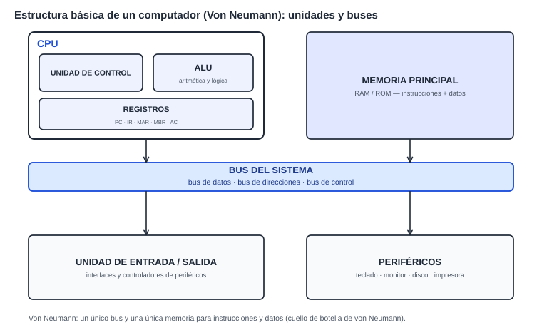

# Estructura básica de un computador

> [!abstract] En una frase
> Un computador es **cinco bloques y tres buses**: **CPU** (UC + ALU + registros), **memoria**, **entrada**,
> **salida** y **buses** (de **datos**, de **direcciones** y de **control**). La idea que lo hace posible es la
> de **von Neumann**: el **programa se guarda en la misma memoria que los datos**, así que la máquina no necesita
> estar cableada para cada tarea.

> [!note] Si es la primera vez que ves esto
> Con ese esquema entendés **cualquier** computadora, desde una calculadora hasta un servidor: cambian los
> tamaños (16 bits o 64), no la estructura. Pensalo como una oficina: la **CPU** es el empleado que trabaja, la
> **memoria** es el archivo, la **entrada** es el mostrador donde llegan los papeles, la **salida** es donde se
> entregan los resultados y los **buses** son los pasillos por donde circulan las carpetas. Si los pasillos son
> angostos (bus de 8 bits), el empleado tarda más; si el archivo está lejos (memoria lenta), también.

---

## 1. Las cinco unidades y qué hace cada una

| Unidad | Qué hace | Qué contiene | Nota de la bóveda |
|---|---|---|---|
| **CPU** (Unidad Central de Proceso) | **ejecuta** las instrucciones | **UC** (manda), **ALU** (calcula), **registros** (memoria rápida interna) | [[Registros de la CPU]] · [[ALU]] · [[Unidad de Control]] |
| **Memoria** | guarda **programa y datos** | celdas + decodificador + registros de dirección y dato | [[Memoria RAM 8x3]] · [[Jerarquía de memorias]] |
| **Entrada** | trae información de afuera | teclado, lector, sensor | [[Interrupciones y entrada-salida]] |
| **Salida** | lleva información afuera | pantalla, impresora, actuador | ídem |
| **Buses** | comunican todo | datos, direcciones, control | abajo, en detalle |

> [!important] La CPU no "hace todo": **manda, calcula y recuerda un poco**
> - **UC**: interpreta la instrucción y genera las señales (no hace cuentas).
> - **ALU**: hace las cuentas y las operaciones lógicas.
> - **Registros**: memoria ultrarrápida de trabajo (decenas de bits, no millones).
> Si te confundís con esto en el oral, se cae toda la respuesta.

---

## 2. Los tres buses, en detalle

> [!note] Definición de la cátedra (TP14)
> "Un **bus** es una vía de comunicación que conecta **dos o más dispositivos**: una señal transmitida por
> cualquier dispositivo conectado será recibida por **todos** los otros."

De esa definición salen las dos consecuencias que hay que decir:
- **Todos escuchan** ⇒ hace falta **seleccionar** quién responde (direcciones + *chip select*).
- **Uno habla por vez** ⇒ cada dispositivo necesita poder **desconectarse** (salida de **tres estados**).

| Bus | Función | Sentido | Su ancho determina |
|---|---|---|---|
| **Datos** | transporta el dato (o la instrucción) | **bidireccional** | el **tamaño de palabra** del sistema |
| **Direcciones** | indica **a quién** va el dato (celda o puerto) | **unidireccional** (CPU → memoria/E/S) | la **capacidad máxima de memoria** (`2ⁿ`) |
| **Control** | ordena **qué** hacer y **cuándo** | UC → todos → UC | cuántas operaciones distintas de control existen |

**Líneas de control típicas** (las que enumera el TP14): lectura/escritura de **memoria** · lectura/escritura
de **E/S** · **petición de bus** · **cesión de bus** · **petición de interrupción**.

**Los números de la BLUE**:
```
   CPU ◄──── bus de datos 16 bits ────► Memoria (4096 × 16)
   CPU ──── bus de direcciones 12 ────► Memoria
   CPU ──── bus de control ───────────► Memoria y periféricos
```

> [!tip] Dos consecuencias que valen puntos
> 1. **Ancho del bus de direcciones y capacidad**: con 12 bits direccionás `2¹² = 4096` celdas. Si querés más
>    memoria, **hay que agregar bits de dirección** (no hay otra).
> 2. **Bus de datos más angosto que la instrucción**: si el bus tiene 8 bits y la instrucción 16, hacen falta
>    **dos accesos** para traer una instrucción. Es la razón por la que el 8088 (bus de 8 bits, registros de 16)
>    es más lento que el 8086.

---

## 3. Von Neumann: la idea que cambió todo

**Antes**: las máquinas se "cableaban" para cada problema (ENIAC se programaba con enchufes y llaves). Cambiar
de tarea era **reconectar la máquina**.

**La idea (von Neumann, 1945, en la máquina **IAS**)**: guardar **las instrucciones en la misma memoria** que los
datos, en forma de números. Entonces:
- la máquina **no cambia**: cambia el **programa** que tiene cargado;
- el hardware puede ser **general**;
- aparece el **ciclo búsqueda–ejecución** (va a buscar instrucciones **y** datos al mismo lugar).

| | **Von Neumann** | **Harvard** |
|---|---|---|
| Memoria | **una**, compartida para programa y datos | **dos** memorias y **dos** buses separados |
| Ventaja | simple, flexible, memoria mejor aprovechada | se puede **buscar instrucción y dato a la vez** (más rápido) |
| Desventaja | **cuello de botella** (el bus atiende una cosa por vez) | más hardware, más pines, menos flexible |
| Dónde se usa | CPUs generales (x86, ARM hasta cierto punto) | microcontroladores y **cachés internas** (L1 separada en I y D) |

> [!warning] El detalle que impresiona
> Las CPUs modernas son **von Neumann por fuera y Harvard por dentro**: la memoria principal es única, pero las
> **cachés de nivel 1 están separadas en instrucciones (I-cache) y datos (D-cache)**. Es decir: se usa la
> variante rápida donde importa y la flexible donde conviene. (Es el mismo tipo de razonamiento híbrido de
> [[CISC y RISC]].)

---

## 4. La máquina IAS: el antepasado concreto (TP15)

La cátedra usa la **IAS** para mostrar la estructura básica "de la época" con números:

| Dato de la IAS | Valor |
|---|---|
| Palabra | **40 bits** |
| Instrucción | **20 bits**, en **dos mitades de 8 + 12**: opcode (8) + dirección (12) |
| En una palabra | entran **dos instrucciones** (2 × 20) |
| Memoria | 4096 palabras de 40 bits |
| Registros | `IR` (8 bits de opcode), `MAR` (12), `MBR` (40), `AC` y `MQ` (40), `PC` (12) |

Lo interesante: **una instrucción de 20 bits dentro de una palabra de 40** ⇒ la mitad de la palabra queda para
la instrucción siguiente. Es la versión histórica del problema "formato y longitud de instrucción"
([[Formato de la instrucción (4 formatos)]]).

---

## 5. El esquema completo, dibujado

```
                    ┌──────────────────────────────────────────┐
                    │                MEMORIA                   │
                    │   celdas + decodificador + MAR/MBR       │
                    └───────▲───────────────▲──────────────────┘
             bus de direcciones (12)   bus de datos (16)
                            │               │
   ┌────────────────────────┴───────────────┴─────────────────────┐
   │                            CPU                               │
   │  ┌──────────────┐   ┌───────────────┐   ┌─────────────────┐  │
   │  │ Unidad de    │   │     ALU       │   │   Registros     │  │
   │  │ Control (UC) │   │ (+ Y y Z)     │   │ PC MAR MBR IR AC│  │
   │  └──────┬───────┘   └───────────────┘   └─────────────────┘  │
   │         │  señales de control                                │
   └─────────┼────────────────────────────────────────────────────┘
             │
   ┌─────────▼─────────┐            ┌──────────────────┐
   │   ENTRADA (E/S)   │◄── bus ───►│   SALIDA (E/S)   │
   │  periféricos,     │            │  periféricos,    │
   │  líneas de selección           │  interrupciones  │
   └───────────────────┘            └──────────────────┘
```



**Y el esquema mínimo de la BLUE** (el que se dibuja en el final):
- arriba: memoria (4096 × 16)
- a la izquierda: la CPU con PC, MAR, MBR, IR, AC, la ALU (Y, Z) y la UC
- a la derecha: los periféricos con **6 líneas de selección de dispositivo** (hasta 64 dispositivos) y las
  líneas **R** (ready)
- en el medio: el **bus único** de 16 bits

---

## 6. Cómo se conecta cada unidad con el resto de la materia

| Si te preguntan… | La respuesta está en… |
|---|---|
| cómo se mueve la información entre estos bloques | [[Flujo de información en BLUE (datos y direcciones)]] |
| qué hace la CPU pulso por pulso | [[Ciclo de máquina]] |
| quién genera las señales de la CPU | [[Unidad de Control]] · [[Cómo se implementa la Unidad de Control]] |
| cómo se guarda un programa | [[Memoria RAM 8x3]] · [[Espacio de direccionamiento y cálculo de CodOp-Dirección]] |
| cómo un periférico avisa que terminó | [[Interrupciones y entrada-salida]] |
| qué hay dentro del gabinete | [[TP13 Componentes internos]] |

---

## 7. Cómo responderlo en el final (3 minutos)

**Movimiento 1 — definición (20 s).** "Un computador tiene cuatro unidades funcionales —CPU, memoria, entrada y
salida— unidas por tres buses: datos, direcciones y control."

**Movimiento 2 — dibujo (60 s).** Los cuatro bloques y los tres buses, con los **anchos** de la BLUE (datos 16,
direcciones 12). Adentro de la CPU, **UC + ALU + registros**.

**Movimiento 3 — desarrollo (80 s).**
1. Para qué sirve **cada bus** y **qué determina su ancho** (palabra vs capacidad de memoria).
2. **Von Neumann**: una sola memoria para programa y datos ⇒ ciclo búsqueda-ejecución.
3. **Harvard** como contraste y su uso real (cachés L1 separadas).
4. Ejemplo histórico con números: la **IAS** (palabra 40, instrucción 20 en dos mitades de 8+12).

**Movimiento 4 — cierre (20 s).** "La estructura no cambia con la tecnología: cambian los anchos. Y el
compromiso central sigue siendo el mismo: **un bus único es simple pero es un cuello de botella**."

### Repreguntas típicas
| Repregunta | Respuesta corta |
|---|---|
| ¿Por qué el bus de direcciones es unidireccional? | Porque la CPU **siempre** es la que indica a dónde ir; la memoria nunca le dice a la CPU "andá a tal lugar" |
| ¿Qué pasa si agrego un bit al bus de direcciones? | **Duplico** la memoria direccionable (`2ⁿ`) |
| ¿Qué pasa si agrego un bit al bus de datos? | Duplico el tamaño de palabra (y el ancho de la ALU y los registros) |
| ¿Dónde está el programa cuando la máquina está apagada? | En memoria **no volátil** (disco, ROM); la RAM se carga al arrancar. Ver [[Memoria ROM y sus tipos]] |
| ¿La E/S es parte de la estructura? | Sí, es una de las cuatro unidades funcionales; se conecta por el bus y por líneas de control |
| ¿Cuál es el cuello de botella de von Neumann? | El **bus único**: la CPU espera a la memoria; se ataca con **caché** y con **pipeline** |

---

## 8. Errores típicos
- Decir "la CPU es la unidad de control": la CPU **contiene** la UC (más la ALU y los registros).
- Confundir **bus de datos** con **bus de direcciones** al describir una transferencia.
- Decir que von Neumann significa "una sola memoria **y** un solo bus": lo primero es la definición; lo segundo
  es una consecuencia de implementación.
- Olvidar las **líneas de control** y quedarse sólo con datos y direcciones.
- Decir que la memoria "piensa" o "decide": la memoria **obedece** órdenes de lectura/escritura.

---

## 9. Para ampliar: qué leer y qué buscar

| Fuente | Dónde | Qué buscar | Para qué te sirve |
|---|---|---|---|
| **Apuntes de cátedra**, *Unidad 4 — Estructura básica de una computadora* | el comienzo de la unidad | los **cuatro elementos** que enumera la cátedra y el esquema de bloques | Es la fuente exacta de esta pregunta |
| **`blue.pdf`** (Foster) | **"Descripción para el programador"** y **"El esquema completo de la máquina"** (Fig. 6) | la BLUE rodeada de memoria, consola y periféricos; los tres tipos de ruta (bus común, múltiple, punto a punto) | Las **tres formas** de interconectar (y por qué se eligió el bus común) |
| **[[TP14 Buses]]** y **[[TP15 Arquitectura de Von Neumann (IAS)]]** | los TPs | la definición de bus de la cátedra y las líneas de control; la IAS con sus 40 bits | Las dos fuentes que usa el profesor para esta pregunta |
| **[[TP13 Componentes internos]]** | el TP | qué hay dentro del gabinete (motherboard, chipset, ranuras) | Para el "contexto físico" si la mesa lo pide |
| **Stallings, *Organización y arquitectura de computadores*** | capítulos de **estructura de computadores** y de **buses** | el modelo de bloques, jerarquía de buses, arbitraje | La versión moderna y completa del mismo esquema |
| **Patterson & Hennessy, *Estructura y diseño de computadores*** | capítulo 1 (**abstracción, rendimiento, von Neumann**) | las cinco componentes clásicas y el "gran cuadro" | Para hablar de rendimiento y del cuello de botella |
| **Hamacher, Vranesic, Zaky, *Organización de computadoras*** | capítulo 1 y el de **el procesador** | estructura funcional, buses y su papel | Notación formal y ejercicios |
| **Tanenbaum, *Estructura de computadores*** | capítulo de **organización del computador** | el modelo de niveles y la estructura de buses | Para explicar con la analogía de "niveles" |
| **`El_manual_del_Microprocesador.pdf`** | el manual completo | encapsulados, zócalos, chipset, cómo se conecta el microprocesador a la placa | Contexto real y útil si te preguntan "¿cómo es físicamente?" |

---

## Relacionado
[[Flujo de información en BLUE (datos y direcciones)]] · [[Ciclo de máquina]] · [[Registros de la CPU]] ·
[[ALU]] · [[Unidad de Control]] · [[Jerarquía de memorias]] · [[Interrupciones y entrada-salida]] ·
[[Memoria RAM 8x3]]
