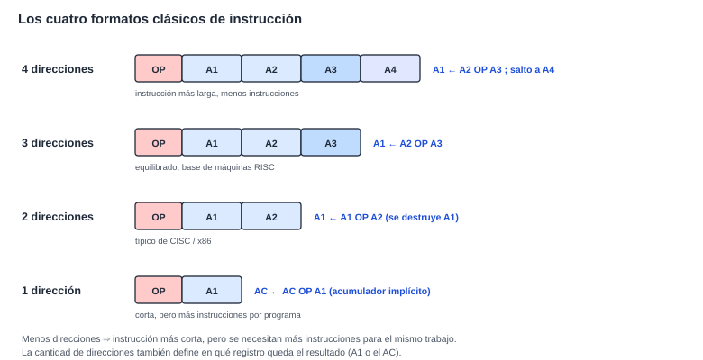

# Formato de la instrucción (4 formatos)

> [!abstract] En una frase
> El **formato** es el reparto de bits de una instrucción entre el **código de operación** (qué hacer) y las
> **direcciones** (dónde están los datos). Hay cuatro formatos clásicos —**4, 3, 2 y 1 dirección**— y cada uno
> se obtiene **eliminando un campo** del anterior: primero la dirección de la próxima instrucción (la reemplaza
> el PC), después la del resultado (se guarda en un operando), después la del primer operando (queda implícito
> en el acumulador). **BLUE usa 1 dirección**: 4 bits de opcode + 12 de dirección.

> [!note] Si es la primera vez que ves esto
> Una instrucción es **una orden escrita en bits**: "sumá" + "de dónde" + "a dónde". El problema es el
> espacio: cada dirección ocupa muchos bits. Si pongo cuatro direcciones, la instrucción es larguísima; si
> pongo una, es corta pero la máquina tiene que "adivinar" el resto guardando un operando fijo en un registro.
> Recorrer los cuatro formatos es recorrer **la historia de la informática** tratando de achicar la
> instrucción sin perder capacidad de cálculo. Y como esa historia está llena de compromisos, es una pregunta
> ideal para el oral: siempre hay algo que decir.

---

## 1. Qué se necesita para hacer una operación
Para cualquier operación con **dos operandos y un resultado** (diódica: `X = A + B`) hacen falta **cuatro
datos** además del "qué hacer":

1. dónde está el **primer operando**,
2. dónde está el **segundo operando**,
3. dónde va el **resultado**,
4. dónde está la **próxima instrucción**.

Ese es el punto de partida: **cuatro direcciones**. Todo lo demás es "¿cuál de estas cuatro puedo eliminar
sin perder nada?".

| Palabra | Qué significa |
|---|---|
| **Opcode** | código de operación: los bits que dicen **qué** hacer (sumar, cargar, saltar) |
| **Campo de dirección** | los bits que dicen **dónde** (una dirección de memoria o un número de registro) |
| **Operando implícito** | el que no aparece en la instrucción porque **se asume** (el acumulador) |
| **Longitud de instrucción** | cuántos bits ocupa; en la palabra fija, es igual al tamaño de la palabra |
| **CPI** | ciclos por instrucción: instrucciones más complejas suelen costar más ciclos |

---

## 2. Los cuatro formatos, uno por uno

### 2.1 Cuatro direcciones (el primero de la historia)
```
┌──────┬─────────┬─────────┬─────────┬──────────────┐
│ OP   │  Dir A  │  Dir B  │  Dir Res│  Dir próxima │
└──────┴─────────┴─────────┴─────────┴──────────────┘
   ADD A, B, C, D    →   M[C] ← M[A] + M[B]   y después sigue en D
```
- **Ventajas**: **no hacen falta instrucciones de salto** (cada instrucción dice dónde sigue) y **un solo
  ciclo de búsqueda** trae los tres operandos con referencia a memoria.
- **Desventaja**: la instrucción es **larguísima** (cinco campos). Con 12 bits por dirección ya son 60 bits
  por instrucción. **Por eso estas máquinas no prosperaron.**

### 2.2 Tres direcciones (se elimina la dirección de la próxima instrucción)
```
┌──────┬─────────┬─────────┬─────────┐
│ OP   │  Dir A  │  Dir B  │  Dir Res│
└──────┴─────────┴─────────┴─────────┘
   ADD A, B, C      →   M[C] ← M[A] + M[B]   ; la próxima la da el PC
```
¿Quién reemplaza ese campo? El **Contador de Programa (PC)**: las instrucciones se guardan **en forma
sucesiva** en memoria y el PC se incrementa solo; **sólo los saltos** lo modifican.
- **Ventaja**: instrucción más corta, programa más legible, **no destruye operandos** (el resultado va a otra
  parte).
- **Desventaja**: sigue siendo larga. Es el formato típico de las **máquinas RISC** y de los lenguajes de alto
  nivel (`X = A + B` se traduce casi directo).

### 2.3 Dos direcciones (se elimina la dirección del resultado)
```
┌──────┬─────────┬─────────┐
│ OP   │  Dir A  │  Dir B  │
└──────┴─────────┴─────────┘
   ADD A, B         →   M[B] ← M[A] + M[B]   ; el resultado pisa el operando B
```
- **Ventaja**: instrucción más corta.
- **Desventaja**: **se destruye un operando** (el B). Si lo necesitás después, hay que copiarlo antes. Es el
  formato de las máquinas tipo **CISC** y de la mayoría de los ensambladores comerciales.
- Con dos direcciones, `X = A + B` necesita **dos instrucciones**: `MOV X, A` y `ADD X, B`.

### 2.4 Una dirección (se elimina la dirección del primer operando) — **el de BLUE**
```
┌──────┬─────────┐
│ OP   │  Dir B  │
└──────┴─────────┘
   ADD B            →   AC ← AC + M[B]
```
El primer operando **no hace falta nombrarlo**: está siempre en **el acumulador** (es un *operando implícito*).
- **Ventajas**: instrucción **muy corta** (BLUE: 16 bits, entra en una palabra) y hardware simple.
- **Desventajas**: todo pasa por el acumulador (cuello de botella), hay que escribir **más instrucciones**
  (`LDA A` + `ADD B` + `STA X` para hacer `X = A + B`) y la instrucción depende de un registro fijo.

> [!example] El mismo cálculo en los cuatro formatos
> Objetivo: `X = A + B`.
> | Formato | Cómo se escribe | Instrucciones |
> |---|---|---|
> | 4 direcciones | `ADD X, A, B, prox` | **1** (la más larga) |
> | 3 direcciones | `ADD X, A, B` | **1** |
> | 2 direcciones | `MOV X, A` + `ADD X, B` | **2** |
> | 1 dirección | `LDA A` + `ADD B` + `STA X` | **3** (las más cortas) |
>
> Y ahora con un arreglo de 100 elementos: los formatos de 3 y 4 direcciones resuelven el lazo con **menos
> instrucciones**, pero ocupan el doble o el triple de memoria **por instrucción**. Ese es el compromiso.

---

## 3. El formato de la BLUE en detalle (16 bits = 1 palabra)

```
 15      12 11                          0
┌──────────┬────────────────────────────┐
│  Opcode  │        Dirección           │
│  4 bits  │          12 bits           │
└──────────┴────────────────────────────┘
   16 instrucciones        4096 celdas
```

**¿Por qué 4 y 12?** Porque la palabra de la BLUE es de **16 bits** y la memoria tiene **4096 = 2¹²** celdas:
- 12 bits de dirección ⇒ direccionás 4096 celdas ✔
- los 4 bits que sobran ⇒ **2⁴ = 16 instrucciones** ✔

Es un reparto "perfecto" para esa máquina: no sobra ni falta nada. Y explica de dónde salen **los dos números
que hay que saber de memoria**: 16 instrucciones y 4096 celdas.



**Palabra de dato vs palabra de instrucción** (esto es del apunte y se pregunta):
| Palabra | Formato | Interpretación |
|---|---|---|
| **Dato** | `S │ Magnitud` (1 + 15 bits) | entero de 15 bits **con signo** (complemento a dos) |
| **Instrucción** | `Opcode (4) │ Dirección (12)` | qué hacer + dónde |

La misma celda de 16 bits puede ser dato o instrucción: **el programa decide cuál es cuál**. Eso es
precisamente von Neumann ([[Estructura básica de un computador]]).

---

## 4. Y en la BLUE indexada: formato **variable** de 2 palabras

```
 31      27 26   25 24        16 15                    0
┌──────────┬───────┬────────────┬────────────────────────┐
│ Opcode 5 │ Modif │  sin uso 9 │   Campo de dirección 16│
└──────────┴───────┴────────────┴────────────────────────┘
```
| Cambio | Consecuencia |
|---|---|
| Opcode de 4 → **5 bits** | hasta **32 instrucciones** |
| Dirección de 12 → **16 bits** | hasta **65 536 celdas** |
| **+ campo modificador de 2 bits** | **4 modos** de direccionamiento |
| Instrucción de 1 → **2 palabras** | el ciclo necesita **un ciclo de máquina extra** (24 pulsos en vez de 16) |

> [!important] El compromiso, dicho en una frase
> **Cada bit que agregás a la instrucción te cuesta memoria y pulsos; cada bit que sacás te cuesta
> instrucciones y registros fijos.** Los formatos de 4 a 1 dirección son la crónica de ese intercambio, y la
> indexada muestra el movimiento contrario: **cuando querés más capacidad, la instrucción vuelve a crecer.**

---

## 5. Cómo se calcula el formato de una máquina (ejercicio clásico del final)
Con la fórmula del TP17/TP18:

```
nº de celdas       = capacidad de memoria ÷ tamaño de celda
bits de dirección  = log₂(nº de celdas)
bits de opcode     = bits de la palabra − bits de dirección
```
**Ejemplo**: memoria de 512 MB, celdas de 4 bytes, palabra de instrucción de 32 bits.
- `512 MB ÷ 4 B = 128 M = 2²⁷` celdas ⇒ **27 bits de dirección**
- `32 − 27 = 5` bits de opcode ⇒ **32 instrucciones**

Desarrollo completo con los cuatro ejercicios del TP: [[Espacio de direccionamiento y cálculo de CodOp-Dirección]].

---

## 6. Cómo responderlo en el final (3–4 minutos)

**Movimiento 1 — definición (20 s).** "El formato es el reparto de bits entre el opcode y las direcciones; hay
cuatro clásicos según cuántas direcciones incluye la instrucción."

**Movimiento 2 — dibujo (60 s).** Las **cuatro cajas** una abajo de la otra, de la más larga a la más corta, y
una flecha que muestre **qué campo se elimina** en cada paso (próxima instrucción → resultado → primer
operando).

**Movimiento 3 — desarrollo (90 s).** Para cada formato: qué mejora y qué se pierde, con el ejemplo
`X = A + B` en 1, 2 y 3 instrucciones. Cerrar con el formato de BLUE: 4 + 12, y **de dónde salen** esos
números (16 bits de palabra y 4096 celdas).

**Movimiento 4 — cierre (20 s).** "BLUE usa 1 dirección: instrucción corta y hardware simple, a cambio de más
instrucciones y un acumulador como cuello de botella. La indexada lo estira a 2 palabras para ganar modos y
memoria."

### Repreguntas típicas
| Repregunta | Respuesta corta |
|---|---|
| ¿Cuál es el mejor formato? | No hay uno mejor: **3 direcciones** es el más equilibrado (base de RISC); **1 dirección** es el más barato de implementar |
| ¿Qué reemplaza la dirección de la próxima instrucción? | El **PC**, que se incrementa solo; sólo los saltos lo cambian |
| ¿Qué es un operando implícito? | El que no se nombra porque está **siempre** en un registro fijo: en BLUE, el **AC** |
| ¿Por qué la indexada tiene formato variable? | Porque necesita un **modificador de 2 bits** y una dirección de 16: no entra en 16 bits |
| ¿Qué pasa si una máquina tiene instrucciones de distinto largo? | El **PC debe incrementarse en el largo real** de cada una (mirá el TP21: los offsets del 8086 no avanzan igual) |
| ¿Cómo se relaciona con RISC y CISC? | RISC usa formatos **fijos** y simples (casi todos 3 direcciones); CISC usa **variables** y de 1 y 2 direcciones ([[CISC y RISC]]) |

---

## 7. Errores típicos
- Decir que "menos direcciones = peor máquina". Es un **compromiso**: menos bits por instrucción, más
  instrucciones por programa.
- Confundir **campo de dirección** con **dirección efectiva**: el campo es el número que está en la
  instrucción; la efectiva es la que **resulta** después de aplicar el modo de direccionamiento.
- Olvidar que en 2 direcciones **se destruye un operando**.
- Decir que BLUE tiene "4 bits de dirección" (son **12**; 4 son de opcode).
- En la indexada, decir "5 + 16" y saltearse el modificador: son **5 + 2 + 9 + 16 = 32**.

---

## 8. Para ampliar: qué leer y qué buscar

| Fuente | Dónde | Qué buscar | Para qué te sirve |
|---|---|---|---|
| **Apuntes de cátedra**, *Unidad 5 — Arquitectura convencional* | sección **"Formatos de instrucción"** (está al principio de la unidad, antes de los modos de direccionamiento) | las cuatro cajas tal como las da la cátedra y las ventajas/desventajas de cada una | **Es la fuente exacta de esta pregunta**: el oral se resuelve con esa sección |
| **`blue.pdf`** (Foster) | sección **"Descripción para el programador"**, Fig. 1 | el formato de palabra de dato (signo + magnitud) frente al de instrucción (opcode + dirección) | El detalle "palabra de dato vs palabra de instrucción" |
| **[[TP17 Formato básico de instrucciones]]** y **[[TP18 Direccionamiento de memoria]]** | los TPs | instrucción de 2 B (4+12) vs dato de 4 B; cálculo de celdas y bits de CodOp | Los ejercicios que caen en el final |
| **Patterson & Hennessy, *Estructura y diseño de computadores*** | capítulo de **representación de instrucciones / formatos de instrucción** | formatos R, I y J de MIPS; por qué las RISC usan largo fijo | Entender el "por qué" del formato fijo y cómo se codifica un opcode real |
| **Hamacher, Vranesic, Zaky, *Organización de computadoras*** | capítulo de **instrucciones y direccionamiento** | formatos de 0, 1, 2 y 3 direcciones con ejemplos numéricos | Otra vuelta a los cuatro formatos, con ejercicios |
| **Stallings, *Organización y arquitectura de computadores*** | capítulo de **formatos de instrucción y modos de direccionamiento** | el compromiso longitud/cantidad de instrucciones, expansión de opcodes | Para poder hablar de "expansión de opcode" y formatos variables |
| **Brey, *Los microprocesadores Intel 8086/8088*** (bibliografía del TP21) | capítulo del **formato de instrucción del 8086** | instrucciones de 1 a 6 bytes, prefijos, campos MOD-REG-R/M | Ver un formato variable real y por qué los offsets no avanzan parejo |
| **[[TP20 Lenguaje máquina]]** | el TP | cómo se pasa de lenguaje ensamblador a máquina | Cerrar el circuito: formato → codificación |

---

## Relacionado
[[Modos de direccionamiento]] · [[Espacio de direccionamiento y cálculo de CodOp-Dirección]] ·
[[BLUE vs BLUE indexada — qué cambia y por qué]] · [[Máquina BLUE — arquitectura y conjunto de instrucciones]] ·
[[Lenguaje máquina y clasificación de instrucciones]] · [[CISC y RISC]] ·
[[Flujo de información en BLUE (datos y direcciones)]]
