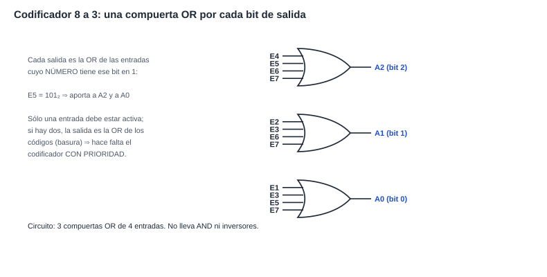

# Codificador

> [!abstract] En una frase
> El **codificador** hace lo **inverso** del [[Decodificador]]: recibe **2ⁿ líneas** (de las cuales **una** está
> activa) y entrega en la salida el **código binario de n bits** de esa línea. Sus salidas son **sumas de las
> entradas** que tienen ese bit en 1: `A0 = E1 + E3 + E5 + E7`, `A1 = E2 + E3 + E6 + E7`,
> `A2 = E4 + E5 + E6 + E7`.

> [!note] Si es la primera vez que ves esto
> Es el **timbre del departamento, al revés**. En el decodificador, yo digo el número y suena un timbre. En el
> codificador, **alguien aprieta un timbre** y en la portería aparece **el número** de quién fue.
>
> Sirve cuando tenés **muchas líneas** y querés **gastar pocos cables**: un teclado tiene 12 teclas, pero al
> sistema le alcanza con saber "se apretó la tecla 7" en 4 bits. El codificador comprime: **2ⁿ líneas de entrada →
> n bits de salida**. Y el caso interesante es cuando **dos o más** aprietan a la vez: ahí hace falta decir quién
> tiene **prioridad**.

---

## 1. La tabla, mirando "una sola entrada activa"

### Codificador 4 → 2
| E3 | E2 | E1 | E0 | A1 | A0 |
|---|---|---|---|---|---|
| 0 | 0 | 0 | **1** | 0 | 0 |
| 0 | 0 | **1** | 0 | 0 | 1 |
| 0 | **1** | 0 | 0 | 1 | 0 |
| **1** | 0 | 0 | 0 | 1 | 1 |

**Funciones** (mirando en qué filas la salida vale 1):
```
   A1 = E2 + E3          A0 = E1 + E3
```
**Circuito: 2 compuertas OR de 2 entradas.** Nada más. Ésa es la diferencia grande con el decodificador: el
codificador **no necesita AND ni inversores**, porque su tabla tiene un solo 1 por fila y las salidas se escriben
directamente como la **OR de las entradas** que les corresponden.

### Codificador 8 → 3
| Entrada activa | E7 | E6 | E5 | E4 | E3 | E2 | E1 | E0 | A2 | A1 | A0 |
|---|---|---|---|---|---|---|---|---|---|---|---|
| E0 | 0 | 0 | 0 | 0 | 0 | 0 | 0 | **1** | 0 | 0 | 0 |
| E1 | 0 | 0 | 0 | 0 | 0 | 0 | **1** | 0 | 0 | 0 | 1 |
| E2 | 0 | 0 | 0 | 0 | 0 | **1** | 0 | 0 | 0 | 1 | 0 |
| E3 | 0 | 0 | 0 | 0 | **1** | 0 | 0 | 0 | 0 | 1 | 1 |
| E4 | 0 | 0 | 0 | **1** | 0 | 0 | 0 | 0 | 1 | 0 | 0 |
| E5 | 0 | 0 | **1** | 0 | 0 | 0 | 0 | 0 | 1 | 0 | 1 |
| E6 | 0 | **1** | 0 | 0 | 0 | 0 | 0 | 0 | 1 | 1 | 0 |
| E7 | **1** | 0 | 0 | 0 | 0 | 0 | 0 | 0 | 1 | 1 | 1 |

**Funciones (una OR por bit de salida):**
```
   A2 = E4 + E5 + E6 + E7      ← todas las entradas cuyo índice es ≥ 4
   A1 = E2 + E3 + E6 + E7      ← las que tienen el bit 1 en 1
   A0 = E1 + E3 + E5 + E7      ← las que tienen el bit 0 en 1
```
**Circuito: 3 compuertas OR de 4 entradas.** 

> [!important] La regla que lo hace fácil
> **Cada bit de salida es la OR de las entradas cuyo número tiene ese bit en 1.** Es literalmente leer el índice
> en binario: `E5` = 101₂ ⇒ aporta a `A2` y a `A0`. Si te olvidás la fórmula, **escribí los índices en binario y
> agrupá**.

---



## 2. El problema del codificador simple (y cómo se arregla)

El codificador "puro" supone que **una sola** entrada está activa. Si se activan dos:

```
   E1 = 1  y  E2 = 1   ⇒   A1 = E2 = 1 ,  A0 = E1 = 1   ⇒   sale 11₂ = "E3"
```
El resultado es la **OR** de los dos códigos: **basura**. Ningún dispositivo real garantiza "una sola a la vez"
(el usuario puede apretar dos teclas, dos periféricos pueden pedir interrupción juntos). La solución es el
**codificador con prioridad**.

### Codificador con prioridad 4 → 2 (con don't care)

| E3 | E2 | E1 | E0 | A1 | A0 | GS |
|---|---|---|---|---|---|---|
| **1** | X | X | X | 1 | 1 | 1 |
| 0 | **1** | X | X | 1 | 0 | 1 |
| 0 | 0 | **1** | X | 0 | 1 | 1 |
| 0 | 0 | 0 | **1** | 0 | 0 | 1 |
| 0 | 0 | 0 | 0 | X | X | **0** |

- Las **X** son **condiciones irrelevantes**: si `E3 = 1`, no importa qué hagan las demás (E3 **gana**).
- **GS** (*group select*) = `E0 + E1 + E2 + E3` ⇒ dice si **hay** algún pedido. Si GS = 0, el código de salida
  **no vale nada**.
- **EO / EI** (*enable out / in*): permiten **encadenar** codificadores: el siguiente se habilita sólo si el
  anterior no tuvo pedidos ⇒ así se prioriza entre bloques y se arman codificadores de **más** entradas
  (16 → 4 con dos 8 → 3).

> [!example] Cómo se resuelve con don't care (método del final)
> Con `E3 = 1` la salida es `11` sin importar el resto: eso permite agrupar **ocho** casilleros en el mapa de
> Karnaugh y la función queda en **dos** literales. Ésa es la ventaja concreta de las X: **el mapa se simplifica
> mucho más**. Se ve en [[Mintérminos y maxtérminos]] (ejemplo 6).

---

## 3. Codificador vs decodificador (cuadro obligatorio)

| | **Decodificador** | **Codificador** |
|---|---|---|
| Entradas | **n** (código) | **2ⁿ** (líneas) |
| Salidas | **2ⁿ** (una activa) | **n** (código) |
| Tabla | **un 1 por fila** (en las salidas) | **un 1 por fila** (en las entradas) |
| Funciones | productos (mintérminos) ⇒ **AND** | sumas ⇒ **OR** |
| Compuertas | n inversores + 2ⁿ AND de n | n OR (de 2ⁿ⁻¹ entradas) |
| Para qué | **elegir** (memoria, registro) | **informar quién** (teclado, interrupciones) |

> [!tip] La simetría que hay que decir
> El decodificador "**explota**" n bits en 2ⁿ líneas; el codificador las "**comprime**" de vuelta. Son
> **inversos** en el sentido de la función (no necesariamente idénticos al conectarlos, por el problema de las
> múltiples entradas activas: por eso existe la prioridad).

---

## 4. Aplicaciones (las cuatro que se nombran)

| Uso | Cómo |
|---|---|
| **Teclado** | cada tecla activa una línea; el codificador entrega el código de la tecla y **genera la interrupción** ([[Interrupciones y entrada-salida]]) |
| **Árbitro de interrupciones** | con **prioridad**: decide cuál de varias fuentes se atiende primero (equivale al *polling* por hardware) |
| **Compresión de líneas** | pasar de "one-hot" (una línea por valor) a binario: ahorra cables en un bus |
| **Codificador de direcciones / de estado** | pasar de "qué señal se activó" a un código que el sistema pueda procesar |

> [!example] Enlace con la materia
> El **polling con `SKF`** de la BLUE resuelve por **software** lo mismo que un codificador con prioridad
> resuelve por **hardware**: preguntar en orden hasta encontrar al que pidió. Y las **interrupciones
> vectorizadas** son el caso donde la fuente entrega directamente su **código** (su vector), que es
> exactamente lo que hace un codificador ([[Interrupciones y entrada-salida]]).

---

## 5. Cómo responderlo en el final (3 minutos)

**Movimiento 1 — definición (20 s).** "Es el inverso del decodificador: 2ⁿ entradas, n salidas; convierte 'qué
línea está activa' en su código binario."

**Movimiento 2 — tabla y funciones (60 s).** Tabla del **8→3** con una sola entrada activa y las tres OR:
`A2 = E4+E5+E6+E7`, etc. Decir la regla: "cada bit es la OR de las entradas que lo tienen en 1".

**Movimiento 3 — el circuito (30 s).** Tres OR de cuatro entradas (para el 8→3); el 4→2 son dos OR de dos.
**Sin AND, sin inversores.**

**Movimiento 4 — el problema (50 s).** Con dos entradas activas la salida es basura ⇒ **codificador con
prioridad**, con **GS** (hay pedido) y **EI/EO** (encadenar). Mostrar la tabla con **X**.

**Movimiento 5 — cierre (20 s).** "Se usa en el teclado y como **árbitro de interrupciones**: es el mismo
problema que el polling de la BLUE, pero resuelto por hardware."

### Repreguntas típicas
| Repregunta | Respuesta corta |
|---|---|
| ¿Cuántas entradas tiene un codificador de 3 salidas? | **8** (2³) |
| ¿Y si hay dos entradas activas? | El código es la **OR** de ambos ⇒ basura ⇒ hace falta **prioridad** |
| ¿Qué es GS? | La señal que indica que **hay** al menos una entrada activa |
| ¿Para qué sirve EI/EO? | Para **encadenar** codificadores y priorizar entre bloques |
| ¿Por qué no lleva AND? | Porque sus salidas son **sumas** (OR) de las entradas, no productos |
| ¿Qué significa la X en la tabla? | **Condición irrelevante** (don't care): no importa el valor |
| ¿Diferencia con el MUX? | El MUX elige **un dato** y lo manda a la salida; el codificador **informa el número** de la línea activa |
| ¿Y con el decodificador? | Son inversos: n → 2ⁿ contra 2ⁿ → n |

---

## 6. Errores típicos
- Escribir las salidas con **AND** (son **OR**: `A2 = E4 + E5 + E6 + E7`).
- Poner los índices al revés (E7 es **111**, no 000): el índice de la entrada **es** el código de salida.
- Usar el codificador simple sabiendo que puede haber dos pedidos a la vez.
- Olvidar las señales **GS/EI/EO** cuando se habla de un codificador real.
- Confundir "prioridad" con "el primero que llega": es **el de índice mayor** (el de más peso), y eso lo define
  el diseño.

---

## 7. Para ampliar: qué leer y qué buscar

| Fuente | Dónde | Qué buscar | Para qué te sirve |
|---|---|---|---|
| **Apuntes de cátedra**, *Unidad 2* | sección de **codificadores** (y la de prioridad) | la tabla y las ecuaciones tal como las da la cátedra | **Es la fuente exacta** |
| **[[TP7 Codificadores y multiplexores]]** | el TP | el 4→2 y el 8→3 que hay que resolver | Lo que se entrega por escrito |
| **Floyd, *Fundamentos de sistemas digitales*** | capítulo de **funciones combinacionales** (codificadores con prioridad) | 74LS148, GS/EI/EO, encadenamiento | **La mejor ampliación**: el chip real dibujado |
| **Mano, *Lógica digital y diseño de computadoras*** | capítulo de **circuitos combinacionales** | codificador con prioridad y su mapa con don't care | Formalización |
| **[[Decodificador]]** · **[[Multiplexor]]** · **[[Demultiplexor]]** | notas de la bóveda | los otros tres bloques de la tanda | Se preguntan juntos |
| **[[Mintérminos y maxtérminos]]** | nota de la bóveda | el uso de **X** en el mapa (prioridad) | Para justificar la simplificación |
| **[[Interrupciones y entrada-salida]]** | nota de la bóveda | polling, prioridad y vectorización | La aplicación más "de la materia" |

---

## Relacionado
[[Decodificador]] · [[Multiplexor]] · [[Demultiplexor]] · [[Mintérminos y maxtérminos]] · [[Compuertas lógicas]] ·
[[Interrupciones y entrada-salida]]
